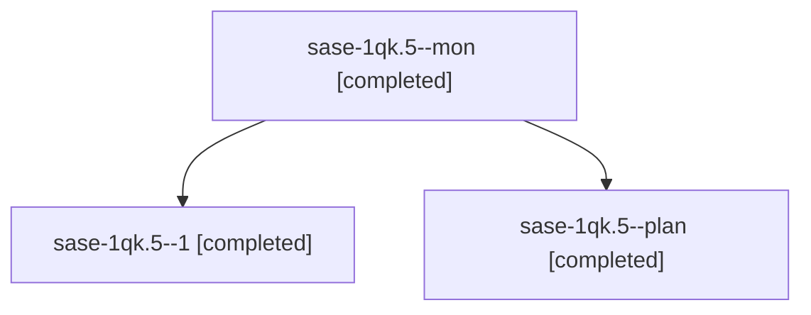

# Session: sase-1qk.5

[Agent Hoods](../README.md) / [bbugyi200](../users/bbugyi200/README.md) / [athena](../users/bbugyi200/machines/athena/README.md) / [sase-1qk](../users/bbugyi200/machines/athena/hoods/sase-1qk/README.md) / sase-1qk.5

Owner: `bbugyi200.athena` · Hood: `sase-1qk` · Members: 3 · Bead: [sase-1qk.5](https://github.com/sase-org/sase--beads/blob/main/pages/sase-1qk/sase-1qk.5.md)

## Lineage

The diagram is an optional enhancement; the ordered table below contains the same lineage in accessible text.

| Role | Agent | State | Model / provider | Timing | Commits | Prompt | Chat |
|---|---|---|---|---|---:|---|---|
| mon | sase-1qk.5--mon | completed | sonnet / claude | 2026-11-01T18:31:21.722452+00:00 → 2026-11-01T18:59:33.965208+00:00 | 0 | — | [Chat](../agents/bbugyi200.athena.sase-1qk.5--mon/chat.md) |
| 1 | sase-1qk.5--1 | completed | sonnet / claude | 2026-11-01T19:01:49.992391+00:00 → 2026-11-01T19:05:29.482887+00:00 | [1](../agents/bbugyi200.athena.sase-1qk.5--1/README.md#commits) | [Prompt](../agents/bbugyi200.athena.sase-1qk.5--1/prompt.md) | [Chat](../agents/bbugyi200.athena.sase-1qk.5--1/chat.md) |
| plan | sase-1qk.5--plan | completed | sonnet / claude | 2026-11-01T18:04:37.858466+00:00 → 2026-11-01T18:31:40.235632+00:00 | 0 | [Prompt](../agents/bbugyi200.athena.sase-1qk.5--plan/prompt.md) | [Chat](../agents/bbugyi200.athena.sase-1qk.5--plan/chat.md) |

## Commits

| Role | Repo | Commit | Subject | Committed |
|---|---|---|---|---|
| 1 | sase | [`71827cf`](https://github.com/sase-org/sase/commit/71827cfecc3c8e0103738e83987bb01afa4394d4) | feat(gate-intent): honor accepted declarations made after a lost gate intent | 2026-11-01 14:04:27 EST |

## Neighbors

| Agent | Relation | State |
|---|---|---|
| [sase-1qk.1](../agents/bbugyi200.athena.sase-1qk.1/README.md) | sase-1qk hood | completed |
| [sase-1qk.2](bbugyi200.athena.sase-1qk.2.md) (session · 3) | sase-1qk hood | completed 3 |
| [sase-1qk.3](bbugyi200.athena.sase-1qk.3.md) (session · 10) | sase-1qk hood | active 1, completed 5, failed 4 |
| [sase-1qk.4](bbugyi200.athena.sase-1qk.4.md) (session · 3) | sase-1qk hood | completed 2, failed 1 |
| [sase-1qk.6](bbugyi200.athena.sase-1qk.6.md) (session · 5) | sase-1qk hood | completed 4, failed 1 |
| [sase-1qk.land](../agents/bbugyi200.athena.sase-1qk.land/README.md) | sase-1qk hood | waiting |
