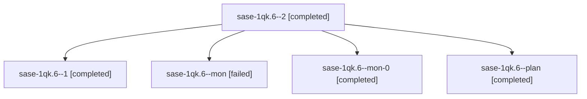

# Session: sase-1qk.6

[Agent Hoods](../README.md) / [bbugyi200](../users/bbugyi200/README.md) / [athena](../users/bbugyi200/machines/athena/README.md) / [sase-1qk](../users/bbugyi200/machines/athena/hoods/sase-1qk/README.md) / sase-1qk.6

Owner: `bbugyi200.athena` · Hood: `sase-1qk` · Members: 5 · Bead: [sase-1qk.6](https://github.com/sase-org/sase--beads/blob/main/pages/sase-1qk/sase-1qk.6.md)

## Lineage

The diagram is an optional enhancement; the ordered table below contains the same lineage in accessible text.

| Role | Agent | State | Model / provider | Timing | Commits | Prompt | Chat |
|---|---|---|---|---|---:|---|---|
| 2 | sase-1qk.6--2 | completed | gpt-6-luna / codex | 2026-11-01T20:36:45.150429+00:00 → 2026-11-01T20:40:53.717231+00:00 | [1](../agents/bbugyi200.athena.sase-1qk.6--2/README.md#commits) | [Prompt](../agents/bbugyi200.athena.sase-1qk.6--2/prompt.md) | [Chat](../agents/bbugyi200.athena.sase-1qk.6--2/chat.md) |
| 1 | sase-1qk.6--1 | completed | gpt-6-luna / codex | 2026-11-01T20:19:48.036130+00:00 → 2026-11-01T20:21:28.692937+00:00 | 0 | [Prompt](../agents/bbugyi200.athena.sase-1qk.6--1/prompt.md) | [Chat](../agents/bbugyi200.athena.sase-1qk.6--1/chat.md) |
| mon | sase-1qk.6--mon | failed | gpt-6-luna / codex | 2026-11-01T19:49:05.204297+00:00 → 2026-11-01T20:08:17.364759+00:00 | 0 | — | [Chat](../agents/bbugyi200.athena.sase-1qk.6--mon/chat.md) |
| mon-0 | sase-1qk.6--mon-0 | completed | gpt-6-luna / codex | 2026-11-01T20:21:21.982632+00:00 → 2026-11-01T20:31:36.074899+00:00 | 0 | — | [Chat](../agents/bbugyi200.athena.sase-1qk.6--mon-0/chat.md) |
| plan | sase-1qk.6--plan | completed | gpt-6-luna / codex | 2026-11-01T17:37:11.217590+00:00 → 2026-11-01T19:49:14.420585+00:00 | 0 | [Prompt](../agents/bbugyi200.athena.sase-1qk.6--plan/prompt.md) | [Chat](../agents/bbugyi200.athena.sase-1qk.6--plan/chat.md) |

## Commits

| Role | Repo | Commit | Subject | Committed |
|---|---|---|---|---|
| 2 | sase | [`c5fdcd1`](https://github.com/sase-org/sase/commit/c5fdcd10cd8a6c678b8a806a1cdad4cefc3b3595) | test(pending-actions): use integral timestamps in transport round-trip | 2026-11-01 15:39:54 EST |

## Neighbors

| Agent | Relation | State |
|---|---|---|
| [sase-1qk.1](../agents/bbugyi200.athena.sase-1qk.1/README.md) | sase-1qk hood | completed |
| [sase-1qk.2](bbugyi200.athena.sase-1qk.2.md) (session · 3) | sase-1qk hood | completed 3 |
| [sase-1qk.3](bbugyi200.athena.sase-1qk.3.md) (session · 17) | sase-1qk hood | completed 10, failed 7 |
| [sase-1qk.4](bbugyi200.athena.sase-1qk.4.md) (session · 3) | sase-1qk hood | completed 2, failed 1 |
| [sase-1qk.5](bbugyi200.athena.sase-1qk.5.md) (session · 3) | sase-1qk hood | completed 3 |
| [sase-1qk.land](../agents/bbugyi200.athena.sase-1qk.land/README.md) | sase-1qk hood | waiting |
