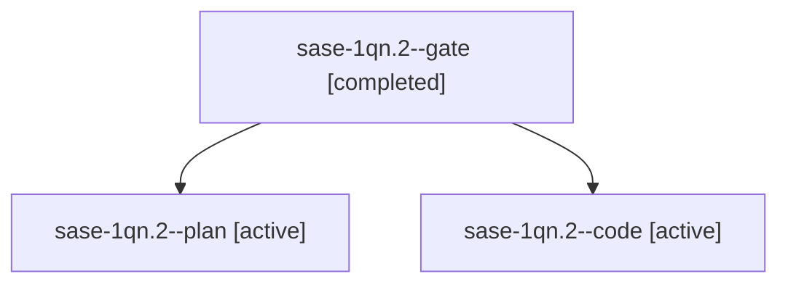

# Session: sase-1qn.2

[Agent Hoods](../README.md) / [bbugyi200](../users/bbugyi200/README.md) / [athena](../users/bbugyi200/machines/athena/README.md) / [sase-1qn](../users/bbugyi200/machines/athena/hoods/sase-1qn/README.md) / sase-1qn.2

Owner: `bbugyi200.athena` · Hood: `sase-1qn` · Members: 3 · Bead: [sase-1qn.2](https://github.com/sase-org/sase--beads/blob/main/pages/sase-1qn/sase-1qn.2.md)

## Lineage

The diagram is an optional enhancement; the ordered table below contains the same lineage in accessible text.

| Role | Agent | State | Model / provider | Timing | Commits | Prompt | Chat |
|---|---|---|---|---|---:|---|---|
| gate | sase-1qn.2--gate | completed | gpt-6-astra / codex | 2026-11-01T19:48:27.964816+00:00 → 2026-11-01T19:49:57.423642+00:00 | 0 | — | [Chat](../agents/bbugyi200.athena.sase-1qn.2--gate/chat.md) |
| plan | sase-1qn.2--plan | active | gpt-6-astra / codex | 2026-11-01T19:40:16.541353+00:00 | 0 | [Prompt](../agents/bbugyi200.athena.sase-1qn.2--plan/prompt.md) | [Chat](../agents/bbugyi200.athena.sase-1qn.2--plan/chat.md) |
| code | sase-1qn.2--code | active | sonnet / claude | 2026-11-01T19:51:19.533380+00:00 | 0 | — | — |

## Neighbors

| Agent | Relation | State |
|---|---|---|
| [sase-1qn.1](bbugyi200.athena.sase-1qn.1.md) (session · 3) | sase-1qn hood | active 2, completed 1 |
| [sase-1qn.3](bbugyi200.athena.sase-1qn.3.md) (session · 5) | sase-1qn hood | completed 4, waiting 1 |
| [sase-1qn.4](bbugyi200.athena.sase-1qn.4.md) (session · 3) | sase-1qn hood | active 2, completed 1 |
| [sase-1qn.5](../agents/bbugyi200.athena.sase-1qn.5/README.md) | sase-1qn hood | waiting |
| [sase-1qn.land](../agents/bbugyi200.athena.sase-1qn.land/README.md) | sase-1qn hood | waiting |
