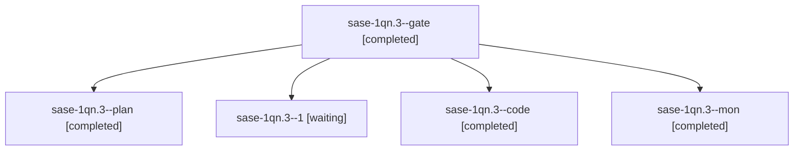

# Session: sase-1qn.3

[Agent Hoods](../README.md) / [bbugyi200](../users/bbugyi200/README.md) / [athena](../users/bbugyi200/machines/athena/README.md) / [sase-1qn](../users/bbugyi200/machines/athena/hoods/sase-1qn/README.md) / sase-1qn.3

Owner: `bbugyi200.athena` · Hood: `sase-1qn` · Members: 5 · Bead: [sase-1qn.3](https://github.com/sase-org/sase--beads/blob/main/pages/sase-1qn/sase-1qn.3.md)

## Lineage

The diagram is an optional enhancement; the ordered table below contains the same lineage in accessible text.

| Role | Agent | State | Model / provider | Timing | Commits | Prompt | Chat |
|---|---|---|---|---|---:|---|---|
| gate | sase-1qn.3--gate | completed | gpt-6-astra / codex | 2026-11-01T19:46:39.906361+00:00 → 2026-11-01T19:47:51.766158+00:00 | 0 | — | [Chat](../agents/bbugyi200.athena.sase-1qn.3--gate/chat.md) |
| plan | sase-1qn.3--plan | completed | gpt-6-astra / codex | 2026-11-01T19:41:21.582614+00:00 → 2026-11-01T20:14:42.636191+00:00 | 0 | [Prompt](../agents/bbugyi200.athena.sase-1qn.3--plan/prompt.md) | [Chat](../agents/bbugyi200.athena.sase-1qn.3--plan/chat.md) |
| 1 | sase-1qn.3--1 | waiting | muse-spark-1.3-contributor / muse | 2026-11-01T20:31:49.438425+00:00 | 0 | [Prompt](../agents/bbugyi200.athena.sase-1qn.3--1/prompt.md) | — |
| code | sase-1qn.3--code | completed | muse-spark-1.3-contributor / muse | 2026-11-01T19:48:06.269602+00:00 → 2026-11-01T20:14:42.636191+00:00 | 0 | — | [Chat](../agents/bbugyi200.athena.sase-1qn.3--code/chat.md) |
| mon | sase-1qn.3--mon | completed | muse-spark-1.3-contributor / muse | 2026-11-01T20:14:21.253713+00:00 → 2026-11-01T20:27:16.268857+00:00 | 0 | — | [Chat](../agents/bbugyi200.athena.sase-1qn.3--mon/chat.md) |

## Neighbors

| Agent | Relation | State |
|---|---|---|
| [sase-1qn.1](bbugyi200.athena.sase-1qn.1.md) (session · 3) | sase-1qn hood | active 2, completed 1 |
| [sase-1qn.2](bbugyi200.athena.sase-1qn.2.md) (session · 3) | sase-1qn hood | active 2, completed 1 |
| [sase-1qn.4](bbugyi200.athena.sase-1qn.4.md) (session · 3) | sase-1qn hood | active 2, completed 1 |
| [sase-1qn.5](../agents/bbugyi200.athena.sase-1qn.5/README.md) | sase-1qn hood | waiting |
| [sase-1qn.land](../agents/bbugyi200.athena.sase-1qn.land/README.md) | sase-1qn hood | waiting |
