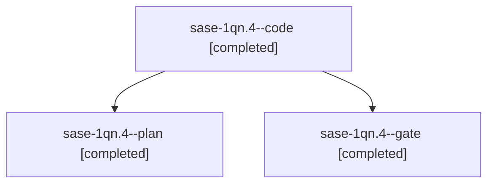

# Session: sase-1qn.4

[Agent Hoods](../README.md) / [bbugyi200](../users/bbugyi200/README.md) / [athena](../users/bbugyi200/machines/athena/README.md) / [sase-1qn](../users/bbugyi200/machines/athena/hoods/sase-1qn/README.md) / sase-1qn.4

Owner: `bbugyi200.athena` · Hood: `sase-1qn` · Members: 3 · Bead: [sase-1qn.4](https://github.com/sase-org/sase--beads/blob/main/pages/sase-1qn/sase-1qn.4.md)

## Lineage

The diagram is an optional enhancement; the ordered table below contains the same lineage in accessible text.

| Role | Agent | State | Model / provider | Timing | Commits | Prompt | Chat |
|---|---|---|---|---|---:|---|---|
| code | sase-1qn.4--code | completed | grok-4.6 / grok | 2026-11-01T20:15:56.808337+00:00 → 2026-11-01T21:16:18.413981+00:00 | [1](../agents/bbugyi200.athena.sase-1qn.4--code/README.md#commits) | — | [Chat](../agents/bbugyi200.athena.sase-1qn.4--code/chat.md) |
| plan | sase-1qn.4--plan | completed | gpt-6-astra / codex | 2026-11-01T20:08:57.460172+00:00 → 2026-11-01T21:16:18.413981+00:00 | 0 | [Prompt](../agents/bbugyi200.athena.sase-1qn.4--plan/prompt.md) | [Chat](../agents/bbugyi200.athena.sase-1qn.4--plan/chat.md) |
| gate | sase-1qn.4--gate | completed | gpt-6-astra / codex | 2026-11-01T20:14:21.254583+00:00 → 2026-11-01T20:15:33.128502+00:00 | 0 | — | [Chat](../agents/bbugyi200.athena.sase-1qn.4--gate/chat.md) |

## Commits

| Role | Repo | Commit | Subject | Committed |
|---|---|---|---|---|
| code | sase | [`0760eb0`](https://github.com/sase-org/sase/commit/0760eb0100e6df72ca78c4cc317b48d824ceb309) | test(completion): isolate zsh PTY smoke tests from live sase | 2026-11-01 16:14:29 EST |

## Neighbors

| Agent | Relation | State |
|---|---|---|
| [sase-1qn.1](bbugyi200.athena.sase-1qn.1.md) (session · 3) | sase-1qn hood | active 2, completed 1 |
| [sase-1qn.2](bbugyi200.athena.sase-1qn.2.md) (session · 3) | sase-1qn hood | active 2, completed 1 |
| [sase-1qn.3](bbugyi200.athena.sase-1qn.3.md) (session · 5) | sase-1qn hood | completed 5 |
| [sase-1qn.5](../agents/bbugyi200.athena.sase-1qn.5/README.md) | sase-1qn hood | waiting |
| [sase-1qn.land](../agents/bbugyi200.athena.sase-1qn.land/README.md) | sase-1qn hood | waiting |
