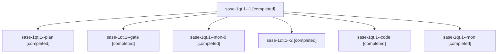

# Session: sase-1qt.1

[Agent Hoods](../README.md) / [bbugyi200](../users/bbugyi200/README.md) / [athena](../users/bbugyi200/machines/athena/README.md) / [sase-1qt](../users/bbugyi200/machines/athena/hoods/sase-1qt/README.md) / sase-1qt.1

Owner: `bbugyi200.athena` · Hood: `sase-1qt` · Members: 7 · Bead: [sase-1qt.1](https://github.com/sase-org/sase--beads/blob/main/pages/sase-1qt/sase-1qt.1.md)

## Lineage

The diagram is an optional enhancement; the ordered table below contains the same lineage in accessible text.

| Role | Agent | State | Model / provider | Timing | Commits | Prompt | Chat |
|---|---|---|---|---|---:|---|---|
| 1 | sase-1qt.1--1 | completed | muse-spark-1.3-contributor / muse | 2026-11-01T23:50:28.006183+00:00 → 2026-11-02T01:13:47.529559+00:00 | 0 | [Prompt](../agents/bbugyi200.athena.sase-1qt.1--1/prompt.md) | [Chat](../agents/bbugyi200.athena.sase-1qt.1--1/chat.md) |
| plan | sase-1qt.1--plan | completed | gpt-6-astra / codex | 2026-11-01T23:12:01.502039+00:00 → 2026-11-01T23:44:41.445814+00:00 | 0 | [Prompt](../agents/bbugyi200.athena.sase-1qt.1--plan/prompt.md) | [Chat](../agents/bbugyi200.athena.sase-1qt.1--plan/chat.md) |
| gate | sase-1qt.1--gate | completed | gpt-6-astra / codex | 2026-11-01T23:18:08.369862+00:00 → 2026-11-01T23:19:12.706386+00:00 | 0 | — | [Chat](../agents/bbugyi200.athena.sase-1qt.1--gate/chat.md) |
| mon-0 | sase-1qt.1--mon-0 | completed | muse-spark-1.3-contributor / muse | 2026-11-02T01:13:36.842763+00:00 → 2026-11-02T01:42:32.468332+00:00 | 0 | — | [Chat](../agents/bbugyi200.athena.sase-1qt.1--mon-0/chat.md) |
| 2 | sase-1qt.1--2 | completed | muse-spark-1.3-contributor / muse | 2026-11-02T01:43:39.074452+00:00 → 2026-11-02T01:47:39.939649+00:00 | [1](../agents/bbugyi200.athena.sase-1qt.1--2/README.md#commits) | [Prompt](../agents/bbugyi200.athena.sase-1qt.1--2/prompt.md) | [Chat](../agents/bbugyi200.athena.sase-1qt.1--2/chat.md) |
| code | sase-1qt.1--code | completed | muse-spark-1.3-contributor / muse | 2026-11-01T23:19:23.642028+00:00 → 2026-11-01T23:44:41.445814+00:00 | 0 | — | [Chat](../agents/bbugyi200.athena.sase-1qt.1--code/chat.md) |
| mon | sase-1qt.1--mon | completed | muse-spark-1.3-contributor / muse | 2026-11-01T23:44:28.318072+00:00 → 2026-11-01T23:48:57.311008+00:00 | 0 | — | [Chat](../agents/bbugyi200.athena.sase-1qt.1--mon/chat.md) |

## Commits

| Role | Repo | Commit | Subject | Committed |
|---|---|---|---|---|
| 2 | sase | [`d26baec`](https://github.com/sase-org/sase/commit/d26baecb051927df38a8bfe4683b7d509371b1d1) | fix(agent-prompts): delegate prompt selection to Rust agent\_prompt\_select binding | 2026-11-01 20:46:50 EST |

## Neighbors

| Agent | Relation | State |
|---|---|---|
| [sase-1qt.2](bbugyi200.athena.sase-1qt.2.md) (session · 7) | sase-1qt hood | completed 6, failed 1 |
| [sase-1qt.3](../agents/bbugyi200.athena.sase-1qt.3/README.md) | sase-1qt hood | completed |
| [sase-1qt.land](bbugyi200.athena.sase-1qt.land.md) (session · 11) | sase-1qt hood | completed 8, failed 3 |
