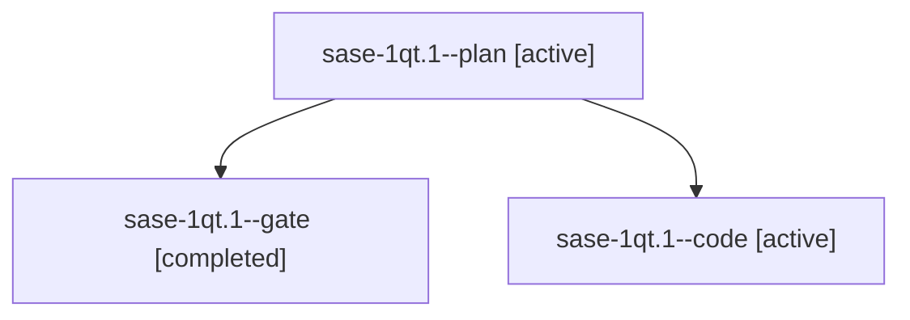

# Session: sase-1qt.1

[Agent Hoods](../README.md) / [bbugyi200](../users/bbugyi200/README.md) / [athena](../users/bbugyi200/machines/athena/README.md) / [sase-1qt](../users/bbugyi200/machines/athena/hoods/sase-1qt/README.md) / sase-1qt.1

Owner: `bbugyi200.athena` · Hood: `sase-1qt` · Members: 3 · Bead: [sase-1qt.1](https://github.com/sase-org/sase--beads/blob/main/pages/sase-1qt/sase-1qt.1.md)

## Lineage

The diagram is an optional enhancement; the ordered table below contains the same lineage in accessible text.

| Role | Agent | State | Model / provider | Timing | Commits | Prompt | Chat |
|---|---|---|---|---|---:|---|---|
| plan | sase-1qt.1--plan | active | gpt-6-astra / codex | 2026-11-01T23:12:01.502039+00:00 | 0 | [Prompt](../agents/bbugyi200.athena.sase-1qt.1--plan/prompt.md) | [Chat](../agents/bbugyi200.athena.sase-1qt.1--plan/chat.md) |
| gate | sase-1qt.1--gate | completed | gpt-6-astra / codex | 2026-11-01T23:18:08.369862+00:00 → 2026-11-01T23:19:12.706386+00:00 | 0 | — | [Chat](../agents/bbugyi200.athena.sase-1qt.1--gate/chat.md) |
| code | sase-1qt.1--code | active | muse-spark-1.3-contributor / muse | 2026-11-01T23:19:23.642028+00:00 | 0 | — | — |

## Neighbors

| Agent | Relation | State |
|---|---|---|
| [sase-1qt.2](bbugyi200.athena.sase-1qt.2.md) (session · 3) | sase-1qt hood | active 2, completed 1 |
| [sase-1qt.3](../agents/bbugyi200.athena.sase-1qt.3/README.md) | sase-1qt hood | active |
| [sase-1qt.land](../agents/bbugyi200.athena.sase-1qt.land/README.md) | sase-1qt hood | waiting |
