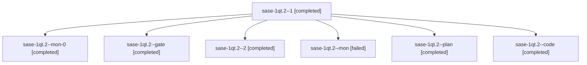

# Session: sase-1qt.2

[Agent Hoods](../README.md) / [bbugyi200](../users/bbugyi200/README.md) / [athena](../users/bbugyi200/machines/athena/README.md) / [sase-1qt](../users/bbugyi200/machines/athena/hoods/sase-1qt/README.md) / sase-1qt.2

Owner: `bbugyi200.athena` · Hood: `sase-1qt` · Members: 7 · Bead: [sase-1qt.2](https://github.com/sase-org/sase--beads/blob/main/pages/sase-1qt/sase-1qt.2.md)

## Lineage

The diagram is an optional enhancement; the ordered table below contains the same lineage in accessible text.

| Role | Agent | State | Model / provider | Timing | Commits | Prompt | Chat |
|---|---|---|---|---|---:|---|---|
| 1 | sase-1qt.2--1 | completed | muse-spark-1.3-contributor / muse | 2026-11-02T00:35:51.070182+00:00 → 2026-11-02T00:50:58.181494+00:00 | 0 | [Prompt](../agents/bbugyi200.athena.sase-1qt.2--1/prompt.md) | [Chat](../agents/bbugyi200.athena.sase-1qt.2--1/chat.md) |
| mon-0 | sase-1qt.2--mon-0 | completed | muse-spark-1.3-contributor / muse | 2026-11-02T00:50:50.581318+00:00 → 2026-11-02T00:54:58.311714+00:00 | 0 | — | [Chat](../agents/bbugyi200.athena.sase-1qt.2--mon-0/chat.md) |
| gate | sase-1qt.2--gate | completed | gpt-6-astra / codex | 2026-11-01T23:18:31.431508+00:00 → 2026-11-01T23:19:48.253504+00:00 | 0 | — | [Chat](../agents/bbugyi200.athena.sase-1qt.2--gate/chat.md) |
| 2 | sase-1qt.2--2 | completed | muse-spark-1.3-contributor / muse | 2026-11-02T00:56:13.843499+00:00 → 2026-11-02T01:00:15.051110+00:00 | [1](../agents/bbugyi200.athena.sase-1qt.2--2/README.md#commits) | [Prompt](../agents/bbugyi200.athena.sase-1qt.2--2/prompt.md) | [Chat](../agents/bbugyi200.athena.sase-1qt.2--2/chat.md) |
| mon | sase-1qt.2--mon | failed | muse-spark-1.3-contributor / muse | 2026-11-02T00:07:35.359887+00:00 → 2026-11-02T00:34:16.785453+00:00 | 0 | — | [Chat](../agents/bbugyi200.athena.sase-1qt.2--mon/chat.md) |
| plan | sase-1qt.2--plan | completed | gpt-6-astra / codex | 2026-11-01T23:11:44.329529+00:00 → 2026-11-02T00:08:18.899822+00:00 | 0 | [Prompt](../agents/bbugyi200.athena.sase-1qt.2--plan/prompt.md) | [Chat](../agents/bbugyi200.athena.sase-1qt.2--plan/chat.md) |
| code | sase-1qt.2--code | completed | muse-spark-1.3-contributor / muse | 2026-11-01T23:20:28.365262+00:00 → 2026-11-02T00:08:18.899822+00:00 | 0 | — | [Chat](../agents/bbugyi200.athena.sase-1qt.2--code/chat.md) |

## Commits

| Role | Repo | Commit | Subject | Committed |
|---|---|---|---|---|
| 2 | sase | [`3e6c19e`](https://github.com/sase-org/sase/commit/3e6c19ee371b3b98184578f99897a2c9ab7953eb) | fix(agents-sync): bound publication drain cleanup under index-lock contention | 2026-11-01 19:59:26 EST |

## Neighbors

| Agent | Relation | State |
|---|---|---|
| [sase-1qt.1](bbugyi200.athena.sase-1qt.1.md) (session · 7) | sase-1qt hood | completed 7 |
| [sase-1qt.3](../agents/bbugyi200.athena.sase-1qt.3/README.md) | sase-1qt hood | completed |
| [sase-1qt.land](bbugyi200.athena.sase-1qt.land.md) (session · 4) | sase-1qt hood | active 1, completed 3 |
