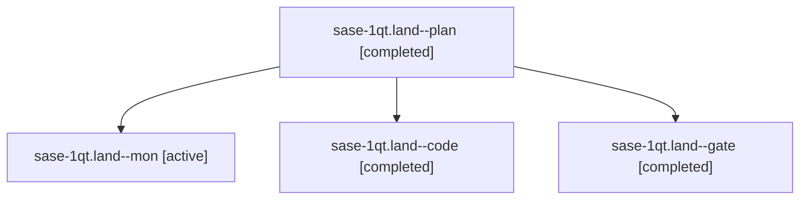

# Session: sase-1qt.land

[Agent Hoods](../README.md) / [bbugyi200](../users/bbugyi200/README.md) / [athena](../users/bbugyi200/machines/athena/README.md) / [sase-1qt](../users/bbugyi200/machines/athena/hoods/sase-1qt/README.md) / sase-1qt.land

Owner: `bbugyi200.athena` · Hood: `sase-1qt` · Members: 4 · Bead: [sase-1qt](https://github.com/sase-org/sase--beads/blob/main/pages/sase-1qt/README.md)

## Lineage

The diagram is an optional enhancement; the ordered table below contains the same lineage in accessible text.

| Role | Agent | State | Model / provider | Timing | Commits | Prompt | Chat |
|---|---|---|---|---|---:|---|---|
| plan | sase-1qt.land--plan | completed | opus / claude | 2026-11-02T11:40:23.151818+00:00 → 2026-11-02T12:04:26.676307+00:00 | 0 | [Prompt](../agents/bbugyi200.athena.sase-1qt.land--plan/prompt.md) | [Chat](../agents/bbugyi200.athena.sase-1qt.land--plan/chat.md) |
| mon | sase-1qt.land--mon | active | gpt-6-luna / codex | 2026-11-02T12:04:18.486596+00:00 | 0 | — | — |
| code | sase-1qt.land--code | completed | gpt-6-luna / codex | 2026-11-02T12:02:32.476197+00:00 → 2026-11-02T12:04:26.676307+00:00 | 0 | — | [Chat](../agents/bbugyi200.athena.sase-1qt.land--code/chat.md) |
| gate | sase-1qt.land--gate | completed | opus / claude | 2026-11-02T12:01:44.508438+00:00 → 2026-11-02T12:02:07.955556+00:00 | 0 | — | [Chat](../agents/bbugyi200.athena.sase-1qt.land--gate/chat.md) |

## Neighbors

| Agent | Relation | State |
|---|---|---|
| [sase-1qt.1](bbugyi200.athena.sase-1qt.1.md) (session · 7) | sase-1qt hood | completed 7 |
| [sase-1qt.2](bbugyi200.athena.sase-1qt.2.md) (session · 7) | sase-1qt hood | completed 6, failed 1 |
| [sase-1qt.3](../agents/bbugyi200.athena.sase-1qt.3/README.md) | sase-1qt hood | completed |
