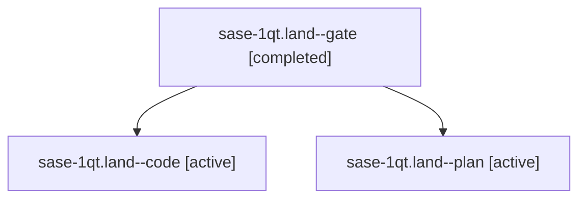

# Session: sase-1qt.land

[Agent Hoods](../README.md) / [bbugyi200](../users/bbugyi200/README.md) / [athena](../users/bbugyi200/machines/athena/README.md) / [sase-1qt](../users/bbugyi200/machines/athena/hoods/sase-1qt/README.md) / sase-1qt.land

Owner: `bbugyi200.athena` · Hood: `sase-1qt` · Members: 3 · Bead: [sase-1qt](https://github.com/sase-org/sase--beads/blob/main/pages/sase-1qt/README.md)

## Lineage



The diagram is an optional enhancement; the ordered table below contains the same lineage in accessible text.

| Role | Agent | State | Model / provider | Timing | Commits | Prompt | Chat |
|---|---|---|---|---|---:|---|---|
| <a id="member-gate"></a>gate | sase-1qt.land--gate | completed | gpt-6-astra / codex | 2026-11-02T02:14:38.040430+00:00 → 2026-11-02T02:14:59.446686+00:00 | 0 | — | [Chat](../agents/bbugyi200.athena.sase-1qt.land--gate/chat.md) |
| <a id="member-code"></a>code | sase-1qt.land--code | active | sonnet / claude | 2026-11-02T02:15:23.435370+00:00 | 0 | — | — |
| <a id="member-plan"></a>plan | sase-1qt.land--plan | active | gpt-6-astra / codex | 2026-11-02T01:48:29.879974+00:00 | 0 | [Prompt](../agents/bbugyi200.athena.sase-1qt.land--plan/prompt.md) | [Chat](../agents/bbugyi200.athena.sase-1qt.land--plan/chat.md) |

## Variables

| Role | Variable | Value |
|---|---|---|
| plan | `artifacts` | \[{bead: sase-1qt, kind: markdown, label: sase-1qt landing audit and follow-up evidence, path: /home/bryan/.sase/artifacts/agents/gh\_sase-org\_\_sase/20261101181016/sase-1qt-landing-audit-e70bb92a897e.m… |

#### artifacts

**Role:** `plan`

```yaml
- bead: sase-1qt
  kind: markdown
  label: sase-1qt landing audit and follow-up evidence
  path: /home/bryan/.sase/artifacts/agents/gh_sase-org__sase/20261101181016/sase-1qt-landing-audit-e70bb92a897e.md
  ref: file:explicit:10d848c95ce1680403f13082
  source_path: /tmp/sase-1qt-landing-audit.md
```

Values are truncated for display; see each member's agent meta.json for the full values.

## Neighbors

| Agent | Relation | State |
|---|---|---|
| [sase-1qt.1](bbugyi200.athena.sase-1qt.1.md) (session · 7) | sase-1qt hood | completed 7 |
| [sase-1qt.2](bbugyi200.athena.sase-1qt.2.md) (session · 7) | sase-1qt hood | completed 6, failed 1 |
| [sase-1qt.3](../agents/bbugyi200.athena.sase-1qt.3/README.md) | sase-1qt hood | completed |
