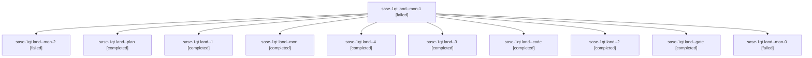

# Session: sase-1qt.land

[Agent Hoods](../README.md) / [bbugyi200](../users/bbugyi200/README.md) / [athena](../users/bbugyi200/machines/athena/README.md) / [sase-1qt](../users/bbugyi200/machines/athena/hoods/sase-1qt/README.md) / sase-1qt.land

Owner: `bbugyi200.athena` · Hood: `sase-1qt` · Members: 11 · Bead: [sase-1qt](https://github.com/sase-org/sase--beads/blob/main/pages/sase-1qt/README.md)

## Lineage



The diagram is an optional enhancement; the ordered table below contains the same lineage in accessible text.

| Role | Agent | State | Model / provider | Timing | Commits | Prompt | Chat |
|---|---|---|---|---|---:|---|---|
| <a id="member-mon-1"></a>mon-1 | sase-1qt.land--mon-1 | failed | gpt-6-luna / codex | 2026-11-02T13:31:43.911546+00:00 → 2026-11-02T13:34:49.314080+00:00 | 0 | — | [Chat](../agents/bbugyi200.athena.sase-1qt.land--mon-1/chat.md) |
| <a id="member-mon-2"></a>mon-2 | sase-1qt.land--mon-2 | failed | gpt-6-luna / codex | 2026-11-02T13:38:34.223509+00:00 → 2026-11-02T13:45:17.107840+00:00 | 0 | — | [Chat](../agents/bbugyi200.athena.sase-1qt.land--mon-2/chat.md) |
| <a id="member-plan"></a>plan | sase-1qt.land--plan | completed | opus / claude | 2026-11-02T11:40:23.151818+00:00 → 2026-11-02T12:04:26.676307+00:00 | 0 | [Prompt](../agents/bbugyi200.athena.sase-1qt.land--plan/prompt.md) | [Chat](../agents/bbugyi200.athena.sase-1qt.land--plan/chat.md) |
| <a id="member-1"></a>1 | sase-1qt.land--1 | completed | gpt-6-luna / codex | 2026-11-02T12:07:08.774744+00:00 → 2026-11-02T13:12:08.891182+00:00 | 0 | [Prompt](../agents/bbugyi200.athena.sase-1qt.land--1/prompt.md) | [Chat](../agents/bbugyi200.athena.sase-1qt.land--1/chat.md) |
| <a id="member-mon"></a>mon | sase-1qt.land--mon | completed | gpt-6-luna / codex | 2026-11-02T12:04:18.486596+00:00 → 2026-11-02T12:06:14.734794+00:00 | 0 | — | [Chat](../agents/bbugyi200.athena.sase-1qt.land--mon/chat.md) |
| <a id="member-4"></a>4 | sase-1qt.land--4 | completed | gpt-6-luna / codex | 2026-11-02T13:46:15.341240+00:00 → 2026-11-02T14:39:30.927437+00:00 | [1](../agents/bbugyi200.athena.sase-1qt.land--4/README.md#commits) | [Prompt](../agents/bbugyi200.athena.sase-1qt.land--4/prompt.md) | [Chat](../agents/bbugyi200.athena.sase-1qt.land--4/chat.md) |
| <a id="member-3"></a>3 | sase-1qt.land--3 | completed | gpt-6-luna / codex | 2026-11-02T13:36:04.837517+00:00 → 2026-11-02T13:38:41.717670+00:00 | 0 | [Prompt](../agents/bbugyi200.athena.sase-1qt.land--3/prompt.md) | [Chat](../agents/bbugyi200.athena.sase-1qt.land--3/chat.md) |
| <a id="member-code"></a>code | sase-1qt.land--code | completed | gpt-6-luna / codex | 2026-11-02T12:02:32.476197+00:00 → 2026-11-02T12:04:26.676307+00:00 | 0 | — | [Chat](../agents/bbugyi200.athena.sase-1qt.land--code/chat.md) |
| <a id="member-2"></a>2 | sase-1qt.land--2 | completed | gpt-6-luna / codex | 2026-11-02T13:23:00.662304+00:00 → 2026-11-02T13:31:52.736807+00:00 | 0 | [Prompt](../agents/bbugyi200.athena.sase-1qt.land--2/prompt.md) | [Chat](../agents/bbugyi200.athena.sase-1qt.land--2/chat.md) |
| <a id="member-gate"></a>gate | sase-1qt.land--gate | completed | opus / claude | 2026-11-02T12:01:44.508438+00:00 → 2026-11-02T12:02:07.955556+00:00 | 0 | — | [Chat](../agents/bbugyi200.athena.sase-1qt.land--gate/chat.md) |
| <a id="member-mon-0"></a>mon-0 | sase-1qt.land--mon-0 | failed | gpt-6-luna / codex | 2026-11-02T13:11:58.218445+00:00 → 2026-11-02T13:21:52.576451+00:00 | 0 | — | [Chat](../agents/bbugyi200.athena.sase-1qt.land--mon-0/chat.md) |

## Commits

| Role | Repo | Commit | Subject | Committed |
|---|---|---|---|---|
| 4 | sase | [`84e22d9`](https://github.com/sase-org/sase/commit/84e22d98be6b6ab289730573cb2525b11b7d7ea0) | fix(agents-sync): require Rust cleanup policy and defer startup imports | 2026-11-02 09:38:04 EST |

## Variables

| Role | Variable | Value |
|---|---|---|
| 2 | `artifacts` | \[{bead: sase-1qt, kind: markdown, label: TUI import closure final vs d26baecb05, path: /home/bryan/.sase/artifacts/agents/gh\_sase-org\_\_sase/20261102082052/tmp-tui-import-closure-b3909088bf91.md, ref:… |

#### artifacts

**Role:** `2`

```yaml
- bead: sase-1qt
  kind: markdown
  label: TUI import closure final vs d26baecb05
  path: /home/bryan/.sase/artifacts/agents/gh_sase-org__sase/20261102082052/tmp-tui-import-closure-b3909088bf91.md
  ref: file:explicit:7dd401778fab313e5a9fc3a1
```

Values are truncated for display; see each member's agent meta.json for the full values.

## Neighbors

| Agent | Relation | State |
|---|---|---|
| [sase-1qt.1](bbugyi200.athena.sase-1qt.1.md) (session · 7) | sase-1qt hood | completed 7 |
| [sase-1qt.2](bbugyi200.athena.sase-1qt.2.md) (session · 7) | sase-1qt hood | completed 6, failed 1 |
| [sase-1qt.3](../agents/bbugyi200.athena.sase-1qt.3/README.md) | sase-1qt hood | completed |
