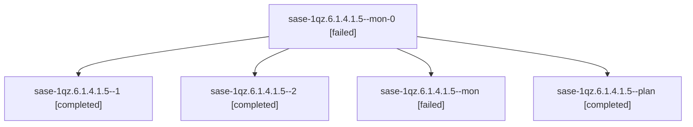

# Session: sase-1qz.6.1.4.1.5

[Agent Hoods](../README.md) / [bbugyi200](../users/bbugyi200/README.md) / [athena](../users/bbugyi200/machines/athena/README.md) / [sase-1qz](../users/bbugyi200/machines/athena/hoods/sase-1qz/README.md) / sase-1qz.6.1.4.1.5

Owner: `bbugyi200.athena` · Hood: `sase-1qz` · Members: 5 · Bead: [sase-1qz.6.1.4.1.5](https://github.com/sase-org/sase--beads/blob/main/pages/sase-1qz/sase-1qz.6.1.4.1.5.md)

## Lineage

The diagram is an optional enhancement; the ordered table below contains the same lineage in accessible text.

| Role | Agent | State | Model / provider | Timing | Commits | Prompt | Chat |
|---|---|---|---|---|---:|---|---|
| mon-0 | sase-1qz.6.1.4.1.5--mon-0 | failed | gpt-6-luna / codex | 2026-11-05T21:08:09.068475+00:00 → 2026-11-05T21:31:46.538883+00:00 | 0 | — | [Chat](../agents/bbugyi200.athena.sase-1qz.6.1.4.1.5--mon-0/chat.md) |
| 1 | sase-1qz.6.1.4.1.5--1 | completed | gpt-6-luna / codex | 2026-11-05T21:02:39.736968+00:00 → 2026-11-05T21:09:40.868052+00:00 | 0 | [Prompt](../agents/bbugyi200.athena.sase-1qz.6.1.4.1.5--1/prompt.md) | [Chat](../agents/bbugyi200.athena.sase-1qz.6.1.4.1.5--1/chat.md) |
| 2 | sase-1qz.6.1.4.1.5--2 | completed | gpt-6-luna / codex | 2026-11-05T21:33:34.631459+00:00 → 2026-11-05T21:42:34.413237+00:00 | [1](../agents/bbugyi200.athena.sase-1qz.6.1.4.1.5--2/README.md#commits) | [Prompt](../agents/bbugyi200.athena.sase-1qz.6.1.4.1.5--2/prompt.md) | [Chat](../agents/bbugyi200.athena.sase-1qz.6.1.4.1.5--2/chat.md) |
| mon | sase-1qz.6.1.4.1.5--mon | failed | gpt-6-luna / codex | 2026-11-05T20:38:58.067217+00:00 → 2026-11-05T21:01:24.620120+00:00 | 0 | — | [Chat](../agents/bbugyi200.athena.sase-1qz.6.1.4.1.5--mon/chat.md) |
| plan | sase-1qz.6.1.4.1.5--plan | completed | gpt-6-luna / codex | 2026-11-05T19:26:30.687433+00:00 → 2026-11-05T20:40:02.290367+00:00 | 0 | [Prompt](../agents/bbugyi200.athena.sase-1qz.6.1.4.1.5--plan/prompt.md) | [Chat](../agents/bbugyi200.athena.sase-1qz.6.1.4.1.5--plan/chat.md) |

## Commits

| Role | Repo | Commit | Subject | Committed |
|---|---|---|---|---|
| 2 | sase | [`812ddbc`](https://github.com/sase-org/sase/commit/812ddbc3aed901f77385830432216598f8843e4c) | fix(hijack): settle recovery only with verified custody | 2026-11-05 16:40:55 EST |

## Neighbors

| Agent | Relation | State |
|---|---|---|
| [sase-1qz.6.1.4](bbugyi200.athena.sase-1qz.6.1.4.md) (session · 4) | ancestor | active 1, completed 3 |
| [sase-1qz.6.1.4.1.1](../agents/bbugyi200.athena.sase-1qz.6.1.4.1.1/README.md) | sase-1qz.6.1.4.1 hood | completed |
| [sase-1qz.6.1.4.1.2](../agents/bbugyi200.athena.sase-1qz.6.1.4.1.2/README.md) | sase-1qz.6.1.4.1 hood | completed |
| [sase-1qz.6.1.4.1.3](../agents/bbugyi200.athena.sase-1qz.6.1.4.1.3/README.md) | sase-1qz.6.1.4.1 hood | completed |
| [sase-1qz.6.1.4.1.4](bbugyi200.athena.sase-1qz.6.1.4.1.4.md) (session · 3) | sase-1qz.6.1.4.1 hood | completed 2, failed 1 |
| [sase-1qz.6.1.4.1.6](../agents/bbugyi200.athena.sase-1qz.6.1.4.1.6/README.md) | sase-1qz.6.1.4.1 hood | waiting |
| [sase-1qz.6.1.4.1.land](../agents/bbugyi200.athena.sase-1qz.6.1.4.1.land/README.md) | sase-1qz.6.1.4.1 hood | waiting |
| [sase-1qz.6.1.2](../agents/bbugyi200.athena.sase-1qz.6.1.2/README.md) | sase-1qz.6.1 hood | completed |
| [sase-1qz.6.1.5](../agents/bbugyi200.athena.sase-1qz.6.1.5/README.md) | sase-1qz.6.1 hood | waiting |
| [sase-1qz.6.1.6](../agents/bbugyi200.athena.sase-1qz.6.1.6/README.md) | sase-1qz.6.1 hood | waiting |
| [sase-1qz.6.1.7](../agents/bbugyi200.athena.sase-1qz.6.1.7/README.md) | sase-1qz.6.1 hood | waiting |
| [sase-1qz.6.1.land](../agents/bbugyi200.athena.sase-1qz.6.1.land/README.md) | sase-1qz.6.1 hood | waiting |
| [sase-1qz.10](../agents/bbugyi200.athena.sase-1qz.10/README.md) | sase-1qz hood | waiting |
| [sase-1qz.11](../agents/bbugyi200.athena.sase-1qz.11/README.md) | sase-1qz hood | waiting |
| [sase-1qz.7](../agents/bbugyi200.athena.sase-1qz.7/README.md) | sase-1qz hood | waiting |
| [sase-1qz.9](../agents/bbugyi200.athena.sase-1qz.9/README.md) | sase-1qz hood | waiting |
| [sase-1qz.land](../agents/bbugyi200.athena.sase-1qz.land/README.md) | sase-1qz hood | waiting |
