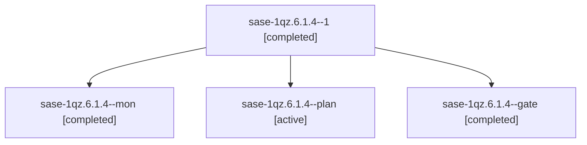

# Session: sase-1qz.6.1.4

[Agent Hoods](../README.md) / [bbugyi200](../users/bbugyi200/README.md) / [athena](../users/bbugyi200/machines/athena/README.md) / [sase-1qz](../users/bbugyi200/machines/athena/hoods/sase-1qz/README.md) / sase-1qz.6.1.4

Owner: `bbugyi200.athena` · Hood: `sase-1qz` · Members: 4 · Bead: [sase-1qz.6.1.4](https://github.com/sase-org/sase--beads/blob/main/pages/sase-1qz/sase-1qz.6.1.4.md)

## Lineage

The diagram is an optional enhancement; the ordered table below contains the same lineage in accessible text.

| Role | Agent | State | Model / provider | Timing | Commits | Prompt | Chat |
|---|---|---|---|---|---:|---|---|
| 1 | sase-1qz.6.1.4--1 | completed | muse-spark-1.3-contributor / muse | 2026-11-04T22:25:25.662928+00:00 → 2026-11-04T22:30:26.616153+00:00 | [1](../agents/bbugyi200.athena.sase-1qz.6.1.4--1/README.md#commits) | [Prompt](../agents/bbugyi200.athena.sase-1qz.6.1.4--1/prompt.md) | [Chat](../agents/bbugyi200.athena.sase-1qz.6.1.4--1/chat.md) |
| mon | sase-1qz.6.1.4--mon | completed | gpt-6-astra / codex | 2026-11-05T15:11:57.641886+00:00 → 2026-11-05T15:15:34.167454+00:00 | 0 | — | [Chat](../agents/bbugyi200.athena.sase-1qz.6.1.4--mon/chat.md) |
| plan | sase-1qz.6.1.4--plan | active | gpt-6-astra / codex | 2026-11-05T14:53:44.928876+00:00 → 2026-11-05T15:12:06.521570+00:00 | 0 | [Prompt](../agents/bbugyi200.athena.sase-1qz.6.1.4--plan/prompt.md) | [Chat](../agents/bbugyi200.athena.sase-1qz.6.1.4--plan/chat.md) |
| gate | sase-1qz.6.1.4--gate | completed | gpt-6-astra / codex | 2026-11-05T15:10:40.251167+00:00 → 2026-11-05T15:11:59.518646+00:00 | 0 | — | [Chat](../agents/bbugyi200.athena.sase-1qz.6.1.4--gate/chat.md) |

## Commits

| Role | Repo | Commit | Subject | Committed |
|---|---|---|---|---|
| 1 | sase | [`8462195`](https://github.com/sase-org/sase/commit/84621953144b886b80b7c36c8d26b9b0aaeb7c7b) | feat(agent): exactly-once hijack recovery launch and settlement | 2026-11-04 17:29:08 EST |

## Neighbors

| Agent | Relation | State |
|---|---|---|
| [sase-1qz.6.1.4.1.1](../agents/bbugyi200.athena.sase-1qz.6.1.4.1.1/README.md) | descendant | completed |
| [sase-1qz.6.1.4.1.2](../agents/bbugyi200.athena.sase-1qz.6.1.4.1.2/README.md) | descendant | completed |
| [sase-1qz.6.1.4.1.3](../agents/bbugyi200.athena.sase-1qz.6.1.4.1.3/README.md) | descendant | completed |
| [sase-1qz.6.1.4.1.4](bbugyi200.athena.sase-1qz.6.1.4.1.4.md) (session · 3) | descendant | completed 2, failed 1 |
| [sase-1qz.6.1.4.1.5](bbugyi200.athena.sase-1qz.6.1.4.1.5.md) (session · 5) | descendant | completed 3, failed 2 |
| [sase-1qz.6.1.4.1.6](../agents/bbugyi200.athena.sase-1qz.6.1.4.1.6/README.md) | descendant | completed |
| [sase-1qz.6.1.4.1.land](bbugyi200.athena.sase-1qz.6.1.4.1.land.md) (session · 3) | descendant | completed 3 |
| [sase-1qz.6.1.2](../agents/bbugyi200.athena.sase-1qz.6.1.2/README.md) | sase-1qz.6.1 hood | completed |
| [sase-1qz.6.1.5](bbugyi200.athena.sase-1qz.6.1.5.md) (session · 3) | sase-1qz.6.1 hood | completed 2, failed 1 |
| [sase-1qz.6.1.5](../agents/bbugyi200.athena.sase-1qz.6.1.5/README.md) | sase-1qz.6.1 hood | completed |
| [sase-1qz.6.1.6](../agents/bbugyi200.athena.sase-1qz.6.1.6/README.md) | sase-1qz.6.1 hood | completed |
| [sase-1qz.6.1.7](bbugyi200.athena.sase-1qz.6.1.7.md) (session · 3) | sase-1qz.6.1 hood | completed 2, failed 1 |
| [sase-1qz.6.1.land](bbugyi200.athena.sase-1qz.6.1.land.md) (session · 3) | sase-1qz.6.1 hood | completed 3 |
| [sase-1qz.10](../agents/bbugyi200.athena.sase-1qz.10/README.md) | sase-1qz hood | completed |
| [sase-1qz.11](../agents/bbugyi200.athena.sase-1qz.11/README.md) | sase-1qz hood | waiting |
| [sase-1qz.7](../agents/bbugyi200.athena.sase-1qz.7/README.md) | sase-1qz hood | completed |
| [sase-1qz.9](bbugyi200.athena.sase-1qz.9.md) (session · 3) | sase-1qz hood | completed 2, failed 1 |
| [sase-1qz.land](../agents/bbugyi200.athena.sase-1qz.land/README.md) | sase-1qz hood | waiting |
