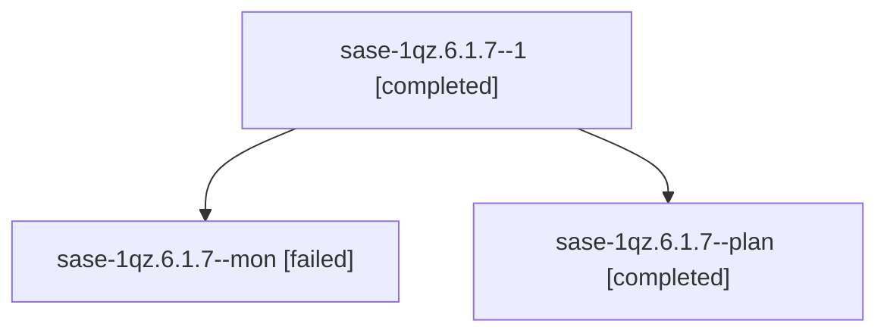

# Session: sase-1qz.6.1.7

[Agent Hoods](../README.md) / [bbugyi200](../users/bbugyi200/README.md) / [athena](../users/bbugyi200/machines/athena/README.md) / [sase-1qz](../users/bbugyi200/machines/athena/hoods/sase-1qz/README.md) / sase-1qz.6.1.7

Owner: `bbugyi200.athena` · Hood: `sase-1qz` · Members: 3 · Bead: [sase-1qz.6.1.7](https://github.com/sase-org/sase--beads/blob/main/pages/sase-1qz/sase-1qz.6.1.7.md)

## Lineage

The diagram is an optional enhancement; the ordered table below contains the same lineage in accessible text.

| Role | Agent | State | Model / provider | Timing | Commits | Prompt | Chat |
|---|---|---|---|---|---:|---|---|
| 1 | sase-1qz.6.1.7--1 | completed | muse-spark-1.3-contributor / muse | 2026-11-06T15:54:33.591817+00:00 → 2026-11-06T15:59:18.627401+00:00 | 0 | [Prompt](../agents/bbugyi200.athena.sase-1qz.6.1.7--1/prompt.md) | [Chat](../agents/bbugyi200.athena.sase-1qz.6.1.7--1/chat.md) |
| mon | sase-1qz.6.1.7--mon | failed | muse-spark-1.3-contributor / muse | 2026-11-06T15:35:46.917586+00:00 → 2026-11-06T15:52:57.905619+00:00 | 0 | — | [Chat](../agents/bbugyi200.athena.sase-1qz.6.1.7--mon/chat.md) |
| plan | sase-1qz.6.1.7--plan | completed | muse-spark-1.3-contributor / muse | 2026-11-06T14:59:43.038498+00:00 → 2026-11-06T15:51:08.536884+00:00 | [1](../agents/bbugyi200.athena.sase-1qz.6.1.7--plan/README.md#commits) | [Prompt](../agents/bbugyi200.athena.sase-1qz.6.1.7--plan/prompt.md) | [Chat](../agents/bbugyi200.athena.sase-1qz.6.1.7--plan/chat.md) |

## Commits

| Role | Repo | Commit | Subject | Committed |
|---|---|---|---|---|
| plan | sase | [`acc6f78`](https://github.com/sase-org/sase/commit/acc6f7842214f4622576e3e56e4914e2e836e2bc) | chore(symvision): re-key leftover sase-1qz.6 epic-symbol rows to sase-1qz.7 | 2026-11-06 10:49:47 EST |

## Neighbors

| Agent | Relation | State |
|---|---|---|
| [sase-1qz.6.1.2](../agents/bbugyi200.athena.sase-1qz.6.1.2/README.md) | sase-1qz.6.1 hood | completed |
| [sase-1qz.6.1.4](bbugyi200.athena.sase-1qz.6.1.4.md) (session · 4) | sase-1qz.6.1 hood | active 1, completed 3 |
| [sase-1qz.6.1.4.1.1](../agents/bbugyi200.athena.sase-1qz.6.1.4.1.1/README.md) | sase-1qz.6.1 hood | completed |
| [sase-1qz.6.1.4.1.2](../agents/bbugyi200.athena.sase-1qz.6.1.4.1.2/README.md) | sase-1qz.6.1 hood | completed |
| [sase-1qz.6.1.4.1.3](../agents/bbugyi200.athena.sase-1qz.6.1.4.1.3/README.md) | sase-1qz.6.1 hood | completed |
| [sase-1qz.6.1.4.1.4](bbugyi200.athena.sase-1qz.6.1.4.1.4.md) (session · 3) | sase-1qz.6.1 hood | completed 2, failed 1 |
| [sase-1qz.6.1.4.1.5](bbugyi200.athena.sase-1qz.6.1.4.1.5.md) (session · 5) | sase-1qz.6.1 hood | completed 3, failed 2 |
| [sase-1qz.6.1.4.1.6](../agents/bbugyi200.athena.sase-1qz.6.1.4.1.6/README.md) | sase-1qz.6.1 hood | completed |
| [sase-1qz.6.1.4.1.land](bbugyi200.athena.sase-1qz.6.1.4.1.land.md) (session · 3) | sase-1qz.6.1 hood | completed 3 |
| [sase-1qz.6.1.5](bbugyi200.athena.sase-1qz.6.1.5.md) (session · 3) | sase-1qz.6.1 hood | completed 2, failed 1 |
| [sase-1qz.6.1.5](../agents/bbugyi200.athena.sase-1qz.6.1.5/README.md) | sase-1qz.6.1 hood | completed |
| [sase-1qz.6.1.6](../agents/bbugyi200.athena.sase-1qz.6.1.6/README.md) | sase-1qz.6.1 hood | completed |
| [sase-1qz.6.1.land](bbugyi200.athena.sase-1qz.6.1.land.md) (session · 3) | sase-1qz.6.1 hood | completed 3 |
| [sase-1qz.10](../agents/bbugyi200.athena.sase-1qz.10/README.md) | sase-1qz hood | completed |
| [sase-1qz.11](../agents/bbugyi200.athena.sase-1qz.11/README.md) | sase-1qz hood | waiting |
| [sase-1qz.7](../agents/bbugyi200.athena.sase-1qz.7/README.md) | sase-1qz hood | completed |
| [sase-1qz.9](bbugyi200.athena.sase-1qz.9.md) (session · 3) | sase-1qz hood | completed 2, failed 1 |
| [sase-1qz.land](../agents/bbugyi200.athena.sase-1qz.land/README.md) | sase-1qz hood | waiting |
