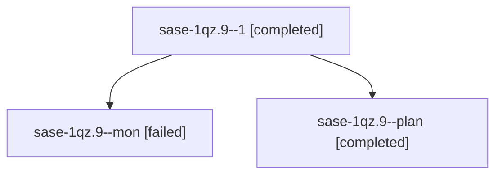

# Session: sase-1qz.9

[Agent Hoods](../README.md) / [bbugyi200](../users/bbugyi200/README.md) / [athena](../users/bbugyi200/machines/athena/README.md) / [sase-1qz](../users/bbugyi200/machines/athena/hoods/sase-1qz/README.md) / sase-1qz.9

Owner: `bbugyi200.athena` · Hood: `sase-1qz` · Members: 3 · Bead: [sase-1qz.9](https://github.com/sase-org/sase--beads/blob/main/pages/sase-1qz/sase-1qz.9.md)

## Lineage

The diagram is an optional enhancement; the ordered table below contains the same lineage in accessible text.

| Role | Agent | State | Model / provider | Timing | Commits | Prompt | Chat |
|---|---|---|---|---|---:|---|---|
| 1 | sase-1qz.9--1 | completed | gpt-6-luna / codex | 2026-11-06T21:10:17.049765+00:00 → 2026-11-06T21:36:22.901013+00:00 | [1](../agents/bbugyi200.athena.sase-1qz.9--1/README.md#commits) | [Prompt](../agents/bbugyi200.athena.sase-1qz.9--1/prompt.md) | [Chat](../agents/bbugyi200.athena.sase-1qz.9--1/chat.md) |
| mon | sase-1qz.9--mon | failed | gpt-6-luna / codex | 2026-11-06T21:03:32.830158+00:00 → 2026-11-06T21:08:11.263589+00:00 | 0 | — | [Chat](../agents/bbugyi200.athena.sase-1qz.9--mon/chat.md) |
| plan | sase-1qz.9--plan | completed | gpt-6-luna / codex | 2026-11-06T20:13:21.622469+00:00 → 2026-11-06T21:04:49.554434+00:00 | 0 | [Prompt](../agents/bbugyi200.athena.sase-1qz.9--plan/prompt.md) | [Chat](../agents/bbugyi200.athena.sase-1qz.9--plan/chat.md) |

## Commits

| Role | Repo | Commit | Subject | Committed |
|---|---|---|---|---|
| 1 | sase | [`a6ceb8b`](https://github.com/sase-org/sase/commit/a6ceb8bf930fee6654b74c7f5aba5c27d747226b) | feat(ace): add hijack recovery panel | 2026-11-06 16:34:33 EST |

## Neighbors

| Agent | Relation | State |
|---|---|---|
| [sase-1qz.10](../agents/bbugyi200.athena.sase-1qz.10/README.md) | sase-1qz hood | waiting |
| [sase-1qz.11](../agents/bbugyi200.athena.sase-1qz.11/README.md) | sase-1qz hood | waiting |
| [sase-1qz.6.1.2](../agents/bbugyi200.athena.sase-1qz.6.1.2/README.md) | sase-1qz hood | completed |
| [sase-1qz.6.1.4](bbugyi200.athena.sase-1qz.6.1.4.md) (session · 4) | sase-1qz hood | active 1, completed 3 |
| [sase-1qz.6.1.4.1.1](../agents/bbugyi200.athena.sase-1qz.6.1.4.1.1/README.md) | sase-1qz hood | completed |
| [sase-1qz.6.1.4.1.2](../agents/bbugyi200.athena.sase-1qz.6.1.4.1.2/README.md) | sase-1qz hood | completed |
| [sase-1qz.6.1.4.1.3](../agents/bbugyi200.athena.sase-1qz.6.1.4.1.3/README.md) | sase-1qz hood | completed |
| [sase-1qz.6.1.4.1.4](bbugyi200.athena.sase-1qz.6.1.4.1.4.md) (session · 3) | sase-1qz hood | completed 2, failed 1 |
| [sase-1qz.6.1.4.1.5](bbugyi200.athena.sase-1qz.6.1.4.1.5.md) (session · 5) | sase-1qz hood | completed 3, failed 2 |
| [sase-1qz.6.1.4.1.6](../agents/bbugyi200.athena.sase-1qz.6.1.4.1.6/README.md) | sase-1qz hood | completed |
| [sase-1qz.6.1.4.1.land](bbugyi200.athena.sase-1qz.6.1.4.1.land.md) (session · 3) | sase-1qz hood | completed 3 |
| [sase-1qz.6.1.5](bbugyi200.athena.sase-1qz.6.1.5.md) (session · 3) | sase-1qz hood | completed 2, failed 1 |
| [sase-1qz.6.1.5](../agents/bbugyi200.athena.sase-1qz.6.1.5/README.md) | sase-1qz hood | completed |
| [sase-1qz.6.1.6](../agents/bbugyi200.athena.sase-1qz.6.1.6/README.md) | sase-1qz hood | completed |
| [sase-1qz.6.1.7](bbugyi200.athena.sase-1qz.6.1.7.md) (session · 3) | sase-1qz hood | completed 2, failed 1 |
| [sase-1qz.6.1.land](bbugyi200.athena.sase-1qz.6.1.land.md) (session · 3) | sase-1qz hood | completed 3 |
| [sase-1qz.7](../agents/bbugyi200.athena.sase-1qz.7/README.md) | sase-1qz hood | completed |
| [sase-1qz.land](../agents/bbugyi200.athena.sase-1qz.land/README.md) | sase-1qz hood | waiting |
