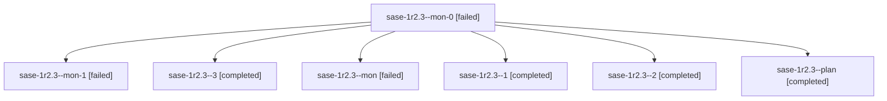

# Session: sase-1r2.3

[Agent Hoods](../README.md) / [bbugyi200](../users/bbugyi200/README.md) / [athena](../users/bbugyi200/machines/athena/README.md) / [sase-1r2](../users/bbugyi200/machines/athena/hoods/sase-1r2/README.md) / sase-1r2.3

Owner: `bbugyi200.athena` · Hood: `sase-1r2` · Members: 7 · Bead: [sase-1r2.3](https://github.com/sase-org/sase--beads/blob/main/pages/sase-1r2/sase-1r2.3.md)

## Lineage

The diagram is an optional enhancement; the ordered table below contains the same lineage in accessible text.

| Role | Agent | State | Model / provider | Timing | Commits | Prompt | Chat |
|---|---|---|---|---|---:|---|---|
| mon-0 | sase-1r2.3--mon-0 | failed | gpt-6-luna / codex | 2026-11-03T16:38:48.618731+00:00 → 2026-11-03T16:49:12.002358+00:00 | 0 | — | [Chat](../agents/bbugyi200.athena.sase-1r2.3--mon-0/chat.md) |
| mon-1 | sase-1r2.3--mon-1 | failed | gpt-6-luna / codex | 2026-11-03T16:55:00.884662+00:00 → 2026-11-03T19:38:41.538632+00:00 | 0 | — | [Chat](../agents/bbugyi200.athena.sase-1r2.3--mon-1/chat.md) |
| 3 | sase-1r2.3--3 | completed | muse-spark-1.3-contributor / muse | 2026-11-03T19:39:46.329425+00:00 → 2026-11-03T20:19:53.429956+00:00 | [1](../agents/bbugyi200.athena.sase-1r2.3--3/README.md#commits) | [Prompt](../agents/bbugyi200.athena.sase-1r2.3--3/prompt.md) | [Chat](../agents/bbugyi200.athena.sase-1r2.3--3/chat.md) |
| mon | sase-1r2.3--mon | failed | gpt-6-luna / codex | 2026-11-03T16:33:11.797442+00:00 → 2026-11-03T16:37:00.263304+00:00 | 0 | — | [Chat](../agents/bbugyi200.athena.sase-1r2.3--mon/chat.md) |
| 1 | sase-1r2.3--1 | completed | gpt-6-luna / codex | 2026-11-03T16:36:48.355791+00:00 → 2026-11-03T16:39:30.488189+00:00 | 0 | [Prompt](../agents/bbugyi200.athena.sase-1r2.3--1/prompt.md) | [Chat](../agents/bbugyi200.athena.sase-1r2.3--1/chat.md) |
| 2 | sase-1r2.3--2 | completed | gpt-6-luna / codex | 2026-11-03T16:51:15.591769+00:00 → 2026-11-03T16:55:41.128384+00:00 | 0 | [Prompt](../agents/bbugyi200.athena.sase-1r2.3--2/prompt.md) | [Chat](../agents/bbugyi200.athena.sase-1r2.3--2/chat.md) |
| plan | sase-1r2.3--plan | completed | gpt-6-luna / codex | 2026-11-03T16:13:29.656773+00:00 → 2026-11-03T16:33:46.043007+00:00 | 0 | [Prompt](../agents/bbugyi200.athena.sase-1r2.3--plan/prompt.md) | [Chat](../agents/bbugyi200.athena.sase-1r2.3--plan/chat.md) |

## Commits

| Role | Repo | Commit | Subject | Committed |
|---|---|---|---|---|
| 3 | sase | [`26b50ca`](https://github.com/sase-org/sase/commit/26b50ca5251945db4d9ca3efe804cd843f36bed9) | fix(flakes): de-flake blocking Master Gate and Full CI test lanes | 2026-11-03 15:18:23 EST |

## Neighbors

| Agent | Relation | State |
|---|---|---|
| [sase-1r2.1](../agents/bbugyi200.athena.sase-1r2.1/README.md) | sase-1r2 hood | completed |
| [sase-1r2.2](../agents/bbugyi200.athena.sase-1r2.2/README.md) | sase-1r2 hood | completed |
| [sase-1r2.4](../agents/bbugyi200.athena.sase-1r2.4/README.md) | sase-1r2 hood | completed |
| [sase-1r2.5](bbugyi200.athena.sase-1r2.5.md) (session · 3) | sase-1r2 hood | completed 2, failed 1 |
| [sase-1r2.6](bbugyi200.athena.sase-1r2.6.md) (session · 5) | sase-1r2 hood | active 1, completed 3, failed 1 |
| [sase-1r2.6](../agents/bbugyi200.athena.sase-1r2.6/README.md) | sase-1r2 hood | waiting |
| [sase-1r2.7](bbugyi200.athena.sase-1r2.7.md) (session · 3) | sase-1r2 hood | completed 2, failed 1 |
| [sase-1r2.8](../agents/bbugyi200.athena.sase-1r2.8/README.md) | sase-1r2 hood | completed |
| [sase-1r2.land](../agents/bbugyi200.athena.sase-1r2.land/README.md) | sase-1r2 hood | waiting |
