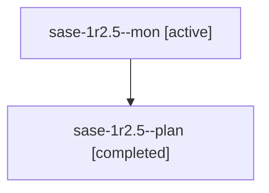

# Session: sase-1r2.5

[Agent Hoods](../README.md) / [bbugyi200](../users/bbugyi200/README.md) / [athena](../users/bbugyi200/machines/athena/README.md) / [sase-1r2](../users/bbugyi200/machines/athena/hoods/sase-1r2/README.md) / sase-1r2.5

Owner: `bbugyi200.athena` · Hood: `sase-1r2` · Members: 2 · Bead: [sase-1r2.5](https://github.com/sase-org/sase--beads/blob/main/pages/sase-1r2/sase-1r2.5.md)

## Lineage

The diagram is an optional enhancement; the ordered table below contains the same lineage in accessible text.

| Role | Agent | State | Model / provider | Timing | Commits | Prompt | Chat |
|---|---|---|---|---|---:|---|---|
| mon | sase-1r2.5--mon | active | muse-spark-1.3-contributor / muse | 2026-11-03T16:26:47.732601+00:00 | 0 | — | — |
| plan | sase-1r2.5--plan | completed | muse-spark-1.3-contributor / muse | 2026-11-03T16:19:39.964070+00:00 → 2026-11-03T16:45:32.242777+00:00 | 0 | [Prompt](../agents/bbugyi200.athena.sase-1r2.5--plan/prompt.md) | [Chat](../agents/bbugyi200.athena.sase-1r2.5--plan/chat.md) |

## Neighbors

| Agent | Relation | State |
|---|---|---|
| [sase-1r2.1](../agents/bbugyi200.athena.sase-1r2.1/README.md) | sase-1r2 hood | completed |
| [sase-1r2.2](../agents/bbugyi200.athena.sase-1r2.2/README.md) | sase-1r2 hood | completed |
| [sase-1r2.3](bbugyi200.athena.sase-1r2.3.md) (session · 7) | sase-1r2 hood | completed 4, failed 3 |
| [sase-1r2.4](../agents/bbugyi200.athena.sase-1r2.4/README.md) | sase-1r2 hood | completed |
| [sase-1r2.6](../agents/bbugyi200.athena.sase-1r2.6/README.md) | sase-1r2 hood | waiting |
| [sase-1r2.7](../agents/bbugyi200.athena.sase-1r2.7/README.md) | sase-1r2 hood | waiting |
| [sase-1r2.8](../agents/bbugyi200.athena.sase-1r2.8/README.md) | sase-1r2 hood | waiting |
| [sase-1r2.land](../agents/bbugyi200.athena.sase-1r2.land/README.md) | sase-1r2 hood | waiting |
