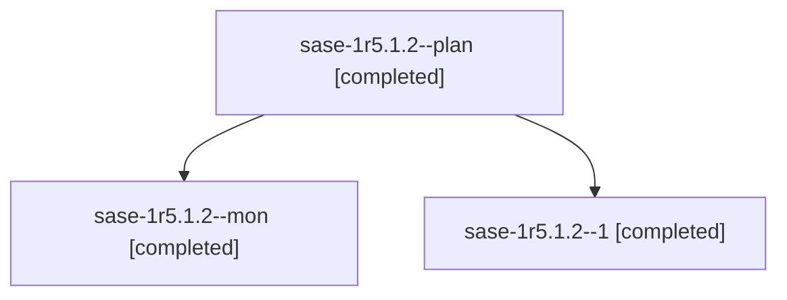

# Session: sase-1r5.1.2

[Agent Hoods](../README.md) / [bbugyi200](../users/bbugyi200/README.md) / [athena](../users/bbugyi200/machines/athena/README.md) / [sase-1r5](../users/bbugyi200/machines/athena/hoods/sase-1r5/README.md) / sase-1r5.1.2

Owner: `bbugyi200.athena` · Hood: `sase-1r5` · Members: 3 · Bead: [sase-1r5.1.2](https://github.com/sase-org/sase--beads/blob/main/pages/sase-1r5/sase-1r5.1.2.md)

## Lineage

The diagram is an optional enhancement; the ordered table below contains the same lineage in accessible text.

| Role | Agent | State | Model / provider | Timing | Commits | Prompt | Chat |
|---|---|---|---|---|---:|---|---|
| plan | sase-1r5.1.2--plan | completed | gpt-6-luna / codex | 2026-11-04T12:17:09.174614+00:00 → 2026-11-04T12:30:38.006655+00:00 | 0 | [Prompt](../agents/bbugyi200.athena.sase-1r5.1.2--plan/prompt.md) | [Chat](../agents/bbugyi200.athena.sase-1r5.1.2--plan/chat.md) |
| mon | sase-1r5.1.2--mon | completed | gpt-6-luna / codex | 2026-11-04T12:29:56.611584+00:00 → 2026-11-04T12:50:57.997223+00:00 | 0 | — | [Chat](../agents/bbugyi200.athena.sase-1r5.1.2--mon/chat.md) |
| 1 | sase-1r5.1.2--1 | completed | gpt-6-luna / codex | 2026-11-04T12:52:04.541295+00:00 → 2026-11-04T13:33:00.543797+00:00 | [1](../agents/bbugyi200.athena.sase-1r5.1.2--1/README.md#commits) | [Prompt](../agents/bbugyi200.athena.sase-1r5.1.2--1/prompt.md) | [Chat](../agents/bbugyi200.athena.sase-1r5.1.2--1/chat.md) |

## Commits

| Role | Repo | Commit | Subject | Committed |
|---|---|---|---|---|
| 1 | sase | [`d008039`](https://github.com/sase-org/sase/commit/d0080395118c2c239433c3bef1c0b0e26a4a5c51) | feat(retryability): add credential confirmation retry policy | 2026-11-04 08:32:04 EST |

## Neighbors

| Agent | Relation | State |
|---|---|---|
| [sase-1r5](bbugyi200.athena.sase-1r5.md) (session · 3) | ancestor | completed 3 |
| [sase-1r5.1.1](../agents/bbugyi200.athena.sase-1r5.1.1/README.md) | sase-1r5.1 hood | completed |
| [sase-1r5.1.3](bbugyi200.athena.sase-1r5.1.3.md) (session · 3) | sase-1r5.1 hood | completed 3 |
| [sase-1r5.1.4](../agents/bbugyi200.athena.sase-1r5.1.4/README.md) | sase-1r5.1 hood | completed |
| [sase-1r5.1.5](../agents/bbugyi200.athena.sase-1r5.1.5/README.md) | sase-1r5.1 hood | completed |
| [sase-1r5.1.land](../agents/bbugyi200.athena.sase-1r5.1.land/README.md) | sase-1r5.1 hood | waiting |
