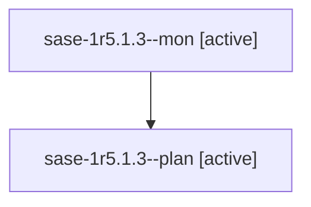

# Session: sase-1r5.1.3

[Agent Hoods](../README.md) / [bbugyi200](../users/bbugyi200/README.md) / [athena](../users/bbugyi200/machines/athena/README.md) / [sase-1r5](../users/bbugyi200/machines/athena/hoods/sase-1r5/README.md) / sase-1r5.1.3

Owner: `bbugyi200.athena` · Hood: `sase-1r5` · Members: 2 · Bead: [sase-1r5.1.3](https://github.com/sase-org/sase--beads/blob/main/pages/sase-1r5/sase-1r5.1.3.md)

## Lineage

The diagram is an optional enhancement; the ordered table below contains the same lineage in accessible text.

| Role | Agent | State | Model / provider | Timing | Commits | Prompt | Chat |
|---|---|---|---|---|---:|---|---|
| mon | sase-1r5.1.3--mon | active | muse-spark-1.3-contributor / muse | 2026-11-04T14:08:25.930304+00:00 | 0 | — | — |
| plan | sase-1r5.1.3--plan | active | muse-spark-1.3-contributor / muse | 2026-11-04T13:33:23.774392+00:00 | 0 | [Prompt](../agents/bbugyi200.athena.sase-1r5.1.3--plan/prompt.md) | — |

## Neighbors

| Agent | Relation | State |
|---|---|---|
| [sase-1r5](bbugyi200.athena.sase-1r5.md) (session · 3) | ancestor | completed 3 |
| [sase-1r5.1.1](../agents/bbugyi200.athena.sase-1r5.1.1/README.md) | sase-1r5.1 hood | completed |
| [sase-1r5.1.2](bbugyi200.athena.sase-1r5.1.2.md) (session · 3) | sase-1r5.1 hood | completed 3 |
| [sase-1r5.1.4](../agents/bbugyi200.athena.sase-1r5.1.4/README.md) | sase-1r5.1 hood | completed |
| [sase-1r5.1.5](../agents/bbugyi200.athena.sase-1r5.1.5/README.md) | sase-1r5.1 hood | waiting |
| [sase-1r5.1.land](../agents/bbugyi200.athena.sase-1r5.1.land/README.md) | sase-1r5.1 hood | waiting |
