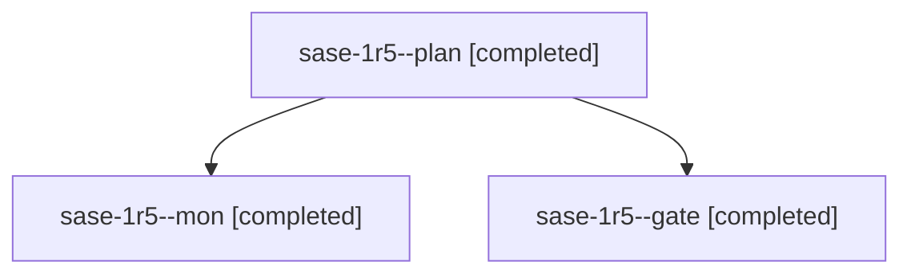

# Session: sase-1r5

[Agent Hoods](../README.md) / [bbugyi200](../users/bbugyi200/README.md) / [athena](../users/bbugyi200/machines/athena/README.md) / [sase-1r5](../users/bbugyi200/machines/athena/hoods/sase-1r5/README.md) / sase-1r5

Owner: `bbugyi200.athena` · Hood: `sase-1r5` · Members: 3 · Bead: [sase-1r5](https://github.com/sase-org/sase--beads/blob/main/pages/sase-1r5/README.md)

## Lineage

The diagram is an optional enhancement; the ordered table below contains the same lineage in accessible text.

| Role | Agent | State | Model / provider | Timing | Commits | Prompt | Chat |
|---|---|---|---|---|---:|---|---|
| plan | sase-1r5--plan | completed | opus / claude | 2026-11-04T11:42:26.113737+00:00 → 2026-11-04T11:50:45.947417+00:00 | 0 | [Prompt](../agents/bbugyi200.athena.sase-1r5--plan/prompt.md) | [Chat](../agents/bbugyi200.athena.sase-1r5--plan/chat.md) |
| mon | sase-1r5--mon | completed | opus / claude | 2026-11-04T11:54:46.617653+00:00 → 2026-11-04T11:57:26.734322+00:00 | 0 | — | [Chat](../agents/bbugyi200.athena.sase-1r5--mon/chat.md) |
| gate | sase-1r5--gate | completed | opus / claude | 2026-11-04T11:53:42.396092+00:00 → 2026-11-04T11:55:09.297435+00:00 | 0 | — | [Chat](../agents/bbugyi200.athena.sase-1r5--gate/chat.md) |

## Neighbors

| Agent | Relation | State |
|---|---|---|
| [sase-1r5.1.1](../agents/bbugyi200.athena.sase-1r5.1.1/README.md) | descendant | completed |
| [sase-1r5.1.2](../agents/bbugyi200.athena.sase-1r5.1.2/README.md) | descendant | active |
| [sase-1r5.1.3](../agents/bbugyi200.athena.sase-1r5.1.3/README.md) | descendant | waiting |
| [sase-1r5.1.4](../agents/bbugyi200.athena.sase-1r5.1.4/README.md) | descendant | waiting |
| [sase-1r5.1.5](../agents/bbugyi200.athena.sase-1r5.1.5/README.md) | descendant | waiting |
| [sase-1r5.1.land](../agents/bbugyi200.athena.sase-1r5.1.land/README.md) | descendant | waiting |
