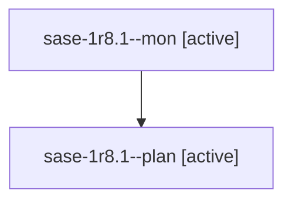

# Session: sase-1r8.1

[Agent Hoods](../README.md) / [bbugyi200](../users/bbugyi200/README.md) / [athena](../users/bbugyi200/machines/athena/README.md) / [sase-1r8](../users/bbugyi200/machines/athena/hoods/sase-1r8/README.md) / sase-1r8.1

Owner: `bbugyi200.athena` · Hood: `sase-1r8` · Members: 2 · Bead: [sase-1r8.1](https://github.com/sase-org/sase--beads/blob/main/pages/sase-1r8/sase-1r8.1.md)

## Lineage

The diagram is an optional enhancement; the ordered table below contains the same lineage in accessible text.

| Role | Agent | State | Model / provider | Timing | Commits | Prompt | Chat |
|---|---|---|---|---|---:|---|---|
| mon | sase-1r8.1--mon | active | muse-spark-1.3-contributor / muse | 2026-11-04T19:32:50.251520+00:00 | 0 | — | — |
| plan | sase-1r8.1--plan | active | muse-spark-1.3-contributor / muse | 2026-11-04T18:57:35.807953+00:00 | 0 | [Prompt](../agents/bbugyi200.athena.sase-1r8.1--plan/prompt.md) | — |

## Neighbors

| Agent | Relation | State |
|---|---|---|
| [sase-1r8.2](../agents/bbugyi200.athena.sase-1r8.2/README.md) | sase-1r8 hood | active |
| [sase-1r8.3](bbugyi200.athena.sase-1r8.3.md) (session · 3) | sase-1r8 hood | completed 2, failed 1 |
| [sase-1r8.4](../agents/bbugyi200.athena.sase-1r8.4/README.md) | sase-1r8 hood | waiting |
| [sase-1r8.5](../agents/bbugyi200.athena.sase-1r8.5/README.md) | sase-1r8 hood | waiting |
| [sase-1r8.6](../agents/bbugyi200.athena.sase-1r8.6/README.md) | sase-1r8 hood | waiting |
| [sase-1r8.land](../agents/bbugyi200.athena.sase-1r8.land/README.md) | sase-1r8 hood | waiting |
