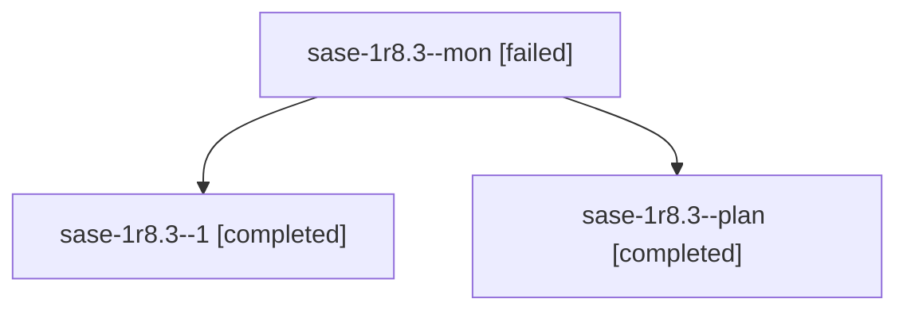

# Session: sase-1r8.3

[Agent Hoods](../README.md) / [bbugyi200](../users/bbugyi200/README.md) / [athena](../users/bbugyi200/machines/athena/README.md) / [sase-1r8](../users/bbugyi200/machines/athena/hoods/sase-1r8/README.md) / sase-1r8.3

Owner: `bbugyi200.athena` · Hood: `sase-1r8` · Members: 3 · Bead: [sase-1r8.3](https://github.com/sase-org/sase--beads/blob/main/pages/sase-1r8/sase-1r8.3.md)

## Lineage

The diagram is an optional enhancement; the ordered table below contains the same lineage in accessible text.

| Role | Agent | State | Model / provider | Timing | Commits | Prompt | Chat |
|---|---|---|---|---|---:|---|---|
| mon | sase-1r8.3--mon | failed | gpt-6-luna / codex | 2026-11-04T19:01:44.947981+00:00 → 2026-11-04T19:25:19.806272+00:00 | 0 | — | [Chat](../agents/bbugyi200.athena.sase-1r8.3--mon/chat.md) |
| 1 | sase-1r8.3--1 | completed | gpt-6-luna / codex | 2026-11-04T19:26:30.525567+00:00 → 2026-11-04T19:31:23.327694+00:00 | [1](../agents/bbugyi200.athena.sase-1r8.3--1/README.md#commits) | [Prompt](../agents/bbugyi200.athena.sase-1r8.3--1/prompt.md) | [Chat](../agents/bbugyi200.athena.sase-1r8.3--1/chat.md) |
| plan | sase-1r8.3--plan | completed | gpt-6-luna / codex | 2026-11-04T18:57:58.077025+00:00 → 2026-11-04T19:02:13.801770+00:00 | 0 | [Prompt](../agents/bbugyi200.athena.sase-1r8.3--plan/prompt.md) | [Chat](../agents/bbugyi200.athena.sase-1r8.3--plan/chat.md) |

## Commits

| Role | Repo | Commit | Subject | Committed |
|---|---|---|---|---|
| 1 | sase | [`59723ae`](https://github.com/sase-org/sase/commit/59723ae0cd6fc12104e16e6e6c4fc63ad147f57e) | fix(agents-sync): match deferred archives by session | 2026-11-04 14:30:23 EST |

## Neighbors

| Agent | Relation | State |
|---|---|---|
| [sase-1r8.1](bbugyi200.athena.sase-1r8.1.md) (session · 3) | sase-1r8 hood | completed 3 |
| [sase-1r8.2](../agents/bbugyi200.athena.sase-1r8.2/README.md) | sase-1r8 hood | active |
| [sase-1r8.4](../agents/bbugyi200.athena.sase-1r8.4/README.md) | sase-1r8 hood | waiting |
| [sase-1r8.5](../agents/bbugyi200.athena.sase-1r8.5/README.md) | sase-1r8 hood | waiting |
| [sase-1r8.6](../agents/bbugyi200.athena.sase-1r8.6/README.md) | sase-1r8 hood | waiting |
| [sase-1r8.land](../agents/bbugyi200.athena.sase-1r8.land/README.md) | sase-1r8 hood | waiting |
