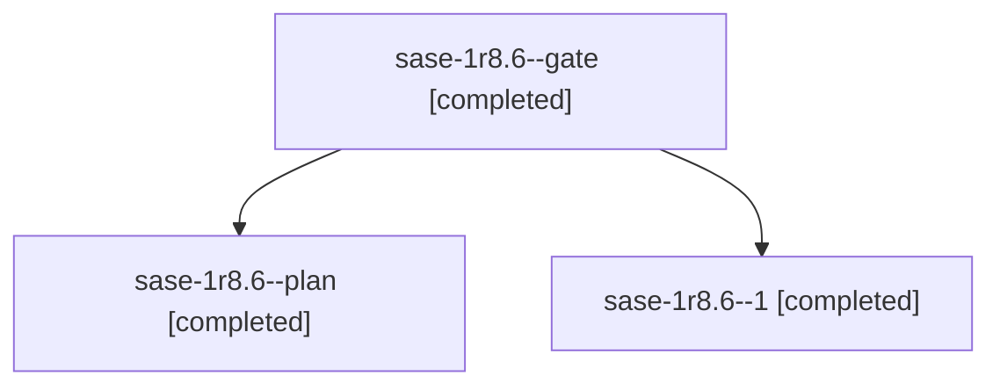

# Session: sase-1r8.6

[Agent Hoods](../README.md) / [bbugyi200](../users/bbugyi200/README.md) / [athena](../users/bbugyi200/machines/athena/README.md) / [sase-1r8](../users/bbugyi200/machines/athena/hoods/sase-1r8/README.md) / sase-1r8.6

Owner: `bbugyi200.athena` · Hood: `sase-1r8` · Members: 3 · Bead: [sase-1r8.6](https://github.com/sase-org/sase--beads/blob/main/pages/sase-1r8/sase-1r8.6.md)

## Lineage

The diagram is an optional enhancement; the ordered table below contains the same lineage in accessible text.

| Role | Agent | State | Model / provider | Timing | Commits | Prompt | Chat |
|---|---|---|---|---|---:|---|---|
| gate | sase-1r8.6--gate | completed | muse-spark-1.3-contributor / muse | 2026-11-04T23:02:22.343381+00:00 → 2026-11-04T23:05:21.476076+00:00 | 0 | — | [Chat](../agents/bbugyi200.athena.sase-1r8.6--gate/chat.md) |
| plan | sase-1r8.6--plan | completed | muse-spark-1.3-contributor / muse | 2026-11-04T22:28:52.964067+00:00 → 2026-11-04T22:36:47.217083+00:00 | 0 | [Prompt](../agents/bbugyi200.athena.sase-1r8.6--plan/prompt.md) | [Chat](../agents/bbugyi200.athena.sase-1r8.6--plan/chat.md) |
| 1 | sase-1r8.6--1 | completed | muse-spark-1.3-contributor / muse | 2026-11-04T23:32:04.026623+00:00 → 2026-11-04T23:47:26.482032+00:00 | 0 | [Prompt](../agents/bbugyi200.athena.sase-1r8.6--1/prompt.md) | [Chat](../agents/bbugyi200.athena.sase-1r8.6--1/chat.md) |

## Neighbors

| Agent | Relation | State |
|---|---|---|
| [sase-1r8.1](bbugyi200.athena.sase-1r8.1.md) (session · 3) | sase-1r8 hood | completed 3 |
| [sase-1r8.2](../agents/bbugyi200.athena.sase-1r8.2/README.md) | sase-1r8 hood | completed |
| [sase-1r8.3](bbugyi200.athena.sase-1r8.3.md) (session · 3) | sase-1r8 hood | completed 2, failed 1 |
| [sase-1r8.4](bbugyi200.athena.sase-1r8.4.md) (session · 3) | sase-1r8 hood | completed 3 |
| [sase-1r8.5](../agents/bbugyi200.athena.sase-1r8.5/README.md) | sase-1r8 hood | completed |
| [sase-1r8.land](../agents/bbugyi200.athena.sase-1r8.land/README.md) | sase-1r8 hood | completed |
