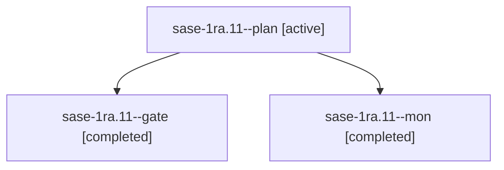

# Session: sase-1ra.11

[Agent Hoods](../README.md) / [bbugyi200](../users/bbugyi200/README.md) / [athena](../users/bbugyi200/machines/athena/README.md) / [sase-1ra](../users/bbugyi200/machines/athena/hoods/sase-1ra/README.md) / sase-1ra.11

Owner: `bbugyi200.athena` · Hood: `sase-1ra` · Members: 3 · Bead: [sase-1ra.11](https://github.com/sase-org/sase--beads/blob/main/pages/sase-1ra/sase-1ra.11.md)

## Lineage

The diagram is an optional enhancement; the ordered table below contains the same lineage in accessible text.

| Role | Agent | State | Model / provider | Timing | Commits | Prompt | Chat |
|---|---|---|---|---|---:|---|---|
| plan | sase-1ra.11--plan | active | gpt-6-astra / codex | 2026-11-04T23:25:14.852536+00:00 | 0 | [Prompt](../agents/bbugyi200.athena.sase-1ra.11--plan/prompt.md) | [Chat](../agents/bbugyi200.athena.sase-1ra.11--plan/chat.md) |
| gate | sase-1ra.11--gate | completed | gpt-6-astra / codex | 2026-11-04T23:34:24.623261+00:00 → 2026-11-04T23:37:24.047951+00:00 | 0 | — | [Chat](../agents/bbugyi200.athena.sase-1ra.11--gate/chat.md) |
| mon | sase-1ra.11--mon | completed | gpt-6-astra / codex | 2026-11-04T23:37:21.487640+00:00 → 2026-11-04T23:42:28.610663+00:00 | 0 | — | [Chat](../agents/bbugyi200.athena.sase-1ra.11--mon/chat.md) |

## Neighbors

| Agent | Relation | State |
|---|---|---|
| [sase-1ra.11.1.1](bbugyi200.athena.sase-1ra.11.1.1.md) (session · 2) | descendant | active 2 |
| [sase-1ra.11.1.2](../agents/bbugyi200.athena.sase-1ra.11.1.2/README.md) | descendant | waiting |
| [sase-1ra.11.1.3](../agents/bbugyi200.athena.sase-1ra.11.1.3/README.md) | descendant | waiting |
| [sase-1ra.11.1.4](../agents/bbugyi200.athena.sase-1ra.11.1.4/README.md) | descendant | waiting |
| [sase-1ra.11.1.5](../agents/bbugyi200.athena.sase-1ra.11.1.5/README.md) | descendant | waiting |
| [sase-1ra.11.1.land](../agents/bbugyi200.athena.sase-1ra.11.1.land/README.md) | descendant | waiting |
| [sase-1ra.1](bbugyi200.athena.sase-1ra.1.md) (session · 2) | sase-1ra hood | active 1, failed 1 |
| [sase-1ra.10](../agents/bbugyi200.athena.sase-1ra.10/README.md) | sase-1ra hood | waiting |
| [sase-1ra.12](../agents/bbugyi200.athena.sase-1ra.12/README.md) | sase-1ra hood | waiting |
| [sase-1ra.2](../agents/bbugyi200.athena.sase-1ra.2/README.md) | sase-1ra hood | completed |
| [sase-1ra.3](../agents/bbugyi200.athena.sase-1ra.3/README.md) | sase-1ra hood | completed |
| [sase-1ra.4](bbugyi200.athena.sase-1ra.4.md) (session · 3) | sase-1ra hood | completed 2, waiting 1 |
| [sase-1ra.5](../agents/bbugyi200.athena.sase-1ra.5/README.md) | sase-1ra hood | active |
| [sase-1ra.6](bbugyi200.athena.sase-1ra.6.md) (session · 2) | sase-1ra hood | active 1, completed 1 |
| [sase-1ra.7](bbugyi200.athena.sase-1ra.7.md) (session · 2) | sase-1ra hood | active 2 |
| [sase-1ra.8](../agents/bbugyi200.athena.sase-1ra.8/README.md) | sase-1ra hood | waiting |
| [sase-1ra.9](../agents/bbugyi200.athena.sase-1ra.9/README.md) | sase-1ra hood | waiting |
| [sase-1ra.land](../agents/bbugyi200.athena.sase-1ra.land/README.md) | sase-1ra hood | waiting |
