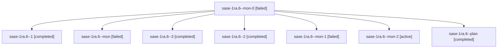

# Session: sase-1ra.6

[Agent Hoods](../README.md) / [bbugyi200](../users/bbugyi200/README.md) / [athena](../users/bbugyi200/machines/athena/README.md) / [sase-1ra](../users/bbugyi200/machines/athena/hoods/sase-1ra/README.md) / sase-1ra.6

Owner: `bbugyi200.athena` · Hood: `sase-1ra` · Members: 8 · Bead: [sase-1ra.6](https://github.com/sase-org/sase--beads/blob/main/pages/sase-1ra/sase-1ra.6.md)

## Lineage

The diagram is an optional enhancement; the ordered table below contains the same lineage in accessible text.

| Role | Agent | State | Model / provider | Timing | Commits | Prompt | Chat |
|---|---|---|---|---|---:|---|---|
| mon-0 | sase-1ra.6--mon-0 | failed | gpt-6-luna / codex | 2026-11-05T00:16:41.306673+00:00 → 2026-11-05T00:21:05.561104+00:00 | 0 | — | [Chat](../agents/bbugyi200.athena.sase-1ra.6--mon-0/chat.md) |
| 1 | sase-1ra.6--1 | completed | gpt-6-luna / codex | 2026-11-05T00:08:08.158526+00:00 → 2026-11-05T00:19:14.826173+00:00 | [1](../agents/bbugyi200.athena.sase-1ra.6--1/README.md#commits) | [Prompt](../agents/bbugyi200.athena.sase-1ra.6--1/prompt.md) | [Chat](../agents/bbugyi200.athena.sase-1ra.6--1/chat.md) |
| mon | sase-1ra.6--mon | failed | gpt-6-luna / codex | 2026-11-04T23:24:03.448184+00:00 → 2026-11-05T00:06:55.985320+00:00 | 0 | — | [Chat](../agents/bbugyi200.athena.sase-1ra.6--mon/chat.md) |
| 3 | sase-1ra.6--3 | completed | gpt-6-luna / codex | 2026-11-05T00:31:24.370507+00:00 → 2026-11-05T00:37:28.683260+00:00 | 0 | [Prompt](../agents/bbugyi200.athena.sase-1ra.6--3/prompt.md) | [Chat](../agents/bbugyi200.athena.sase-1ra.6--3/chat.md) |
| 2 | sase-1ra.6--2 | completed | gpt-6-luna / codex | 2026-11-05T00:22:12.508336+00:00 → 2026-11-05T00:27:35.908653+00:00 | 0 | [Prompt](../agents/bbugyi200.athena.sase-1ra.6--2/prompt.md) | [Chat](../agents/bbugyi200.athena.sase-1ra.6--2/chat.md) |
| mon-1 | sase-1ra.6--mon-1 | failed | gpt-6-luna / codex | 2026-11-05T00:26:50.398344+00:00 → 2026-11-05T00:29:45.934760+00:00 | 0 | — | [Chat](../agents/bbugyi200.athena.sase-1ra.6--mon-1/chat.md) |
| mon-2 | sase-1ra.6--mon-2 | active | gpt-6-luna / codex | 2026-11-05T00:36:55.896148+00:00 | 0 | — | — |
| plan | sase-1ra.6--plan | completed | gpt-6-luna / codex | 2026-11-04T23:10:35.899201+00:00 → 2026-11-04T23:25:23.463793+00:00 | 0 | [Prompt](../agents/bbugyi200.athena.sase-1ra.6--plan/prompt.md) | [Chat](../agents/bbugyi200.athena.sase-1ra.6--plan/chat.md) |

## Commits

| Role | Repo | Commit | Subject | Committed |
|---|---|---|---|---|
| 1 | sase | [`02e93fd`](https://github.com/sase-org/sase/commit/02e93fd261505a8ff00342f48a1f4f8501786470) | test(ace): prebuild command-line grammar for panel pilot tests | 2026-11-04 19:18:03 EST |

## Neighbors

| Agent | Relation | State |
|---|---|---|
| [sase-1ra.1](bbugyi200.athena.sase-1ra.1.md) (session · 2) | sase-1ra hood | active 1, failed 1 |
| [sase-1ra.10](../agents/bbugyi200.athena.sase-1ra.10/README.md) | sase-1ra hood | waiting |
| [sase-1ra.11](bbugyi200.athena.sase-1ra.11.md) (session · 3) | sase-1ra hood | active 1, completed 2 |
| [sase-1ra.11.1.1](bbugyi200.athena.sase-1ra.11.1.1.md) (session · 2) | sase-1ra hood | active 1, completed 1 |
| [sase-1ra.11.1.2](../agents/bbugyi200.athena.sase-1ra.11.1.2/README.md) | sase-1ra hood | waiting |
| [sase-1ra.11.1.3](../agents/bbugyi200.athena.sase-1ra.11.1.3/README.md) | sase-1ra hood | waiting |
| [sase-1ra.11.1.4](../agents/bbugyi200.athena.sase-1ra.11.1.4/README.md) | sase-1ra hood | waiting |
| [sase-1ra.11.1.5](../agents/bbugyi200.athena.sase-1ra.11.1.5/README.md) | sase-1ra hood | waiting |
| [sase-1ra.11.1.land](../agents/bbugyi200.athena.sase-1ra.11.1.land/README.md) | sase-1ra hood | waiting |
| [sase-1ra.12](../agents/bbugyi200.athena.sase-1ra.12/README.md) | sase-1ra hood | waiting |
| [sase-1ra.2](../agents/bbugyi200.athena.sase-1ra.2/README.md) | sase-1ra hood | completed |
| [sase-1ra.3](../agents/bbugyi200.athena.sase-1ra.3/README.md) | sase-1ra hood | completed |
| [sase-1ra.4](bbugyi200.athena.sase-1ra.4.md) (session · 3) | sase-1ra hood | completed 3 |
| [sase-1ra.5](../agents/bbugyi200.athena.sase-1ra.5/README.md) | sase-1ra hood | completed |
| [sase-1ra.7](bbugyi200.athena.sase-1ra.7.md) (session · 2) | sase-1ra hood | active 1, failed 1 |
| [sase-1ra.8](../agents/bbugyi200.athena.sase-1ra.8/README.md) | sase-1ra hood | waiting |
| [sase-1ra.9](../agents/bbugyi200.athena.sase-1ra.9/README.md) | sase-1ra hood | waiting |
| [sase-1ra.land](../agents/bbugyi200.athena.sase-1ra.land/README.md) | sase-1ra hood | waiting |
