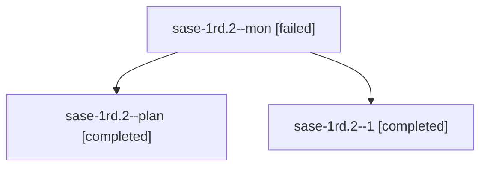

# Session: sase-1rd.2

[Agent Hoods](../README.md) / [bbugyi200](../users/bbugyi200/README.md) / [athena](../users/bbugyi200/machines/athena/README.md) / [sase-1rd](../users/bbugyi200/machines/athena/hoods/sase-1rd/README.md) / sase-1rd.2

Owner: `bbugyi200.athena` · Hood: `sase-1rd` · Members: 3 · Bead: [sase-1rd.2](https://github.com/sase-org/sase--beads/blob/main/pages/sase-1rd/sase-1rd.2.md)

## Lineage

The diagram is an optional enhancement; the ordered table below contains the same lineage in accessible text.

| Role | Agent | State | Model / provider | Timing | Commits | Prompt | Chat |
|---|---|---|---|---|---:|---|---|
| mon | sase-1rd.2--mon | failed | muse-spark-1.3-contributor / muse | 2026-11-05T13:56:22.425916+00:00 → 2026-11-05T15:08:49.370932+00:00 | 0 | — | [Chat](../agents/bbugyi200.athena.sase-1rd.2--mon/chat.md) |
| plan | sase-1rd.2--plan | completed | muse-spark-1.3-contributor / muse | 2026-11-05T13:02:08.949251+00:00 → 2026-11-05T15:07:12.525588+00:00 | 0 | [Prompt](../agents/bbugyi200.athena.sase-1rd.2--plan/prompt.md) | [Chat](../agents/bbugyi200.athena.sase-1rd.2--plan/chat.md) |
| 1 | sase-1rd.2--1 | completed | muse-spark-1.3-contributor / muse | 2026-11-05T15:09:54.305693+00:00 → 2026-11-05T15:15:11.677296+00:00 | [1](../agents/bbugyi200.athena.sase-1rd.2--1/README.md#commits) | [Prompt](../agents/bbugyi200.athena.sase-1rd.2--1/prompt.md) | [Chat](../agents/bbugyi200.athena.sase-1rd.2--1/chat.md) |

## Commits

| Role | Repo | Commit | Subject | Committed |
|---|---|---|---|---|
| 1 | sase | [`37a4c8e`](https://github.com/sase-org/sase/commit/37a4c8ed8d2b30942697494d1624532a63434460) | feat(artifact): quarantine ACE runs to restorable trash with review snapshots | 2026-11-05 10:14:11 EST |

## Neighbors

| Agent | Relation | State |
|---|---|---|
| [sase-1rd.1](../agents/bbugyi200.athena.sase-1rd.1/README.md) | sase-1rd hood | completed |
| [sase-1rd.3](../agents/bbugyi200.athena.sase-1rd.3/README.md) | sase-1rd hood | completed |
| [sase-1rd.4](../agents/bbugyi200.athena.sase-1rd.4/README.md) | sase-1rd hood | completed |
| [sase-1rd.land](bbugyi200.athena.sase-1rd.land.md) (session · 3) | sase-1rd hood | active 2, completed 1 |
