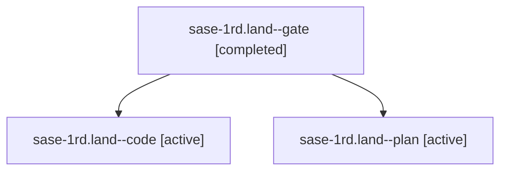

# Session: sase-1rd.land

[Agent Hoods](../README.md) / [bbugyi200](../users/bbugyi200/README.md) / [athena](../users/bbugyi200/machines/athena/README.md) / [sase-1rd](../users/bbugyi200/machines/athena/hoods/sase-1rd/README.md) / sase-1rd.land

Owner: `bbugyi200.athena` · Hood: `sase-1rd` · Members: 3 · Bead: [sase-1rd](https://github.com/sase-org/sase--beads/blob/main/pages/sase-1rd/README.md)

## Lineage

The diagram is an optional enhancement; the ordered table below contains the same lineage in accessible text.

| Role | Agent | State | Model / provider | Timing | Commits | Prompt | Chat |
|---|---|---|---|---|---:|---|---|
| gate | sase-1rd.land--gate | completed | gpt-6-astra / codex | 2026-11-06T18:18:56.808420+00:00 → 2026-11-06T18:19:55.877840+00:00 | 0 | — | [Chat](../agents/bbugyi200.athena.sase-1rd.land--gate/chat.md) |
| code | sase-1rd.land--code | active | grok-4.6 / grok | 2026-11-06T18:20:55.449255+00:00 | 0 | — | — |
| plan | sase-1rd.land--plan | active | gpt-6-astra / codex | 2026-11-06T17:36:55.874639+00:00 | [1](../agents/bbugyi200.athena.sase-1rd.land--plan/README.md#commits) | [Prompt](../agents/bbugyi200.athena.sase-1rd.land--plan/prompt.md) | [Chat](../agents/bbugyi200.athena.sase-1rd.land--plan/chat.md) |

## Commits

| Role | Repo | Commit | Subject | Committed |
|---|---|---|---|---|
| plan | sase | [`d8381f2`](https://github.com/sase-org/sase/commit/d8381f230fff8bcfb0cbf26420f1bbc4af0d100d) | refactor(run-prune): privatize snapshot directory helper | 2026-11-06 13:17:09 EST |

## Neighbors

| Agent | Relation | State |
|---|---|---|
| [sase-1rd.1](../agents/bbugyi200.athena.sase-1rd.1/README.md) | sase-1rd hood | completed |
| [sase-1rd.2](bbugyi200.athena.sase-1rd.2.md) (session · 3) | sase-1rd hood | completed 2, failed 1 |
| [sase-1rd.3](../agents/bbugyi200.athena.sase-1rd.3/README.md) | sase-1rd hood | completed |
| [sase-1rd.4](../agents/bbugyi200.athena.sase-1rd.4/README.md) | sase-1rd hood | completed |
