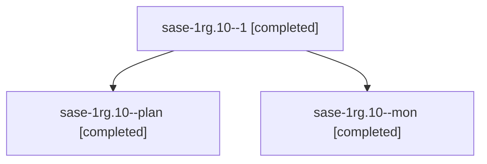

# Session: sase-1rg.10

[Agent Hoods](../README.md) / [bbugyi200](../users/bbugyi200/README.md) / [athena](../users/bbugyi200/machines/athena/README.md) / [sase-1rg](../users/bbugyi200/machines/athena/hoods/sase-1rg/README.md) / sase-1rg.10

Owner: `bbugyi200.athena` · Hood: `sase-1rg` · Members: 3 · Bead: [sase-1rg.10](https://github.com/sase-org/sase--beads/blob/main/pages/sase-1rg/sase-1rg.10.md)

## Lineage

The diagram is an optional enhancement; the ordered table below contains the same lineage in accessible text.

| Role | Agent | State | Model / provider | Timing | Commits | Prompt | Chat |
|---|---|---|---|---|---:|---|---|
| 1 | sase-1rg.10--1 | completed | muse-spark-1.3-contributor / muse | 2026-11-06T14:26:17.639072+00:00 → 2026-11-06T14:30:40.399666+00:00 | [1](../agents/bbugyi200.athena.sase-1rg.10--1/README.md#commits) | [Prompt](../agents/bbugyi200.athena.sase-1rg.10--1/prompt.md) | [Chat](../agents/bbugyi200.athena.sase-1rg.10--1/chat.md) |
| plan | sase-1rg.10--plan | completed | muse-spark-1.3-contributor / muse | 2026-11-06T12:47:58.073213+00:00 → 2026-11-06T14:23:01.729387+00:00 | 0 | [Prompt](../agents/bbugyi200.athena.sase-1rg.10--plan/prompt.md) | [Chat](../agents/bbugyi200.athena.sase-1rg.10--plan/chat.md) |
| mon | sase-1rg.10--mon | completed | muse-spark-1.3-contributor / muse | 2026-11-06T13:39:11.682642+00:00 → 2026-11-06T14:24:41.681639+00:00 | 0 | — | [Chat](../agents/bbugyi200.athena.sase-1rg.10--mon/chat.md) |

## Commits

| Role | Repo | Commit | Subject | Committed |
|---|---|---|---|---|
| 1 | sase | [`a6fe55c`](https://github.com/sase-org/sase/commit/a6fe55c1bee573b0f6b9ee23442c9fc242aeb670) | feat(bead): record acting opener and skip no-op reopen | 2026-11-06 09:29:37 EST |

## Neighbors

| Agent | Relation | State |
|---|---|---|
| [sase-1rg.1](../agents/bbugyi200.athena.sase-1rg.1/README.md) | sase-1rg hood | completed |
| [sase-1rg.2](bbugyi200.athena.sase-1rg.2.md) (session · 3) | sase-1rg hood | active 1, completed 2 |
| [sase-1rg.3](../agents/bbugyi200.athena.sase-1rg.3/README.md) | sase-1rg hood | completed |
| [sase-1rg.4](../agents/bbugyi200.athena.sase-1rg.4/README.md) | sase-1rg hood | completed |
| [sase-1rg.5](../agents/bbugyi200.athena.sase-1rg.5/README.md) | sase-1rg hood | completed |
| [sase-1rg.6](../agents/bbugyi200.athena.sase-1rg.6/README.md) | sase-1rg hood | completed |
| [sase-1rg.7](bbugyi200.athena.sase-1rg.7.md) (session · 3) | sase-1rg hood | completed 2, failed 1 |
| [sase-1rg.8](../agents/bbugyi200.athena.sase-1rg.8/README.md) | sase-1rg hood | completed |
| [sase-1rg.9](bbugyi200.athena.sase-1rg.9.md) (session · 3) | sase-1rg hood | completed 2, failed 1 |
| [sase-1rg.land](../agents/bbugyi200.athena.sase-1rg.land/README.md) | sase-1rg hood | waiting |
