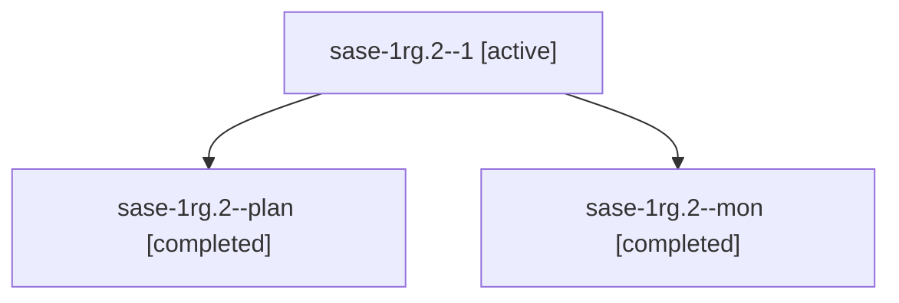

# Session: sase-1rg.2

[Agent Hoods](../README.md) / [bbugyi200](../users/bbugyi200/README.md) / [athena](../users/bbugyi200/machines/athena/README.md) / [sase-1rg](../users/bbugyi200/machines/athena/hoods/sase-1rg/README.md) / sase-1rg.2

Owner: `bbugyi200.athena` · Hood: `sase-1rg` · Members: 3 · Bead: [sase-1rg.2](https://github.com/sase-org/sase--beads/blob/main/pages/sase-1rg/sase-1rg.2.md)

## Lineage

The diagram is an optional enhancement; the ordered table below contains the same lineage in accessible text.

| Role | Agent | State | Model / provider | Timing | Commits | Prompt | Chat |
|---|---|---|---|---|---:|---|---|
| 1 | sase-1rg.2--1 | active | gpt-6-luna / codex | 2026-11-06T14:11:47.663311+00:00 | 0 | [Prompt](../agents/bbugyi200.athena.sase-1rg.2--1/prompt.md) | — |
| plan | sase-1rg.2--plan | completed | gpt-6-luna / codex | 2026-11-06T13:25:20.264460+00:00 → 2026-11-06T14:07:41.342703+00:00 | 0 | [Prompt](../agents/bbugyi200.athena.sase-1rg.2--plan/prompt.md) | [Chat](../agents/bbugyi200.athena.sase-1rg.2--plan/chat.md) |
| mon | sase-1rg.2--mon | completed | gpt-6-luna / codex | 2026-11-06T14:06:25.692195+00:00 → 2026-11-06T14:09:43.221662+00:00 | 0 | — | [Chat](../agents/bbugyi200.athena.sase-1rg.2--mon/chat.md) |

## Neighbors

| Agent | Relation | State |
|---|---|---|
| [sase-1rg.1](../agents/bbugyi200.athena.sase-1rg.1/README.md) | sase-1rg hood | completed |
| [sase-1rg.10](bbugyi200.athena.sase-1rg.10.md) (session · 3) | sase-1rg hood | completed 3 |
| [sase-1rg.3](../agents/bbugyi200.athena.sase-1rg.3/README.md) | sase-1rg hood | completed |
| [sase-1rg.4](../agents/bbugyi200.athena.sase-1rg.4/README.md) | sase-1rg hood | completed |
| [sase-1rg.5](../agents/bbugyi200.athena.sase-1rg.5/README.md) | sase-1rg hood | completed |
| [sase-1rg.6](../agents/bbugyi200.athena.sase-1rg.6/README.md) | sase-1rg hood | completed |
| [sase-1rg.7](bbugyi200.athena.sase-1rg.7.md) (session · 3) | sase-1rg hood | completed 2, failed 1 |
| [sase-1rg.8](../agents/bbugyi200.athena.sase-1rg.8/README.md) | sase-1rg hood | completed |
| [sase-1rg.9](bbugyi200.athena.sase-1rg.9.md) (session · 3) | sase-1rg hood | completed 2, failed 1 |
| [sase-1rg.land](../agents/bbugyi200.athena.sase-1rg.land/README.md) | sase-1rg hood | waiting |
