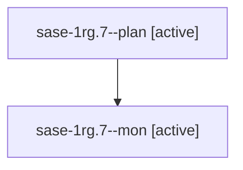

# Session: sase-1rg.7

[Agent Hoods](../README.md) / [bbugyi200](../users/bbugyi200/README.md) / [athena](../users/bbugyi200/machines/athena/README.md) / [sase-1rg](../users/bbugyi200/machines/athena/hoods/sase-1rg/README.md) / sase-1rg.7

Owner: `bbugyi200.athena` · Hood: `sase-1rg` · Members: 2 · Bead: [sase-1rg.7](https://github.com/sase-org/sase--beads/blob/main/pages/sase-1rg/sase-1rg.7.md)

## Lineage

The diagram is an optional enhancement; the ordered table below contains the same lineage in accessible text.

| Role | Agent | State | Model / provider | Timing | Commits | Prompt | Chat |
|---|---|---|---|---|---:|---|---|
| plan | sase-1rg.7--plan | active | muse-spark-1.3-contributor / muse | 2026-11-06T11:40:22.850823+00:00 | 0 | [Prompt](../agents/bbugyi200.athena.sase-1rg.7--plan/prompt.md) | — |
| mon | sase-1rg.7--mon | active | muse-spark-1.3-contributor / muse | 2026-11-06T11:55:59.119733+00:00 | 0 | — | — |

## Neighbors

| Agent | Relation | State |
|---|---|---|
| [sase-1rg.1](../agents/bbugyi200.athena.sase-1rg.1/README.md) | sase-1rg hood | active |
| [sase-1rg.10](../agents/bbugyi200.athena.sase-1rg.10/README.md) | sase-1rg hood | waiting |
| [sase-1rg.2](../agents/bbugyi200.athena.sase-1rg.2/README.md) | sase-1rg hood | waiting |
| [sase-1rg.3](../agents/bbugyi200.athena.sase-1rg.3/README.md) | sase-1rg hood | completed |
| [sase-1rg.4](../agents/bbugyi200.athena.sase-1rg.4/README.md) | sase-1rg hood | completed |
| [sase-1rg.5](../agents/bbugyi200.athena.sase-1rg.5/README.md) | sase-1rg hood | waiting |
| [sase-1rg.6](../agents/bbugyi200.athena.sase-1rg.6/README.md) | sase-1rg hood | completed |
| [sase-1rg.8](../agents/bbugyi200.athena.sase-1rg.8/README.md) | sase-1rg hood | waiting |
| [sase-1rg.9](bbugyi200.athena.sase-1rg.9.md) (session · 2) | sase-1rg hood | active 2 |
| [sase-1rg.land](../agents/bbugyi200.athena.sase-1rg.land/README.md) | sase-1rg hood | waiting |
