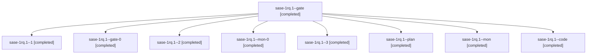

# Session: sase-1rq.1

[Agent Hoods](../README.md) / [bbugyi200](../users/bbugyi200/README.md) / [athena](../users/bbugyi200/machines/athena/README.md) / [sase-1rq](../users/bbugyi200/machines/athena/hoods/sase-1rq/README.md) / sase-1rq.1

Owner: `bbugyi200.athena` · Hood: `sase-1rq` · Members: 9 · Bead: [sase-1rq.1](https://github.com/sase-org/sase--beads/blob/main/pages/sase-1rq/sase-1rq.1.md)

## Lineage



The diagram is an optional enhancement; the ordered table below contains the same lineage in accessible text.

| Role | Agent | State | Model / provider | Timing | Commits | Prompt | Chat |
|---|---|---|---|---|---:|---|---|
| <a id="member-gate"></a>gate | sase-1rq.1--gate | completed | opus / claude | 2026-11-07T13:00:06.390189+00:00 → 2026-11-07T13:01:37.606903+00:00 | 0 | — | [Chat](../agents/bbugyi200.athena.sase-1rq.1--gate/chat.md) |
| <a id="member-1"></a>1 | sase-1rq.1--1 | completed | muse-spark-1.3-contributor / muse | 2026-11-07T14:03:29.027793+00:00 → 2026-11-07T14:07:35.937918+00:00 | 0 | [Prompt](../agents/bbugyi200.athena.sase-1rq.1--1/prompt.md) | [Chat](../agents/bbugyi200.athena.sase-1rq.1--1/chat.md) |
| <a id="member-gate-0"></a>gate-0 | sase-1rq.1--gate-0 | completed | muse-spark-1.3-contributor / muse | 2026-11-07T14:07:51.918575+00:00 → 2026-11-07T14:10:45.045829+00:00 | 0 | — | [Chat](../agents/bbugyi200.athena.sase-1rq.1--gate-0/chat.md) |
| <a id="member-2"></a>2 | sase-1rq.1--2 | completed | muse-spark-1.3-contributor / muse | 2026-11-07T14:13:31.670284+00:00 → 2026-11-07T14:28:57.817451+00:00 | 0 | [Prompt](../agents/bbugyi200.athena.sase-1rq.1--2/prompt.md) | [Chat](../agents/bbugyi200.athena.sase-1rq.1--2/chat.md) |
| <a id="member-mon-0"></a>mon-0 | sase-1rq.1--mon-0 | completed | muse-spark-1.3-contributor / muse | 2026-11-07T14:16:26.534397+00:00 → 2026-11-07T15:01:38.442816+00:00 | 0 | — | [Chat](../agents/bbugyi200.athena.sase-1rq.1--mon-0/chat.md) |
| <a id="member-3"></a>3 | sase-1rq.1--3 | completed | muse-spark-1.3-contributor / muse | 2026-11-07T15:04:46.866026+00:00 → 2026-11-07T15:07:42.744632+00:00 | 0 | [Prompt](../agents/bbugyi200.athena.sase-1rq.1--3/prompt.md) | [Chat](../agents/bbugyi200.athena.sase-1rq.1--3/chat.md) |
| <a id="member-plan"></a>plan | sase-1rq.1--plan | completed | opus / claude | 2026-11-07T12:51:14.740972+00:00 → 2026-11-07T13:24:04.137945+00:00 | 0 | [Prompt](../agents/bbugyi200.athena.sase-1rq.1--plan/prompt.md) | [Chat](../agents/bbugyi200.athena.sase-1rq.1--plan/chat.md) |
| <a id="member-mon"></a>mon | sase-1rq.1--mon | completed | muse-spark-1.3-contributor / muse | 2026-11-07T13:20:13.872116+00:00 → 2026-11-07T14:02:35.973474+00:00 | 0 | — | [Chat](../agents/bbugyi200.athena.sase-1rq.1--mon/chat.md) |
| <a id="member-code"></a>code | sase-1rq.1--code | completed | muse-spark-1.3-contributor / muse | 2026-11-07T13:02:45.521548+00:00 → 2026-11-07T13:24:04.137945+00:00 | 0 | — | [Chat](../agents/bbugyi200.athena.sase-1rq.1--code/chat.md) |

## Variables

| Role | Variable | Value |
|---|---|---|
| 3 | `ci_evidence` | {epic\_symbols: clean, final\_ci\_conclusion: success, final\_ci\_run: "42380255837", final\_ci\_sha: 317ea6a1252710e1d6c44d7289eb856f994950e0, fix\_sha\_in\_tag: dec432ca, master\_ci\_conclusion: success, maste… |

#### ci_evidence

**Role:** `3`

```yaml
epic_symbols: clean
final_ci_conclusion: success
final_ci_run: "42380255837"
final_ci_sha: 317ea6a1252710e1d6c44d7289eb856f994950e0
fix_sha_in_tag: dec432ca
master_ci_conclusion: success
master_ci_run: "42376693328"
master_ci_sha: dec432ca
master_tip: 317ea6a1252710e1d6c44d7289eb856f994950e0
merge_sha: 317ea6a1252710e1d6c44d7289eb856f994950e0
pin_ancestor_of_tag: true
pin_sha: c8adc878aedfda494731eb1c0a4ecbc359be1c0e
pr_ci_conclusion: success
pr_ci_run: "42376753765"
pr_ci_sha: 7aadfbbe1742893e2c8544e7b560805d185ad7f8
pr_number: 343
push_publish_failure: sigstore Rekor HTTP 500 (transient infra, post-twine-check)
push_release_plz_conclusion: failure
push_release_plz_run: "42380255957"
pypi_files: 5
pypi_package: sase-core-rs
pypi_unyanked: true
pypi_uploads: 2026-11-07T14:58:01Z/04/07/09/12Z
pypi_version: 0.44.0
scheduled_publish: success
scheduled_release_plz_conclusion: success
scheduled_release_plz_run: "42381001806"
tag: v0.44.0
```

Values are truncated for display; see each member's agent meta.json for the full values.

## Neighbors

| Agent | Relation | State |
|---|---|---|
| [sase-1rq.2](../agents/bbugyi200.athena.sase-1rq.2/README.md) | sase-1rq hood | waiting |
| [sase-1rq.3](bbugyi200.athena.sase-1rq.3.md) (session · 3) | sase-1rq hood | active 1, completed 2 |
| [sase-1rq.3.1.1](../agents/bbugyi200.athena.sase-1rq.3.1.1/README.md) | sase-1rq hood | completed |
| [sase-1rq.3.1.2](../agents/bbugyi200.athena.sase-1rq.3.1.2/README.md) | sase-1rq hood | completed |
| [sase-1rq.3.1.3](bbugyi200.athena.sase-1rq.3.1.3.md) (session · 3) | sase-1rq hood | active 2, completed 1 |
| [sase-1rq.3.1.4](../agents/bbugyi200.athena.sase-1rq.3.1.4/README.md) | sase-1rq hood | waiting |
| [sase-1rq.3.1.land](../agents/bbugyi200.athena.sase-1rq.3.1.land/README.md) | sase-1rq hood | waiting |
| [sase-1rq.4](bbugyi200.athena.sase-1rq.4.md) (session · 3) | sase-1rq hood | active 1, completed 2 |
| [sase-1rq.4.1.1](bbugyi200.athena.sase-1rq.4.1.1.md) (session · 8) | sase-1rq hood | active 1, completed 5, failed 2 |
| [sase-1rq.4.1.2](bbugyi200.athena.sase-1rq.4.1.2.md) (session · 3) | sase-1rq hood | completed 2, failed 1 |
| [sase-1rq.4.1.3](../agents/bbugyi200.athena.sase-1rq.4.1.3/README.md) | sase-1rq hood | active |
| [sase-1rq.4.1.4](../agents/bbugyi200.athena.sase-1rq.4.1.4/README.md) | sase-1rq hood | waiting |
| [sase-1rq.4.1.land](../agents/bbugyi200.athena.sase-1rq.4.1.land/README.md) | sase-1rq hood | waiting |
| [sase-1rq.5](bbugyi200.athena.sase-1rq.5.md) (session · 5) | sase-1rq hood | completed 4, failed 1 |
| [sase-1rq.land](../agents/bbugyi200.athena.sase-1rq.land/README.md) | sase-1rq hood | waiting |
