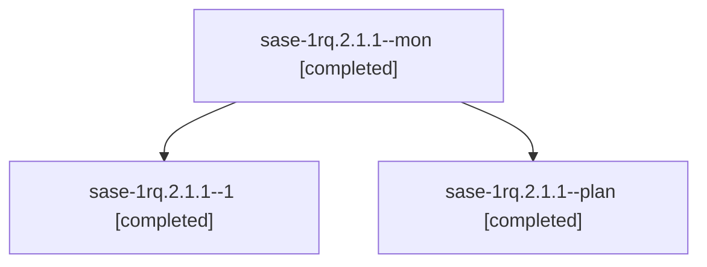

# Session: sase-1rq.2.1.1

[Agent Hoods](../README.md) / [bbugyi200](../users/bbugyi200/README.md) / [athena](../users/bbugyi200/machines/athena/README.md) / [sase-1rq](../users/bbugyi200/machines/athena/hoods/sase-1rq/README.md) / sase-1rq.2.1.1

Owner: `bbugyi200.athena` · Hood: `sase-1rq` · Members: 3 · Bead: [sase-1rq.2.1.1](https://github.com/sase-org/sase--beads/blob/main/pages/sase-1rq/sase-1rq.2.1.1.md)

## Lineage

The diagram is an optional enhancement; the ordered table below contains the same lineage in accessible text.

| Role | Agent | State | Model / provider | Timing | Commits | Prompt | Chat |
|---|---|---|---|---|---:|---|---|
| mon | sase-1rq.2.1.1--mon | completed | opus / claude | 2026-11-07T16:44:39.885085+00:00 → 2026-11-07T17:14:20.424867+00:00 | 0 | — | [Chat](../agents/bbugyi200.athena.sase-1rq.2.1.1--mon/chat.md) |
| 1 | sase-1rq.2.1.1--1 | completed | opus / claude | 2026-11-07T17:14:29.050715+00:00 → 2026-11-07T17:16:03.247204+00:00 | 0 | [Prompt](../agents/bbugyi200.athena.sase-1rq.2.1.1--1/prompt.md) | [Chat](../agents/bbugyi200.athena.sase-1rq.2.1.1--1/chat.md) |
| plan | sase-1rq.2.1.1--plan | completed | opus / claude | 2026-11-07T15:37:25.395286+00:00 → 2026-11-07T16:47:23.431332+00:00 | [1](../agents/bbugyi200.athena.sase-1rq.2.1.1--plan/README.md#commits) | [Prompt](../agents/bbugyi200.athena.sase-1rq.2.1.1--plan/prompt.md) | [Chat](../agents/bbugyi200.athena.sase-1rq.2.1.1--plan/chat.md) |

## Commits

| Role | Repo | Commit | Subject | Committed |
|---|---|---|---|---|
| plan | sase | [`c732c6e`](https://github.com/sase-org/sase/commit/c732c6e38e7b5cc3c270a9c60acb7a800186b593) | fix(tui): keep a visible agent-list highlight on screen across resizes | 2026-11-07 11:45:47 EST |

## Neighbors

| Agent | Relation | State |
|---|---|---|
| [sase-1rq.2](bbugyi200.athena.sase-1rq.2.md) (session · 3) | ancestor | active 1, completed 2 |
| [sase-1rq.2.1.2](bbugyi200.athena.sase-1rq.2.1.2.md) (session · 3) | sase-1rq.2.1 hood | completed 3 |
| [sase-1rq.2.1.3](bbugyi200.athena.sase-1rq.2.1.3.md) (session · 5) | sase-1rq.2.1 hood | completed 4, failed 1 |
| [sase-1rq.2.1.4](bbugyi200.athena.sase-1rq.2.1.4.md) (session · 3) | sase-1rq.2.1 hood | active 1, completed 2 |
| [sase-1rq.2.1.4.1.1](bbugyi200.athena.sase-1rq.2.1.4.1.1.md) (session · 5) | sase-1rq.2.1 hood | completed 4, failed 1 |
| [sase-1rq.2.1.4.1.2](bbugyi200.athena.sase-1rq.2.1.4.1.2.md) (session · 3) | sase-1rq.2.1 hood | completed 2, failed 1 |
| [sase-1rq.2.1.4.1.3](bbugyi200.athena.sase-1rq.2.1.4.1.3.md) (session · 3) | sase-1rq.2.1 hood | completed 2, failed 1 |
| [sase-1rq.2.1.4.1.4](bbugyi200.athena.sase-1rq.2.1.4.1.4.md) (session · 3) | sase-1rq.2.1 hood | completed 2, failed 1 |
| [sase-1rq.2.1.4.1.5.1](bbugyi200.athena.sase-1rq.2.1.4.1.5.1.md) (session · 5) | sase-1rq.2.1 hood | completed 4, failed 1 |
| [sase-1rq.2.1.4.1.5.2](bbugyi200.athena.sase-1rq.2.1.4.1.5.2.md) (session · 16) | sase-1rq.2.1 hood | active 1, completed 8, failed 7 |
| [sase-1rq.2.1.4.1.5.3](../agents/bbugyi200.athena.sase-1rq.2.1.4.1.5.3/README.md) | sase-1rq.2.1 hood | waiting |
| [sase-1rq.2.1.4.1.5.land](../agents/bbugyi200.athena.sase-1rq.2.1.4.1.5.land/README.md) | sase-1rq.2.1 hood | waiting |
| [sase-1rq.2.1.4.1.land](bbugyi200.athena.sase-1rq.2.1.4.1.land.md) (session · 3) | sase-1rq.2.1 hood | active 1, completed 2 |
| [sase-1rq.2.1.5](bbugyi200.athena.sase-1rq.2.1.5.md) (session · 3) | sase-1rq.2.1 hood | active 1, completed 2 |
| [sase-1rq.2.1.5.1.1](../agents/bbugyi200.athena.sase-1rq.2.1.5.1.1/README.md) | sase-1rq.2.1 hood | completed |
| [sase-1rq.2.1.5.1.2](../agents/bbugyi200.athena.sase-1rq.2.1.5.1.2/README.md) | sase-1rq.2.1 hood | completed |
| [sase-1rq.2.1.5.1.3](../agents/bbugyi200.athena.sase-1rq.2.1.5.1.3/README.md) | sase-1rq.2.1 hood | completed |
| [sase-1rq.2.1.5.1.4](bbugyi200.athena.sase-1rq.2.1.5.1.4.md) (session · 3) | sase-1rq.2.1 hood | completed 3 |
| [sase-1rq.2.1.5.1.land](../agents/bbugyi200.athena.sase-1rq.2.1.5.1.land/README.md) | sase-1rq.2.1 hood | completed |
| [sase-1rq.2.1.6](../agents/bbugyi200.athena.sase-1rq.2.1.6/README.md) | sase-1rq.2.1 hood | completed |
| [sase-1rq.2.1.7](../agents/bbugyi200.athena.sase-1rq.2.1.7/README.md) | sase-1rq.2.1 hood | waiting |
| [sase-1rq.2.1.land](../agents/bbugyi200.athena.sase-1rq.2.1.land/README.md) | sase-1rq.2.1 hood | waiting |
| [sase-1rq.1](bbugyi200.athena.sase-1rq.1.md) (session · 9) | sase-1rq hood | completed 9 |
| [sase-1rq.3](bbugyi200.athena.sase-1rq.3.md) (session · 3) | sase-1rq hood | active 1, completed 2 |
| [sase-1rq.3.1.1](../agents/bbugyi200.athena.sase-1rq.3.1.1/README.md) | sase-1rq hood | completed |
| [sase-1rq.3.1.2](../agents/bbugyi200.athena.sase-1rq.3.1.2/README.md) | sase-1rq hood | completed |
| [sase-1rq.3.1.3](bbugyi200.athena.sase-1rq.3.1.3.md) (session · 5) | sase-1rq hood | completed 5 |
| [sase-1rq.3.1.4](bbugyi200.athena.sase-1rq.3.1.4.md) (session · 3) | sase-1rq hood | completed 3 |
| [sase-1rq.3.1.land](../agents/bbugyi200.athena.sase-1rq.3.1.land/README.md) | sase-1rq hood | completed |
| [sase-1rq.4](bbugyi200.athena.sase-1rq.4.md) (session · 3) | sase-1rq hood | active 1, completed 2 |
| [sase-1rq.4.1.1](bbugyi200.athena.sase-1rq.4.1.1.md) (session · 15) | sase-1rq hood | completed 11, failed 4 |
| [sase-1rq.4.1.2](bbugyi200.athena.sase-1rq.4.1.2.md) (session · 3) | sase-1rq hood | completed 2, failed 1 |
| [sase-1rq.4.1.3](bbugyi200.athena.sase-1rq.4.1.3.md) (session · 5) | sase-1rq hood | completed 5 |
| [sase-1rq.4.1.4](../agents/bbugyi200.athena.sase-1rq.4.1.4/README.md) | sase-1rq hood | completed |
| [sase-1rq.4.1.land](../agents/bbugyi200.athena.sase-1rq.4.1.land/README.md) | sase-1rq hood | completed |
| [sase-1rq.5](bbugyi200.athena.sase-1rq.5.md) (session · 5) | sase-1rq hood | completed 4, failed 1 |
| [sase-1rq.land](../agents/bbugyi200.athena.sase-1rq.land/README.md) | sase-1rq hood | waiting |
