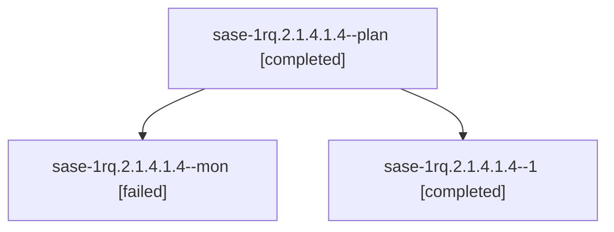

# Session: sase-1rq.2.1.4.1.4

[Agent Hoods](../README.md) / [bbugyi200](../users/bbugyi200/README.md) / [athena](../users/bbugyi200/machines/athena/README.md) / [sase-1rq](../users/bbugyi200/machines/athena/hoods/sase-1rq/README.md) / sase-1rq.2.1.4.1.4

Owner: `bbugyi200.athena` · Hood: `sase-1rq` · Members: 3 · Bead: [sase-1rq.2.1.4.1.4](https://github.com/sase-org/sase--beads/blob/main/pages/sase-1rq/sase-1rq.2.1.4.1.4.md)

## Lineage



The diagram is an optional enhancement; the ordered table below contains the same lineage in accessible text.

| Role | Agent | State | Model / provider | Timing | Commits | Prompt | Chat |
|---|---|---|---|---|---:|---|---|
| <a id="member-plan"></a>plan | sase-1rq.2.1.4.1.4--plan | completed | gpt-6-luna / codex | 2026-11-08T02:12:57.809625+00:00 → 2026-11-08T02:16:45.390056+00:00 | 0 | [Prompt](../agents/bbugyi200.athena.sase-1rq.2.1.4.1.4--plan/prompt.md) | [Chat](../agents/bbugyi200.athena.sase-1rq.2.1.4.1.4--plan/chat.md) |
| <a id="member-mon"></a>mon | sase-1rq.2.1.4.1.4--mon | failed | gpt-6-luna / codex | 2026-11-08T02:16:14.107380+00:00 → 2026-11-08T04:19:01.572449+00:00 | 0 | — | [Chat](../agents/bbugyi200.athena.sase-1rq.2.1.4.1.4--mon/chat.md) |
| <a id="member-1"></a>1 | sase-1rq.2.1.4.1.4--1 | completed | gpt-6-luna / codex | 2026-11-08T04:21:03.369834+00:00 → 2026-11-08T04:25:11.636178+00:00 | 0 | [Prompt](../agents/bbugyi200.athena.sase-1rq.2.1.4.1.4--1/prompt.md) | [Chat](../agents/bbugyi200.athena.sase-1rq.2.1.4.1.4--1/chat.md) |

## Variables

| Role | Variable | Value |
|---|---|---|
| 1 | `ci_evidence` | {artifact\_ref: file:explicit:693da93bb045b80e58b1448c, cgroup\_peak\_bytes: 15678185472, collected: 60569, contention\_job\_url: https://github.com/sase-org/sase/actions/runs/42437776062/job/128603421769… |

#### ci_evidence

**Role:** `1`

```yaml
artifact_ref: file:explicit:693da93bb045b80e58b1448c
cgroup_peak_bytes: 15678185472
collected: 60569
contention_job_url: https://github.com/sase-org/sase/actions/runs/42437776062/job/128603421769
failed_reports: 17
finished: 29354
github_artifact_id: 13603715213
harness_seconds: 5387
host_mem_available_min_bytes: 2790080512
in_flight: 24
job_conclusion: cancelled
oom_kill_delta: 0
pinned_cpus: 0-1
pytest_tally: null
quarantines: 0
repeat_count: 1
run_attempt: 1
run_id: 42437776062
run_url: https://github.com/sase-org/sase/actions/runs/42437776062
sha: 539afb211e381bd3b1d708baa19eefc649132aa7
started: 29378
workers: 26
workflow_conclusion: failure
```

Values are truncated for display; see each member's agent meta.json for the full values.

## Neighbors

| Agent | Relation | State |
|---|---|---|
| [sase-1rq.2.1.4](bbugyi200.athena.sase-1rq.2.1.4.md) (session · 3) | ancestor | active 1, completed 2 |
| [sase-1rq.2](bbugyi200.athena.sase-1rq.2.md) (session · 3) | ancestor | active 1, completed 2 |
| [sase-1rq.2.1.4.1.1](bbugyi200.athena.sase-1rq.2.1.4.1.1.md) (session · 5) | sase-1rq.2.1.4.1 hood | completed 4, failed 1 |
| [sase-1rq.2.1.4.1.2](bbugyi200.athena.sase-1rq.2.1.4.1.2.md) (session · 3) | sase-1rq.2.1.4.1 hood | completed 2, failed 1 |
| [sase-1rq.2.1.4.1.3](bbugyi200.athena.sase-1rq.2.1.4.1.3.md) (session · 3) | sase-1rq.2.1.4.1 hood | completed 2, failed 1 |
| [sase-1rq.2.1.4.1.5.1](bbugyi200.athena.sase-1rq.2.1.4.1.5.1.md) (session · 5) | sase-1rq.2.1.4.1 hood | completed 4, failed 1 |
| [sase-1rq.2.1.4.1.5.2](bbugyi200.athena.sase-1rq.2.1.4.1.5.2.md) (session · 23) | sase-1rq.2.1.4.1 hood | completed 13, failed 10 |
| [sase-1rq.2.1.4.1.5.3](bbugyi200.athena.sase-1rq.2.1.4.1.5.3.md) (session · 5) | sase-1rq.2.1.4.1 hood | completed 5 |
| [sase-1rq.2.1.4.1.5.3.1.1](../agents/bbugyi200.athena.sase-1rq.2.1.4.1.5.3.1.1/README.md) | sase-1rq.2.1.4.1 hood | completed |
| [sase-1rq.2.1.4.1.5.3.1.2](../agents/bbugyi200.athena.sase-1rq.2.1.4.1.5.3.1.2/README.md) | sase-1rq.2.1.4.1 hood | waiting |
| [sase-1rq.2.1.4.1.5.3.1.3](../agents/bbugyi200.athena.sase-1rq.2.1.4.1.5.3.1.3/README.md) | sase-1rq.2.1.4.1 hood | waiting |
| [sase-1rq.2.1.4.1.5.3.1.land](../agents/bbugyi200.athena.sase-1rq.2.1.4.1.5.3.1.land/README.md) | sase-1rq.2.1.4.1 hood | waiting |
| [sase-1rq.2.1.4.1.5.land](../agents/bbugyi200.athena.sase-1rq.2.1.4.1.5.land/README.md) | sase-1rq.2.1.4.1 hood | waiting |
| [sase-1rq.2.1.4.1.land](bbugyi200.athena.sase-1rq.2.1.4.1.land.md) (session · 3) | sase-1rq.2.1.4.1 hood | active 1, completed 2 |
| [sase-1rq.2.1.1](bbugyi200.athena.sase-1rq.2.1.1.md) (session · 3) | sase-1rq.2.1 hood | completed 3 |
| [sase-1rq.2.1.2](bbugyi200.athena.sase-1rq.2.1.2.md) (session · 3) | sase-1rq.2.1 hood | completed 3 |
| [sase-1rq.2.1.3](bbugyi200.athena.sase-1rq.2.1.3.md) (session · 5) | sase-1rq.2.1 hood | completed 4, failed 1 |
| [sase-1rq.2.1.5](bbugyi200.athena.sase-1rq.2.1.5.md) (session · 3) | sase-1rq.2.1 hood | active 1, completed 2 |
| [sase-1rq.2.1.5.1.1](../agents/bbugyi200.athena.sase-1rq.2.1.5.1.1/README.md) | sase-1rq.2.1 hood | completed |
| [sase-1rq.2.1.5.1.2](../agents/bbugyi200.athena.sase-1rq.2.1.5.1.2/README.md) | sase-1rq.2.1 hood | completed |
| [sase-1rq.2.1.5.1.3](../agents/bbugyi200.athena.sase-1rq.2.1.5.1.3/README.md) | sase-1rq.2.1 hood | completed |
| [sase-1rq.2.1.5.1.4](bbugyi200.athena.sase-1rq.2.1.5.1.4.md) (session · 3) | sase-1rq.2.1 hood | completed 3 |
| [sase-1rq.2.1.5.1.land](../agents/bbugyi200.athena.sase-1rq.2.1.5.1.land/README.md) | sase-1rq.2.1 hood | completed |
| [sase-1rq.2.1.6](../agents/bbugyi200.athena.sase-1rq.2.1.6/README.md) | sase-1rq.2.1 hood | completed |
| [sase-1rq.2.1.7](../agents/bbugyi200.athena.sase-1rq.2.1.7/README.md) | sase-1rq.2.1 hood | waiting |
| [sase-1rq.2.1.land](../agents/bbugyi200.athena.sase-1rq.2.1.land/README.md) | sase-1rq.2.1 hood | waiting |
| [sase-1rq.1](bbugyi200.athena.sase-1rq.1.md) (session · 9) | sase-1rq hood | completed 9 |
| [sase-1rq.3](bbugyi200.athena.sase-1rq.3.md) (session · 3) | sase-1rq hood | active 1, completed 2 |
| [sase-1rq.3.1.1](../agents/bbugyi200.athena.sase-1rq.3.1.1/README.md) | sase-1rq hood | completed |
| [sase-1rq.3.1.2](../agents/bbugyi200.athena.sase-1rq.3.1.2/README.md) | sase-1rq hood | completed |
| [sase-1rq.3.1.3](bbugyi200.athena.sase-1rq.3.1.3.md) (session · 5) | sase-1rq hood | completed 5 |
| [sase-1rq.3.1.4](bbugyi200.athena.sase-1rq.3.1.4.md) (session · 3) | sase-1rq hood | completed 3 |
| [sase-1rq.3.1.land](../agents/bbugyi200.athena.sase-1rq.3.1.land/README.md) | sase-1rq hood | completed |
| [sase-1rq.4](bbugyi200.athena.sase-1rq.4.md) (session · 3) | sase-1rq hood | active 1, completed 2 |
| [sase-1rq.4.1.1](bbugyi200.athena.sase-1rq.4.1.1.md) (session · 15) | sase-1rq hood | completed 11, failed 4 |
| [sase-1rq.4.1.2](bbugyi200.athena.sase-1rq.4.1.2.md) (session · 3) | sase-1rq hood | completed 2, failed 1 |
| [sase-1rq.4.1.3](bbugyi200.athena.sase-1rq.4.1.3.md) (session · 5) | sase-1rq hood | completed 5 |
| [sase-1rq.4.1.4](../agents/bbugyi200.athena.sase-1rq.4.1.4/README.md) | sase-1rq hood | completed |
| [sase-1rq.4.1.land](../agents/bbugyi200.athena.sase-1rq.4.1.land/README.md) | sase-1rq hood | completed |
| [sase-1rq.5](bbugyi200.athena.sase-1rq.5.md) (session · 5) | sase-1rq hood | completed 4, failed 1 |
| [sase-1rq.land](../agents/bbugyi200.athena.sase-1rq.land/README.md) | sase-1rq hood | waiting |
