# Session: sase-1rq.2.1.4.1.5.2

[Agent Hoods](../README.md) / [bbugyi200](../users/bbugyi200/README.md) / [athena](../users/bbugyi200/machines/athena/README.md) / [sase-1rq](../users/bbugyi200/machines/athena/hoods/sase-1rq/README.md) / sase-1rq.2.1.4.1.5.2

Owner: `bbugyi200.athena` · Hood: `sase-1rq` · Members: 23 · Bead: [sase-1rq.2.1.4.1.5.2](https://github.com/sase-org/sase--beads/blob/main/pages/sase-1rq/sase-1rq.2.1.4.1.5.2.md)

## Lineage

```mermaid
flowchart TD
  n0["sase-1rq.2.1.4.1.5.2--1 [completed]"]
  n1["sase-1rq.2.1.4.1.5.2--mon-3 [failed]"]
  n0 --> n1
  n2["sase-1rq.2.1.4.1.5.2--mon-9 [completed]"]
  n0 --> n2
  n3["sase-1rq.2.1.4.1.5.2--mon-7 [failed]"]
  n0 --> n3
  n4["sase-1rq.2.1.4.1.5.2--5 [completed]"]
  n0 --> n4
  n5["sase-1rq.2.1.4.1.5.2--mon-4 [failed]"]
  n0 --> n5
  n6["sase-1rq.2.1.4.1.5.2--mon-8 [failed]"]
  n0 --> n6
  n7["sase-1rq.2.1.4.1.5.2--6 [completed]"]
  n0 --> n7
  n8["sase-1rq.2.1.4.1.5.2--mon-2 [failed]"]
  n0 --> n8
  n9["sase-1rq.2.1.4.1.5.2--mon-0 [failed]"]
  n0 --> n9
  n10["sase-1rq.2.1.4.1.5.2--plan [completed]"]
  n0 --> n10
  n11["sase-1rq.2.1.4.1.5.2--mon [failed]"]
  n0 --> n11
  n12["sase-1rq.2.1.4.1.5.2--mon-6 [failed]"]
  n0 --> n12
  n13["sase-1rq.2.1.4.1.5.2--3 [completed]"]
  n0 --> n13
  n14["sase-1rq.2.1.4.1.5.2--b [completed]"]
  n0 --> n14
  n15["sase-1rq.2.1.4.1.5.2--a [completed]"]
  n0 --> n15
  n16["sase-1rq.2.1.4.1.5.2--4 [completed]"]
  n0 --> n16
  n17["sase-1rq.2.1.4.1.5.2--mon-1 [failed]"]
  n0 --> n17
  n18["sase-1rq.2.1.4.1.5.2--7 [completed]"]
  n0 --> n18
  n19["sase-1rq.2.1.4.1.5.2--9 [completed]"]
  n0 --> n19
  n20["sase-1rq.2.1.4.1.5.2--8 [completed]"]
  n0 --> n20
  n21["sase-1rq.2.1.4.1.5.2--2 [completed]"]
  n0 --> n21
  n22["sase-1rq.2.1.4.1.5.2--mon-5 [failed]"]
  n0 --> n22
```

The diagram is an optional enhancement; the ordered table below contains the same lineage in accessible text.

| Role | Agent | State | Model / provider | Timing | Commits | Prompt | Chat |
|---|---|---|---|---|---:|---|---|
| 1 | sase-1rq.2.1.4.1.5.2--1 | completed | grok-4.6 / grok | 2026-11-08T09:01:27.684782+00:00 → 2026-11-08T09:33:30.798612+00:00 | [1](../agents/bbugyi200.athena.sase-1rq.2.1.4.1.5.2--1/README.md#commits) | [Prompt](../agents/bbugyi200.athena.sase-1rq.2.1.4.1.5.2--1/prompt.md) | [Chat](../agents/bbugyi200.athena.sase-1rq.2.1.4.1.5.2--1/chat.md) |
| mon-3 | sase-1rq.2.1.4.1.5.2--mon-3 | failed | grok-4.6 / grok | 2026-11-08T15:34:30.396861+00:00 → 2026-11-08T16:58:50.244649+00:00 | 0 | — | [Chat](../agents/bbugyi200.athena.sase-1rq.2.1.4.1.5.2--mon-3/chat.md) |
| mon-9 | sase-1rq.2.1.4.1.5.2--mon-9 | completed | grok-4.6 / grok | 2026-11-09T05:08:26.475333+00:00 → 2026-11-09T06:29:09.944191+00:00 | 0 | — | [Chat](../agents/bbugyi200.athena.sase-1rq.2.1.4.1.5.2--mon-9/chat.md) |
| mon-7 | sase-1rq.2.1.4.1.5.2--mon-7 | failed | grok-4.6 / grok | 2026-11-08T23:04:57.585748+00:00 → 2026-11-09T00:32:04.470989+00:00 | 0 | — | [Chat](../agents/bbugyi200.athena.sase-1rq.2.1.4.1.5.2--mon-7/chat.md) |
| 5 | sase-1rq.2.1.4.1.5.2--5 | completed | grok-4.6 / grok | 2026-11-08T17:00:00.349418+00:00 → 2026-11-08T17:42:53.752158+00:00 | [1](../agents/bbugyi200.athena.sase-1rq.2.1.4.1.5.2--5/README.md#commits) | [Prompt](../agents/bbugyi200.athena.sase-1rq.2.1.4.1.5.2--5/prompt.md) | [Chat](../agents/bbugyi200.athena.sase-1rq.2.1.4.1.5.2--5/chat.md) |
| mon-4 | sase-1rq.2.1.4.1.5.2--mon-4 | failed | grok-4.6 / grok | 2026-11-08T17:39:28.108082+00:00 → 2026-11-08T19:03:17.327268+00:00 | 0 | — | [Chat](../agents/bbugyi200.athena.sase-1rq.2.1.4.1.5.2--mon-4/chat.md) |
| mon-8 | sase-1rq.2.1.4.1.5.2--mon-8 | failed | grok-4.6 / grok | 2026-11-09T02:07:40.413131+00:00 → 2026-11-09T03:29:16.716873+00:00 | 0 | — | [Chat](../agents/bbugyi200.athena.sase-1rq.2.1.4.1.5.2--mon-8/chat.md) |
| 6 | sase-1rq.2.1.4.1.5.2--6 | completed | grok-4.6 / grok | 2026-11-08T19:05:00.626123+00:00 → 2026-11-08T19:22:23.706540+00:00 | [1](../agents/bbugyi200.athena.sase-1rq.2.1.4.1.5.2--6/README.md#commits) | [Prompt](../agents/bbugyi200.athena.sase-1rq.2.1.4.1.5.2--6/prompt.md) | [Chat](../agents/bbugyi200.athena.sase-1rq.2.1.4.1.5.2--6/chat.md) |
| mon-2 | sase-1rq.2.1.4.1.5.2--mon-2 | failed | grok-4.6 / grok | 2026-11-08T13:31:51.208569+00:00 → 2026-11-08T14:55:21.858009+00:00 | 0 | — | [Chat](../agents/bbugyi200.athena.sase-1rq.2.1.4.1.5.2--mon-2/chat.md) |
| mon-0 | sase-1rq.2.1.4.1.5.2--mon-0 | failed | grok-4.6 / grok | 2026-11-08T09:30:21.749330+00:00 → 2026-11-08T10:47:38.185449+00:00 | 0 | — | [Chat](../agents/bbugyi200.athena.sase-1rq.2.1.4.1.5.2--mon-0/chat.md) |
| plan | sase-1rq.2.1.4.1.5.2--plan | completed | grok-4.6 / grok | 2026-11-08T07:27:47.053820+00:00 → 2026-11-08T07:46:07.542717+00:00 | 0 | [Prompt](../agents/bbugyi200.athena.sase-1rq.2.1.4.1.5.2--plan/prompt.md) | [Chat](../agents/bbugyi200.athena.sase-1rq.2.1.4.1.5.2--plan/chat.md) |
| mon | sase-1rq.2.1.4.1.5.2--mon | failed | grok-4.6 / grok | 2026-11-08T07:45:07.161053+00:00 → 2026-11-08T09:00:18.396976+00:00 | 0 | — | [Chat](../agents/bbugyi200.athena.sase-1rq.2.1.4.1.5.2--mon/chat.md) |
| mon-6 | sase-1rq.2.1.4.1.5.2--mon-6 | failed | grok-4.6 / grok | 2026-11-08T21:06:42.444393+00:00 → 2026-11-08T22:27:20.321706+00:00 | 0 | — | [Chat](../agents/bbugyi200.athena.sase-1rq.2.1.4.1.5.2--mon-6/chat.md) |
| 3 | sase-1rq.2.1.4.1.5.2--3 | completed | grok-4.6 / grok | 2026-11-08T12:35:34.842103+00:00 → 2026-11-08T13:35:06.503185+00:00 | [1](../agents/bbugyi200.athena.sase-1rq.2.1.4.1.5.2--3/README.md#commits) | [Prompt](../agents/bbugyi200.athena.sase-1rq.2.1.4.1.5.2--3/prompt.md) | [Chat](../agents/bbugyi200.athena.sase-1rq.2.1.4.1.5.2--3/chat.md) |
| b | sase-1rq.2.1.4.1.5.2--b | completed | grok-4.6 / grok | 2026-11-09T06:30:37.707188+00:00 → 2026-11-09T06:35:02.227088+00:00 | 0 | [Prompt](../agents/bbugyi200.athena.sase-1rq.2.1.4.1.5.2--b/prompt.md) | [Chat](../agents/bbugyi200.athena.sase-1rq.2.1.4.1.5.2--b/chat.md) |
| a | sase-1rq.2.1.4.1.5.2--a | completed | grok-4.6 / grok | 2026-11-09T03:29:36.047621+00:00 → 2026-11-09T05:11:19.566363+00:00 | [1](../agents/bbugyi200.athena.sase-1rq.2.1.4.1.5.2--a/README.md#commits) | [Prompt](../agents/bbugyi200.athena.sase-1rq.2.1.4.1.5.2--a/prompt.md) | [Chat](../agents/bbugyi200.athena.sase-1rq.2.1.4.1.5.2--a/chat.md) |
| 4 | sase-1rq.2.1.4.1.5.2--4 | completed | grok-4.6 / grok | 2026-11-08T14:56:34.111829+00:00 → 2026-11-08T15:38:21.001847+00:00 | [1](../agents/bbugyi200.athena.sase-1rq.2.1.4.1.5.2--4/README.md#commits) | [Prompt](../agents/bbugyi200.athena.sase-1rq.2.1.4.1.5.2--4/prompt.md) | [Chat](../agents/bbugyi200.athena.sase-1rq.2.1.4.1.5.2--4/chat.md) |
| mon-1 | sase-1rq.2.1.4.1.5.2--mon-1 | failed | grok-4.6 / grok | 2026-11-08T11:11:13.783575+00:00 → 2026-11-08T12:33:41.629488+00:00 | 0 | — | [Chat](../agents/bbugyi200.athena.sase-1rq.2.1.4.1.5.2--mon-1/chat.md) |
| 7 | sase-1rq.2.1.4.1.5.2--7 | completed | grok-4.6 / grok | 2026-11-08T20:42:39.985895+00:00 → 2026-11-08T21:09:44.508468+00:00 | [1](../agents/bbugyi200.athena.sase-1rq.2.1.4.1.5.2--7/README.md#commits) | [Prompt](../agents/bbugyi200.athena.sase-1rq.2.1.4.1.5.2--7/prompt.md) | [Chat](../agents/bbugyi200.athena.sase-1rq.2.1.4.1.5.2--7/chat.md) |
| 9 | sase-1rq.2.1.4.1.5.2--9 | completed | grok-4.6 / grok | 2026-11-09T00:33:22.589455+00:00 → 2026-11-09T02:10:42.752263+00:00 | [1](../agents/bbugyi200.athena.sase-1rq.2.1.4.1.5.2--9/README.md#commits) | [Prompt](../agents/bbugyi200.athena.sase-1rq.2.1.4.1.5.2--9/prompt.md) | [Chat](../agents/bbugyi200.athena.sase-1rq.2.1.4.1.5.2--9/chat.md) |
| 8 | sase-1rq.2.1.4.1.5.2--8 | completed | grok-4.6 / grok | 2026-11-08T22:28:41.602000+00:00 → 2026-11-08T23:08:30.575596+00:00 | [1](../agents/bbugyi200.athena.sase-1rq.2.1.4.1.5.2--8/README.md#commits) | [Prompt](../agents/bbugyi200.athena.sase-1rq.2.1.4.1.5.2--8/prompt.md) | [Chat](../agents/bbugyi200.athena.sase-1rq.2.1.4.1.5.2--8/chat.md) |
| 2 | sase-1rq.2.1.4.1.5.2--2 | completed | grok-4.6 / grok | 2026-11-08T10:48:44.843223+00:00 → 2026-11-08T11:14:13.514084+00:00 | [1](../agents/bbugyi200.athena.sase-1rq.2.1.4.1.5.2--2/README.md#commits) | [Prompt](../agents/bbugyi200.athena.sase-1rq.2.1.4.1.5.2--2/prompt.md) | [Chat](../agents/bbugyi200.athena.sase-1rq.2.1.4.1.5.2--2/chat.md) |
| mon-5 | sase-1rq.2.1.4.1.5.2--mon-5 | failed | grok-4.6 / grok | 2026-11-08T19:19:19.226339+00:00 → 2026-11-08T20:41:21.093918+00:00 | 0 | — | [Chat](../agents/bbugyi200.athena.sase-1rq.2.1.4.1.5.2--mon-5/chat.md) |

## Commits

| Role | Repo | Commit | Subject | Committed |
|---|---|---|---|---|
| 1 | sase | [`dde1ada`](https://github.com/sase-org/sase/commit/dde1ada139e5698b8723b2166fab97d65d3d0f7c) | fix(test): isolate contention hang guards and nested soak records | 2026-11-08 04:31:55 EST |
| 2 | sase | [`2400e61`](https://github.com/sase-org/sase/commit/2400e61e938c0535ca3de61e83f63f698c8b25c2) | fix(test): keep contended TUI waits off the event loop | 2026-11-08 06:12:38 EST |
| 3 | sase | [`229f85a`](https://github.com/sase-org/sase/commit/229f85a998cb8fade8a4331f3ac4877b5104adf9) | fix(test): keep contended subprocess waits load-tolerant | 2026-11-08 08:33:25 EST |
| 4 | sase | [`6a6cc2b`](https://github.com/sase-org/sase/commit/6a6cc2b4268eb6c14f70d20f58d1a5e3cbc43580) | fix(test): keep contended nested and TUI waits load-tolerant | 2026-11-08 10:36:05 EST |
| 5 | sase | [`11de7c8`](https://github.com/sase-org/sase/commit/11de7c8591e506af66ae7029480e0e64a86011a0) | fix(test): bound TUI settle and zsh PTY waits under contention | 2026-11-08 12:40:57 EST |
| 6 | sase | [`8f82a88`](https://github.com/sase-org/sase/commit/8f82a88607750ed1c87156b0656220b30a96b19d) | fix(test): pin post-update toast timeout under contention | 2026-11-08 14:20:39 EST |
| 7 | sase | [`7190490`](https://github.com/sase-org/sase/commit/719049003053750ddf089d7eab53af5eee6a294c) | fix(tui): keep stitches first-paint coverage exact under contention | 2026-11-08 16:08:03 EST |
| 8 | sase | [`9c4cebe`](https://github.com/sase-org/sase/commit/9c4cebea9820b5917f9027f70aa2a0409edb6ba9) | fix: stabilize bump microbench and provider timer under contention | 2026-11-08 18:06:48 EST |
| 9 | sase | [`d1c6a2c`](https://github.com/sase-org/sase/commit/d1c6a2c10b3473020df6831b71d2d21096156a9f) | fix: skip same-key highlight echo and wait for group-kill reaping under contention | 2026-11-08 21:09:04 EST |
| a | sase | [`7a7ecd6`](https://github.com/sase-org/sase/commit/7a7ecd6885b32ea969d462881673e96d776a37d1) | fix(tui): return archive pulse Enter to inbox and drop paused stalls | 2026-11-09 00:09:40 EST |

## Neighbors

| Agent | Relation | State |
|---|---|---|
| [sase-1rq.2.1.4](bbugyi200.athena.sase-1rq.2.1.4.md) (session · 3) | ancestor | active 1, completed 2 |
| [sase-1rq.2](bbugyi200.athena.sase-1rq.2.md) (session · 3) | ancestor | active 1, completed 2 |
| [sase-1rq.2.1.4.1.5.1](bbugyi200.athena.sase-1rq.2.1.4.1.5.1.md) (session · 5) | sase-1rq.2.1.4.1.5 hood | completed 4, failed 1 |
| [sase-1rq.2.1.4.1.5.3](bbugyi200.athena.sase-1rq.2.1.4.1.5.3.md) (session · 5) | sase-1rq.2.1.4.1.5 hood | completed 5 |
| [sase-1rq.2.1.4.1.5.3.1.1](../agents/bbugyi200.athena.sase-1rq.2.1.4.1.5.3.1.1/README.md) | sase-1rq.2.1.4.1.5 hood | completed |
| [sase-1rq.2.1.4.1.5.3.1.2](bbugyi200.athena.sase-1rq.2.1.4.1.5.3.1.2.md) (session · 31) | sase-1rq.2.1.4.1.5 hood | completed 21, failed 10 |
| [sase-1rq.2.1.4.1.5.3.1.3](../agents/bbugyi200.athena.sase-1rq.2.1.4.1.5.3.1.3/README.md) | sase-1rq.2.1.4.1.5 hood | waiting |
| [sase-1rq.2.1.4.1.5.3.1.land](../agents/bbugyi200.athena.sase-1rq.2.1.4.1.5.3.1.land/README.md) | sase-1rq.2.1.4.1.5 hood | waiting |
| [sase-1rq.2.1.4.1.5.land](../agents/bbugyi200.athena.sase-1rq.2.1.4.1.5.land/README.md) | sase-1rq.2.1.4.1.5 hood | waiting |
| [sase-1rq.2.1.4.1.1](bbugyi200.athena.sase-1rq.2.1.4.1.1.md) (session · 5) | sase-1rq.2.1.4.1 hood | completed 4, failed 1 |
| [sase-1rq.2.1.4.1.2](bbugyi200.athena.sase-1rq.2.1.4.1.2.md) (session · 3) | sase-1rq.2.1.4.1 hood | completed 2, failed 1 |
| [sase-1rq.2.1.4.1.3](bbugyi200.athena.sase-1rq.2.1.4.1.3.md) (session · 3) | sase-1rq.2.1.4.1 hood | completed 2, failed 1 |
| [sase-1rq.2.1.4.1.4](bbugyi200.athena.sase-1rq.2.1.4.1.4.md) (session · 3) | sase-1rq.2.1.4.1 hood | completed 2, failed 1 |
| [sase-1rq.2.1.4.1.land](bbugyi200.athena.sase-1rq.2.1.4.1.land.md) (session · 3) | sase-1rq.2.1.4.1 hood | active 1, completed 2 |
| [sase-1rq.2.1.1](bbugyi200.athena.sase-1rq.2.1.1.md) (session · 3) | sase-1rq.2.1 hood | completed 3 |
| [sase-1rq.2.1.2](bbugyi200.athena.sase-1rq.2.1.2.md) (session · 3) | sase-1rq.2.1 hood | completed 3 |
| [sase-1rq.2.1.3](bbugyi200.athena.sase-1rq.2.1.3.md) (session · 5) | sase-1rq.2.1 hood | completed 4, failed 1 |
| [sase-1rq.2.1.5](bbugyi200.athena.sase-1rq.2.1.5.md) (session · 3) | sase-1rq.2.1 hood | active 1, completed 2 |
| [sase-1rq.2.1.5.1.1](../agents/bbugyi200.athena.sase-1rq.2.1.5.1.1/README.md) | sase-1rq.2.1 hood | completed |
| [sase-1rq.2.1.5.1.2](../agents/bbugyi200.athena.sase-1rq.2.1.5.1.2/README.md) | sase-1rq.2.1 hood | completed |
| [sase-1rq.2.1.5.1.3](../agents/bbugyi200.athena.sase-1rq.2.1.5.1.3/README.md) | sase-1rq.2.1 hood | completed |
| [sase-1rq.2.1.5.1.4](bbugyi200.athena.sase-1rq.2.1.5.1.4.md) (session · 3) | sase-1rq.2.1 hood | completed 3 |
| [sase-1rq.2.1.5.1.land](../agents/bbugyi200.athena.sase-1rq.2.1.5.1.land/README.md) | sase-1rq.2.1 hood | completed |
| [sase-1rq.2.1.6](../agents/bbugyi200.athena.sase-1rq.2.1.6/README.md) | sase-1rq.2.1 hood | completed |
| [sase-1rq.2.1.7](../agents/bbugyi200.athena.sase-1rq.2.1.7/README.md) | sase-1rq.2.1 hood | waiting |
| [sase-1rq.2.1.land](../agents/bbugyi200.athena.sase-1rq.2.1.land/README.md) | sase-1rq.2.1 hood | waiting |
| [sase-1rq.1](bbugyi200.athena.sase-1rq.1.md) (session · 9) | sase-1rq hood | completed 9 |
| [sase-1rq.3](bbugyi200.athena.sase-1rq.3.md) (session · 3) | sase-1rq hood | active 1, completed 2 |
| [sase-1rq.3.1.1](../agents/bbugyi200.athena.sase-1rq.3.1.1/README.md) | sase-1rq hood | completed |
| [sase-1rq.3.1.2](../agents/bbugyi200.athena.sase-1rq.3.1.2/README.md) | sase-1rq hood | completed |
| [sase-1rq.3.1.3](bbugyi200.athena.sase-1rq.3.1.3.md) (session · 5) | sase-1rq hood | completed 5 |
| [sase-1rq.3.1.4](bbugyi200.athena.sase-1rq.3.1.4.md) (session · 3) | sase-1rq hood | completed 3 |
| [sase-1rq.3.1.land](../agents/bbugyi200.athena.sase-1rq.3.1.land/README.md) | sase-1rq hood | completed |
| [sase-1rq.4](bbugyi200.athena.sase-1rq.4.md) (session · 3) | sase-1rq hood | active 1, completed 2 |
| [sase-1rq.4.1.1](bbugyi200.athena.sase-1rq.4.1.1.md) (session · 15) | sase-1rq hood | completed 11, failed 4 |
| [sase-1rq.4.1.2](bbugyi200.athena.sase-1rq.4.1.2.md) (session · 3) | sase-1rq hood | completed 2, failed 1 |
| [sase-1rq.4.1.3](bbugyi200.athena.sase-1rq.4.1.3.md) (session · 5) | sase-1rq hood | completed 5 |
| [sase-1rq.4.1.4](../agents/bbugyi200.athena.sase-1rq.4.1.4/README.md) | sase-1rq hood | completed |
| [sase-1rq.4.1.land](../agents/bbugyi200.athena.sase-1rq.4.1.land/README.md) | sase-1rq hood | completed |
| [sase-1rq.5](bbugyi200.athena.sase-1rq.5.md) (session · 5) | sase-1rq hood | completed 4, failed 1 |
| [sase-1rq.land](../agents/bbugyi200.athena.sase-1rq.land/README.md) | sase-1rq hood | waiting |
