# Session: sase-1rq.2.1.4.1.5.3.1.2

[Agent Hoods](../README.md) / [bbugyi200](../users/bbugyi200/README.md) / [athena](../users/bbugyi200/machines/athena/README.md) / [sase-1rq](../users/bbugyi200/machines/athena/hoods/sase-1rq/README.md) / sase-1rq.2.1.4.1.5.3.1.2

Owner: `bbugyi200.athena` · Hood: `sase-1rq` · Members: 31 · Bead: [sase-1rq.2.1.4.1.5.3.1.2](https://github.com/sase-org/sase--beads/blob/main/pages/sase-1rq/sase-1rq.2.1.4.1.5.3.1.2.md)

## Lineage

```mermaid
flowchart TD
  n0["sase-1rq.2.1.4.1.5.3.1.2--5 [completed]"]
  n1["sase-1rq.2.1.4.1.5.3.1.2--4 [completed]"]
  n0 --> n1
  n2["sase-1rq.2.1.4.1.5.3.1.2--d [completed]"]
  n0 --> n2
  n3["sase-1rq.2.1.4.1.5.3.1.2--mon-6 [failed]"]
  n0 --> n3
  n4["sase-1rq.2.1.4.1.5.3.1.2--f [completed]"]
  n0 --> n4
  n5["sase-1rq.2.1.4.1.5.3.1.2--mon-b [completed]"]
  n0 --> n5
  n6["sase-1rq.2.1.4.1.5.3.1.2--mon-1 [failed]"]
  n0 --> n6
  n7["sase-1rq.2.1.4.1.5.3.1.2--8 [completed]"]
  n0 --> n7
  n8["sase-1rq.2.1.4.1.5.3.1.2--2 [completed]"]
  n0 --> n8
  n9["sase-1rq.2.1.4.1.5.3.1.2--9 [completed]"]
  n0 --> n9
  n10["sase-1rq.2.1.4.1.5.3.1.2--1 [completed]"]
  n0 --> n10
  n11["sase-1rq.2.1.4.1.5.3.1.2--mon-9 [failed]"]
  n0 --> n11
  n12["sase-1rq.2.1.4.1.5.3.1.2--3 [completed]"]
  n0 --> n12
  n13["sase-1rq.2.1.4.1.5.3.1.2--mon-a [failed]"]
  n0 --> n13
  n14["sase-1rq.2.1.4.1.5.3.1.2--a [completed]"]
  n0 --> n14
  n15["sase-1rq.2.1.4.1.5.3.1.2--6 [completed]"]
  n0 --> n15
  n16["sase-1rq.2.1.4.1.5.3.1.2--mon-3 [failed]"]
  n0 --> n16
  n17["sase-1rq.2.1.4.1.5.3.1.2--mon-5 [completed]"]
  n0 --> n17
  n18["sase-1rq.2.1.4.1.5.3.1.2--e [completed]"]
  n0 --> n18
  n19["sase-1rq.2.1.4.1.5.3.1.2--c [completed]"]
  n0 --> n19
  n20["sase-1rq.2.1.4.1.5.3.1.2--mon [failed]"]
  n0 --> n20
  n21["sase-1rq.2.1.4.1.5.3.1.2--mon-2 [completed]"]
  n0 --> n21
  n22["sase-1rq.2.1.4.1.5.3.1.2--plan [completed]"]
  n0 --> n22
  n23["sase-1rq.2.1.4.1.5.3.1.2--mon-0 [failed]"]
  n0 --> n23
  n24["sase-1rq.2.1.4.1.5.3.1.2--7 [completed]"]
  n0 --> n24
  n25["sase-1rq.2.1.4.1.5.3.1.2--mon-8 [failed]"]
  n0 --> n25
  n26["sase-1rq.2.1.4.1.5.3.1.2--mon-4 [failed]"]
  n0 --> n26
  n27["sase-1rq.2.1.4.1.5.3.1.2--mon-7 [failed]"]
  n0 --> n27
  n28["sase-1rq.2.1.4.1.5.3.1.2--b [completed]"]
  n0 --> n28
  n29["sase-1rq.2.1.4.1.5.3.1.2--mon-d [completed]"]
  n0 --> n29
  n30["sase-1rq.2.1.4.1.5.3.1.2--mon-c [completed]"]
  n0 --> n30
```

The diagram is an optional enhancement; the ordered table below contains the same lineage in accessible text.

| Role | Agent | State | Model / provider | Timing | Commits | Prompt | Chat |
|---|---|---|---|---|---:|---|---|
| 5 | sase-1rq.2.1.4.1.5.3.1.2--5 | completed | gpt-6-luna / codex | 2026-11-09T15:55:06.732443+00:00 → 2026-11-09T16:00:42.272962+00:00 | 0 | [Prompt](../agents/bbugyi200.athena.sase-1rq.2.1.4.1.5.3.1.2--5/prompt.md) | [Chat](../agents/bbugyi200.athena.sase-1rq.2.1.4.1.5.3.1.2--5/chat.md) |
| 4 | sase-1rq.2.1.4.1.5.3.1.2--4 | completed | gpt-6-luna / codex | 2026-11-09T14:30:02.844780+00:00 → 2026-11-09T14:33:28.174564+00:00 | 0 | [Prompt](../agents/bbugyi200.athena.sase-1rq.2.1.4.1.5.3.1.2--4/prompt.md) | [Chat](../agents/bbugyi200.athena.sase-1rq.2.1.4.1.5.3.1.2--4/chat.md) |
| d | sase-1rq.2.1.4.1.5.3.1.2--d | completed | gpt-6-luna / codex | 2026-11-09T20:14:47.043697+00:00 → 2026-11-09T20:16:56.894880+00:00 | 0 | [Prompt](../agents/bbugyi200.athena.sase-1rq.2.1.4.1.5.3.1.2--d/prompt.md) | [Chat](../agents/bbugyi200.athena.sase-1rq.2.1.4.1.5.3.1.2--d/chat.md) |
| mon-6 | sase-1rq.2.1.4.1.5.3.1.2--mon-6 | failed | gpt-6-luna / codex | 2026-11-09T16:55:35.551090+00:00 → 2026-11-09T18:15:34.361992+00:00 | 0 | — | — |
| f | sase-1rq.2.1.4.1.5.3.1.2--f | completed | gpt-6-luna / codex | 2026-11-09T22:07:16.690431+00:00 → 2026-11-09T22:21:58.564375+00:00 | [1](../agents/bbugyi200.athena.sase-1rq.2.1.4.1.5.3.1.2--f/README.md#commits) | [Prompt](../agents/bbugyi200.athena.sase-1rq.2.1.4.1.5.3.1.2--f/prompt.md) | [Chat](../agents/bbugyi200.athena.sase-1rq.2.1.4.1.5.3.1.2--f/chat.md) |
| mon-b | sase-1rq.2.1.4.1.5.3.1.2--mon-b | completed | gpt-6-luna / codex | 2026-11-09T20:07:15.955267+00:00 → 2026-11-09T20:13:20.553911+00:00 | 0 | — | [Chat](../agents/bbugyi200.athena.sase-1rq.2.1.4.1.5.3.1.2--mon-b/chat.md) |
| mon-1 | sase-1rq.2.1.4.1.5.3.1.2--mon-1 | failed | gpt-6-luna / codex | 2026-11-09T12:34:04.406569+00:00 → 2026-11-09T14:14:14.481919+00:00 | 0 | — | — |
| 8 | sase-1rq.2.1.4.1.5.3.1.2--8 | completed | gpt-6-luna / codex | 2026-11-09T18:17:29.553426+00:00 → 2026-11-09T18:24:05.165444+00:00 | 0 | [Prompt](../agents/bbugyi200.athena.sase-1rq.2.1.4.1.5.3.1.2--8/prompt.md) | [Chat](../agents/bbugyi200.athena.sase-1rq.2.1.4.1.5.3.1.2--8/chat.md) |
| 2 | sase-1rq.2.1.4.1.5.3.1.2--2 | completed | gpt-6-luna / codex | 2026-11-09T12:31:05.596740+00:00 → 2026-11-09T12:34:57.242527+00:00 | 0 | [Prompt](../agents/bbugyi200.athena.sase-1rq.2.1.4.1.5.3.1.2--2/prompt.md) | [Chat](../agents/bbugyi200.athena.sase-1rq.2.1.4.1.5.3.1.2--2/chat.md) |
| 9 | sase-1rq.2.1.4.1.5.3.1.2--9 | completed | gpt-6-luna / codex | 2026-11-09T18:33:39.909176+00:00 → 2026-11-09T18:40:19.758223+00:00 | 0 | [Prompt](../agents/bbugyi200.athena.sase-1rq.2.1.4.1.5.3.1.2--9/prompt.md) | [Chat](../agents/bbugyi200.athena.sase-1rq.2.1.4.1.5.3.1.2--9/chat.md) |
| 1 | sase-1rq.2.1.4.1.5.3.1.2--1 | completed | gpt-6-luna / codex | 2026-11-09T11:40:25.015369+00:00 → 2026-11-09T12:27:55.438542+00:00 | 0 | [Prompt](../agents/bbugyi200.athena.sase-1rq.2.1.4.1.5.3.1.2--1/prompt.md) | [Chat](../agents/bbugyi200.athena.sase-1rq.2.1.4.1.5.3.1.2--1/chat.md) |
| mon-9 | sase-1rq.2.1.4.1.5.3.1.2--mon-9 | failed | gpt-6-luna / codex | 2026-11-09T19:18:21.566285+00:00 → 2026-11-09T19:35:28.217144+00:00 | 0 | — | [Chat](../agents/bbugyi200.athena.sase-1rq.2.1.4.1.5.3.1.2--mon-9/chat.md) |
| 3 | sase-1rq.2.1.4.1.5.3.1.2--3 | completed | gpt-6-luna / codex | 2026-11-09T14:15:45.584898+00:00 → 2026-11-09T14:20:54.708511+00:00 | 0 | [Prompt](../agents/bbugyi200.athena.sase-1rq.2.1.4.1.5.3.1.2--3/prompt.md) | [Chat](../agents/bbugyi200.athena.sase-1rq.2.1.4.1.5.3.1.2--3/chat.md) |
| mon-a | sase-1rq.2.1.4.1.5.3.1.2--mon-a | failed | gpt-6-luna / codex | 2026-11-09T19:42:57.040738+00:00 → 2026-11-09T20:00:15.647180+00:00 | 0 | — | [Chat](../agents/bbugyi200.athena.sase-1rq.2.1.4.1.5.3.1.2--mon-a/chat.md) |
| a | sase-1rq.2.1.4.1.5.3.1.2--a | completed | gpt-6-luna / codex | 2026-11-09T19:10:45.418222+00:00 → 2026-11-09T19:19:09.769106+00:00 | 0 | [Prompt](../agents/bbugyi200.athena.sase-1rq.2.1.4.1.5.3.1.2--a/prompt.md) | [Chat](../agents/bbugyi200.athena.sase-1rq.2.1.4.1.5.3.1.2--a/chat.md) |
| 6 | sase-1rq.2.1.4.1.5.3.1.2--6 | completed | gpt-6-luna / codex | 2026-11-09T16:12:22.396283+00:00 → 2026-11-09T16:16:56.899741+00:00 | 0 | [Prompt](../agents/bbugyi200.athena.sase-1rq.2.1.4.1.5.3.1.2--6/prompt.md) | [Chat](../agents/bbugyi200.athena.sase-1rq.2.1.4.1.5.3.1.2--6/chat.md) |
| mon-3 | sase-1rq.2.1.4.1.5.3.1.2--mon-3 | failed | gpt-6-luna / codex | 2026-11-09T14:32:17.854558+00:00 → 2026-11-09T15:53:46.355956+00:00 | 0 | — | [Chat](../agents/bbugyi200.athena.sase-1rq.2.1.4.1.5.3.1.2--mon-3/chat.md) |
| mon-5 | sase-1rq.2.1.4.1.5.3.1.2--mon-5 | completed | gpt-6-luna / codex | 2026-11-09T16:16:20.021827+00:00 → 2026-11-09T16:27:51.809622+00:00 | 0 | — | [Chat](../agents/bbugyi200.athena.sase-1rq.2.1.4.1.5.3.1.2--mon-5/chat.md) |
| e | sase-1rq.2.1.4.1.5.3.1.2--e | completed | gpt-6-luna / codex | 2026-11-09T20:40:09.236036+00:00 → 2026-11-09T20:46:26.200099+00:00 | 0 | [Prompt](../agents/bbugyi200.athena.sase-1rq.2.1.4.1.5.3.1.2--e/prompt.md) | [Chat](../agents/bbugyi200.athena.sase-1rq.2.1.4.1.5.3.1.2--e/chat.md) |
| c | sase-1rq.2.1.4.1.5.3.1.2--c | completed | gpt-6-luna / codex | 2026-11-09T20:01:25.667703+00:00 → 2026-11-09T20:08:05.689291+00:00 | 0 | [Prompt](../agents/bbugyi200.athena.sase-1rq.2.1.4.1.5.3.1.2--c/prompt.md) | [Chat](../agents/bbugyi200.athena.sase-1rq.2.1.4.1.5.3.1.2--c/chat.md) |
| mon | sase-1rq.2.1.4.1.5.3.1.2--mon | failed | gpt-6-luna / codex | 2026-11-09T10:02:30.709536+00:00 → 2026-11-09T11:39:01.432459+00:00 | 0 | — | [Chat](../agents/bbugyi200.athena.sase-1rq.2.1.4.1.5.3.1.2--mon/chat.md) |
| mon-2 | sase-1rq.2.1.4.1.5.3.1.2--mon-2 | completed | gpt-6-luna / codex | 2026-11-09T14:20:11.188570+00:00 → 2026-11-09T14:29:06.480908+00:00 | 0 | — | [Chat](../agents/bbugyi200.athena.sase-1rq.2.1.4.1.5.3.1.2--mon-2/chat.md) |
| plan | sase-1rq.2.1.4.1.5.3.1.2--plan | completed | gpt-6-luna / codex | 2026-11-09T09:54:31.464856+00:00 → 2026-11-09T10:03:06.665240+00:00 | 0 | [Prompt](../agents/bbugyi200.athena.sase-1rq.2.1.4.1.5.3.1.2--plan/prompt.md) | [Chat](../agents/bbugyi200.athena.sase-1rq.2.1.4.1.5.3.1.2--plan/chat.md) |
| mon-0 | sase-1rq.2.1.4.1.5.3.1.2--mon-0 | failed | gpt-6-luna / codex | 2026-11-09T12:26:52.840388+00:00 → 2026-11-09T12:29:32.213295+00:00 | 0 | — | [Chat](../agents/bbugyi200.athena.sase-1rq.2.1.4.1.5.3.1.2--mon-0/chat.md) |
| 7 | sase-1rq.2.1.4.1.5.3.1.2--7 | completed | gpt-6-luna / codex | 2026-11-09T16:28:54.444198+00:00 → 2026-11-09T16:56:29.060713+00:00 | 0 | [Prompt](../agents/bbugyi200.athena.sase-1rq.2.1.4.1.5.3.1.2--7/prompt.md) | [Chat](../agents/bbugyi200.athena.sase-1rq.2.1.4.1.5.3.1.2--7/chat.md) |
| mon-8 | sase-1rq.2.1.4.1.5.3.1.2--mon-8 | failed | gpt-6-luna / codex | 2026-11-09T18:39:36.403160+00:00 → 2026-11-09T19:09:13.767119+00:00 | 0 | — | [Chat](../agents/bbugyi200.athena.sase-1rq.2.1.4.1.5.3.1.2--mon-8/chat.md) |
| mon-4 | sase-1rq.2.1.4.1.5.3.1.2--mon-4 | failed | gpt-6-luna / codex | 2026-11-09T15:59:43.319375+00:00 → 2026-11-09T16:11:17.403621+00:00 | 0 | — | [Chat](../agents/bbugyi200.athena.sase-1rq.2.1.4.1.5.3.1.2--mon-4/chat.md) |
| mon-7 | sase-1rq.2.1.4.1.5.3.1.2--mon-7 | failed | gpt-6-luna / codex | 2026-11-09T18:23:10.325308+00:00 → 2026-11-09T18:32:11.433308+00:00 | 0 | — | [Chat](../agents/bbugyi200.athena.sase-1rq.2.1.4.1.5.3.1.2--mon-7/chat.md) |
| b | sase-1rq.2.1.4.1.5.3.1.2--b | completed | gpt-6-luna / codex | 2026-11-09T19:37:06.618947+00:00 → 2026-11-09T19:43:47.339803+00:00 | 0 | [Prompt](../agents/bbugyi200.athena.sase-1rq.2.1.4.1.5.3.1.2--b/prompt.md) | [Chat](../agents/bbugyi200.athena.sase-1rq.2.1.4.1.5.3.1.2--b/chat.md) |
| mon-d | sase-1rq.2.1.4.1.5.3.1.2--mon-d | completed | gpt-6-luna / codex | 2026-11-09T20:42:53.776688+00:00 → 2026-11-09T22:05:43.867717+00:00 | 0 | — | — |
| mon-c | sase-1rq.2.1.4.1.5.3.1.2--mon-c | completed | gpt-6-luna / codex | 2026-11-09T20:16:11.353905+00:00 → 2026-11-09T20:38:29.194256+00:00 | 0 | — | [Chat](../agents/bbugyi200.athena.sase-1rq.2.1.4.1.5.3.1.2--mon-c/chat.md) |

## Commits

| Role | Repo | Commit | Subject | Committed |
|---|---|---|---|---|
| f | sase | [`bd97664`](https://github.com/sase-org/sase/commit/bd97664e07f78922f4f9803cb5688ba0b425f6fd) | fix(contention): repair remaining contention failures | 2026-11-09 17:19:20 EST |

## Neighbors

| Agent | Relation | State |
|---|---|---|
| [sase-1rq.2.1.4.1.5.3](bbugyi200.athena.sase-1rq.2.1.4.1.5.3.md) (session · 5) | ancestor | completed 5 |
| [sase-1rq.2.1.4](bbugyi200.athena.sase-1rq.2.1.4.md) (session · 3) | ancestor | active 1, completed 2 |
| [sase-1rq.2](bbugyi200.athena.sase-1rq.2.md) (session · 3) | ancestor | active 1, completed 2 |
| [sase-1rq.2.1.4.1.5.3.1.1](../agents/bbugyi200.athena.sase-1rq.2.1.4.1.5.3.1.1/README.md) | sase-1rq.2.1.4.1.5.3.1 hood | completed |
| [sase-1rq.2.1.4.1.5.3.1.3](../agents/bbugyi200.athena.sase-1rq.2.1.4.1.5.3.1.3/README.md) | sase-1rq.2.1.4.1.5.3.1 hood | waiting |
| [sase-1rq.2.1.4.1.5.3.1.land](../agents/bbugyi200.athena.sase-1rq.2.1.4.1.5.3.1.land/README.md) | sase-1rq.2.1.4.1.5.3.1 hood | waiting |
| [sase-1rq.2.1.4.1.5.1](bbugyi200.athena.sase-1rq.2.1.4.1.5.1.md) (session · 5) | sase-1rq.2.1.4.1.5 hood | completed 4, failed 1 |
| [sase-1rq.2.1.4.1.5.2](bbugyi200.athena.sase-1rq.2.1.4.1.5.2.md) (session · 23) | sase-1rq.2.1.4.1.5 hood | completed 13, failed 10 |
| [sase-1rq.2.1.4.1.5.land](../agents/bbugyi200.athena.sase-1rq.2.1.4.1.5.land/README.md) | sase-1rq.2.1.4.1.5 hood | waiting |
| [sase-1rq.2.1.4.1.1](bbugyi200.athena.sase-1rq.2.1.4.1.1.md) (session · 5) | sase-1rq.2.1.4.1 hood | completed 4, failed 1 |
| [sase-1rq.2.1.4.1.2](bbugyi200.athena.sase-1rq.2.1.4.1.2.md) (session · 3) | sase-1rq.2.1.4.1 hood | completed 2, failed 1 |
| [sase-1rq.2.1.4.1.3](bbugyi200.athena.sase-1rq.2.1.4.1.3.md) (session · 3) | sase-1rq.2.1.4.1 hood | completed 2, failed 1 |
| [sase-1rq.2.1.4.1.4](bbugyi200.athena.sase-1rq.2.1.4.1.4.md) (session · 3) | sase-1rq.2.1.4.1 hood | completed 2, failed 1 |
| [sase-1rq.2.1.4.1.land](bbugyi200.athena.sase-1rq.2.1.4.1.land.md) (session · 3) | sase-1rq.2.1.4.1 hood | active 1, completed 2 |
| [sase-1rq.2.1.1](bbugyi200.athena.sase-1rq.2.1.1.md) (session · 3) | sase-1rq.2.1 hood | completed 3 |
| [sase-1rq.2.1.2](bbugyi200.athena.sase-1rq.2.1.2.md) (session · 3) | sase-1rq.2.1 hood | completed 3 |
| [sase-1rq.2.1.3](bbugyi200.athena.sase-1rq.2.1.3.md) (session · 5) | sase-1rq.2.1 hood | completed 4, failed 1 |
| [sase-1rq.2.1.5](bbugyi200.athena.sase-1rq.2.1.5.md) (session · 3) | sase-1rq.2.1 hood | active 1, completed 2 |
| [sase-1rq.2.1.5.1.1](../agents/bbugyi200.athena.sase-1rq.2.1.5.1.1/README.md) | sase-1rq.2.1 hood | completed |
| [sase-1rq.2.1.5.1.2](../agents/bbugyi200.athena.sase-1rq.2.1.5.1.2/README.md) | sase-1rq.2.1 hood | completed |
| [sase-1rq.2.1.5.1.3](../agents/bbugyi200.athena.sase-1rq.2.1.5.1.3/README.md) | sase-1rq.2.1 hood | completed |
| [sase-1rq.2.1.5.1.4](bbugyi200.athena.sase-1rq.2.1.5.1.4.md) (session · 3) | sase-1rq.2.1 hood | completed 3 |
| [sase-1rq.2.1.5.1.land](../agents/bbugyi200.athena.sase-1rq.2.1.5.1.land/README.md) | sase-1rq.2.1 hood | completed |
| [sase-1rq.2.1.6](../agents/bbugyi200.athena.sase-1rq.2.1.6/README.md) | sase-1rq.2.1 hood | completed |
| [sase-1rq.2.1.7](../agents/bbugyi200.athena.sase-1rq.2.1.7/README.md) | sase-1rq.2.1 hood | waiting |
| [sase-1rq.2.1.land](../agents/bbugyi200.athena.sase-1rq.2.1.land/README.md) | sase-1rq.2.1 hood | waiting |
| [sase-1rq.1](bbugyi200.athena.sase-1rq.1.md) (session · 9) | sase-1rq hood | completed 9 |
| [sase-1rq.3](bbugyi200.athena.sase-1rq.3.md) (session · 3) | sase-1rq hood | active 1, completed 2 |
| [sase-1rq.3.1.1](../agents/bbugyi200.athena.sase-1rq.3.1.1/README.md) | sase-1rq hood | completed |
| [sase-1rq.3.1.2](../agents/bbugyi200.athena.sase-1rq.3.1.2/README.md) | sase-1rq hood | completed |
| [sase-1rq.3.1.3](bbugyi200.athena.sase-1rq.3.1.3.md) (session · 5) | sase-1rq hood | completed 5 |
| [sase-1rq.3.1.4](bbugyi200.athena.sase-1rq.3.1.4.md) (session · 3) | sase-1rq hood | completed 3 |
| [sase-1rq.3.1.land](../agents/bbugyi200.athena.sase-1rq.3.1.land/README.md) | sase-1rq hood | completed |
| [sase-1rq.4](bbugyi200.athena.sase-1rq.4.md) (session · 3) | sase-1rq hood | active 1, completed 2 |
| [sase-1rq.4.1.1](bbugyi200.athena.sase-1rq.4.1.1.md) (session · 15) | sase-1rq hood | completed 11, failed 4 |
| [sase-1rq.4.1.2](bbugyi200.athena.sase-1rq.4.1.2.md) (session · 3) | sase-1rq hood | completed 2, failed 1 |
| [sase-1rq.4.1.3](bbugyi200.athena.sase-1rq.4.1.3.md) (session · 5) | sase-1rq hood | completed 5 |
| [sase-1rq.4.1.4](../agents/bbugyi200.athena.sase-1rq.4.1.4/README.md) | sase-1rq hood | completed |
| [sase-1rq.4.1.land](../agents/bbugyi200.athena.sase-1rq.4.1.land/README.md) | sase-1rq hood | completed |
| [sase-1rq.5](bbugyi200.athena.sase-1rq.5.md) (session · 5) | sase-1rq hood | completed 4, failed 1 |
| [sase-1rq.land](../agents/bbugyi200.athena.sase-1rq.land/README.md) | sase-1rq hood | waiting |
