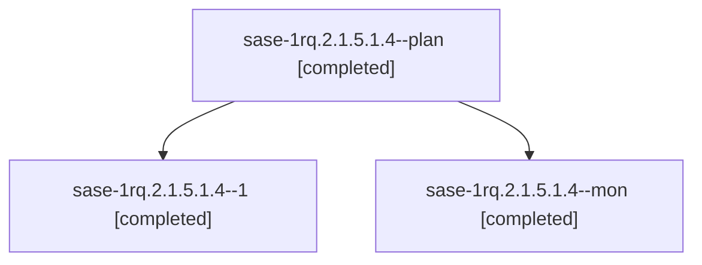

# Session: sase-1rq.2.1.5.1.4

[Agent Hoods](../README.md) / [bbugyi200](../users/bbugyi200/README.md) / [athena](../users/bbugyi200/machines/athena/README.md) / [sase-1rq](../users/bbugyi200/machines/athena/hoods/sase-1rq/README.md) / sase-1rq.2.1.5.1.4

Owner: `bbugyi200.athena` · Hood: `sase-1rq` · Members: 3 · Bead: [sase-1rq.2.1.5.1.4](https://github.com/sase-org/sase--beads/blob/main/pages/sase-1rq/sase-1rq.2.1.5.1.4.md)

## Lineage



The diagram is an optional enhancement; the ordered table below contains the same lineage in accessible text.

| Role | Agent | State | Model / provider | Timing | Commits | Prompt | Chat |
|---|---|---|---|---|---:|---|---|
| <a id="member-plan"></a>plan | sase-1rq.2.1.5.1.4--plan | completed | opus / claude | 2026-11-07T19:58:04.555603+00:00 → 2026-11-07T21:13:37.118781+00:00 | [1](../agents/bbugyi200.athena.sase-1rq.2.1.5.1.4--plan/README.md#commits) | [Prompt](../agents/bbugyi200.athena.sase-1rq.2.1.5.1.4--plan/prompt.md) | [Chat](../agents/bbugyi200.athena.sase-1rq.2.1.5.1.4--plan/chat.md) |
| <a id="member-1"></a>1 | sase-1rq.2.1.5.1.4--1 | completed | opus / claude | 2026-11-07T23:01:39.779589+00:00 → 2026-11-07T23:05:30.432374+00:00 | 0 | [Prompt](../agents/bbugyi200.athena.sase-1rq.2.1.5.1.4--1/prompt.md) | [Chat](../agents/bbugyi200.athena.sase-1rq.2.1.5.1.4--1/chat.md) |
| <a id="member-mon"></a>mon | sase-1rq.2.1.5.1.4--mon | completed | opus / claude | 2026-11-07T21:06:42.305667+00:00 → 2026-11-07T22:59:22.137637+00:00 | 0 | — | [Chat](../agents/bbugyi200.athena.sase-1rq.2.1.5.1.4--mon/chat.md) |

## Commits

| Role | Repo | Commit | Subject | Committed |
|---|---|---|---|---|
| plan | sase | [`dd5567e`](https://github.com/sase-org/sase/commit/dd5567e5801095c709f7145dd7d6cdfe2a7d8673) | fix(ci): land the AGENT PROMPT golden repair and capacity hostname pin | 2026-11-07 16:07:57 EST |

## Variables

| Role | Variable | Value |
|---|---|---|
| 1 | `ci_evidence` | {default\_branch: master, fixes: \[{name: files-reserve regression deterministic (sase-1rq.2.1.5.1.1), sha: da1561407ab03db299959ec3ab8e2a5fadafb1e3}, {name: Reply selection preserved across same-subje… |

#### ci_evidence

**Role:** `1`

```yaml
default_branch: master
fixes:
  - name: files-reserve regression deterministic (sase-1rq.2.1.5.1.1)
    sha: da1561407ab03db299959ec3ab8e2a5fadafb1e3
  - name: Reply selection preserved across same-subject delivery (sase-1rq.2.1.5.1.2)
    sha: 92fc89d83f062259857b6d8870996231ddd4315e
  - name: stranded modal + empty Beads captures stabilized (sase-1rq.2.1.5.1.3)
    sha: 960646e8cea50f80a19a08199be044fbfe55bf03
  - name: sase-1r2.6 109-golden AGENT PROMPT repair + capacity hostname pin, taken over and landed (FIX_SHA)
    sha: dd5567e5801095c709f7145dd7d6cdfe2a7d8673
notes:
  - Acceptance met: GitHub attempt 1 completed success; all ten executing jobs success; only docs-build and release-core-floor-smoke skipped (job names validated against .github/workflows/ci.yml).
  - All four fix SHAs verified ancestors of run head dd5567e580 via git merge-base --is-ancestor.
  - visual-test built-in recapture: counts created=0 updated=0 unchanged=1148 stale=0; 2 unstable nodes passed on recapture (listed in visual_recaptures); this is separate from GitHub's run attempt, which stayed 1.
  - origin/master at publish time is 291265f08a (two later commits); scheduled Full CI 42418116452 on the same SHA dd5567e580 was in_progress at publish time.
  - Reproduce: gh run list --repo sase-org/sase --workflow full.yml --branch master -L 5
quarantined: []
repo: sase-org/sase
runs:
  - attempt: 1
    completed_at: 2026-11-07T22:55:11Z
    conclusion: success
    created_at: 2026-11-07T21:09:39Z
    event: workflow_dispatch
    head_sha: dd5567e5801095c709f7145dd7d6cdfe2a7d8673
    jobs:
      ace-page-group-isolation: success
      build-core: success
      docs-build: skipped
      lint: success
      perf-floors: success
      prepare: success
      release-core-floor-smoke: skipped
      test (3.12): success
      test (3.13): success
      test (3.14): success
      tutorial-tests: success
      visual-test: success
    run_id: 42414511192
    url: https://github.com/sase-org/sase/actions/runs/42414511192
    workflow: full.yml
tip_sha: dd5567e5801095c709f7145dd7d6cdfe2a7d8673
visual_recaptures:
  - attempts: 2
    first_pass: 15s timeout waiting for SVG sentinel 'jump': footer still showed agent-row hints, reply-card focus had not landed
    node: tests/ace/tui/visual/test_ace_png_snapshots_agents_agent_session_panel_gate.py::test_agent_session_gate_turns_narrow_png_snapshot
  - attempts: 2
    first_pass: pixel mismatch: '1 newer' header label right-aligned ~4 columns off; related open bead sase-1f9
    node: tests/pager/visual/test_history_png_snapshots.py::test_history_png_snapshot[past-frame-False-size1]
```

Values are truncated for display; see each member's agent meta.json for the full values.

## Neighbors

| Agent | Relation | State |
|---|---|---|
| [sase-1rq.2.1.5](bbugyi200.athena.sase-1rq.2.1.5.md) (session · 3) | ancestor | active 1, completed 2 |
| [sase-1rq.2](bbugyi200.athena.sase-1rq.2.md) (session · 3) | ancestor | active 1, completed 2 |
| [sase-1rq.2.1.5.1.1](../agents/bbugyi200.athena.sase-1rq.2.1.5.1.1/README.md) | sase-1rq.2.1.5.1 hood | completed |
| [sase-1rq.2.1.5.1.2](../agents/bbugyi200.athena.sase-1rq.2.1.5.1.2/README.md) | sase-1rq.2.1.5.1 hood | completed |
| [sase-1rq.2.1.5.1.3](../agents/bbugyi200.athena.sase-1rq.2.1.5.1.3/README.md) | sase-1rq.2.1.5.1 hood | completed |
| [sase-1rq.2.1.5.1.land](../agents/bbugyi200.athena.sase-1rq.2.1.5.1.land/README.md) | sase-1rq.2.1.5.1 hood | completed |
| [sase-1rq.2.1.1](bbugyi200.athena.sase-1rq.2.1.1.md) (session · 3) | sase-1rq.2.1 hood | completed 3 |
| [sase-1rq.2.1.2](bbugyi200.athena.sase-1rq.2.1.2.md) (session · 3) | sase-1rq.2.1 hood | completed 3 |
| [sase-1rq.2.1.3](bbugyi200.athena.sase-1rq.2.1.3.md) (session · 5) | sase-1rq.2.1 hood | completed 4, failed 1 |
| [sase-1rq.2.1.4](bbugyi200.athena.sase-1rq.2.1.4.md) (session · 3) | sase-1rq.2.1 hood | active 1, completed 2 |
| [sase-1rq.2.1.4.1.1](bbugyi200.athena.sase-1rq.2.1.4.1.1.md) (session · 5) | sase-1rq.2.1 hood | completed 4, failed 1 |
| [sase-1rq.2.1.4.1.2](bbugyi200.athena.sase-1rq.2.1.4.1.2.md) (session · 3) | sase-1rq.2.1 hood | completed 2, failed 1 |
| [sase-1rq.2.1.4.1.3](bbugyi200.athena.sase-1rq.2.1.4.1.3.md) (session · 2) | sase-1rq.2.1 hood | active 1, completed 1 |
| [sase-1rq.2.1.4.1.4](../agents/bbugyi200.athena.sase-1rq.2.1.4.1.4/README.md) | sase-1rq.2.1 hood | waiting |
| [sase-1rq.2.1.4.1.land](../agents/bbugyi200.athena.sase-1rq.2.1.4.1.land/README.md) | sase-1rq.2.1 hood | waiting |
| [sase-1rq.2.1.6](../agents/bbugyi200.athena.sase-1rq.2.1.6/README.md) | sase-1rq.2.1 hood | completed |
| [sase-1rq.2.1.7](../agents/bbugyi200.athena.sase-1rq.2.1.7/README.md) | sase-1rq.2.1 hood | waiting |
| [sase-1rq.2.1.land](../agents/bbugyi200.athena.sase-1rq.2.1.land/README.md) | sase-1rq.2.1 hood | waiting |
| [sase-1rq.1](bbugyi200.athena.sase-1rq.1.md) (session · 9) | sase-1rq hood | completed 9 |
| [sase-1rq.3](bbugyi200.athena.sase-1rq.3.md) (session · 3) | sase-1rq hood | active 1, completed 2 |
| [sase-1rq.3.1.1](../agents/bbugyi200.athena.sase-1rq.3.1.1/README.md) | sase-1rq hood | completed |
| [sase-1rq.3.1.2](../agents/bbugyi200.athena.sase-1rq.3.1.2/README.md) | sase-1rq hood | completed |
| [sase-1rq.3.1.3](bbugyi200.athena.sase-1rq.3.1.3.md) (session · 5) | sase-1rq hood | completed 5 |
| [sase-1rq.3.1.4](bbugyi200.athena.sase-1rq.3.1.4.md) (session · 3) | sase-1rq hood | completed 3 |
| [sase-1rq.3.1.land](../agents/bbugyi200.athena.sase-1rq.3.1.land/README.md) | sase-1rq hood | completed |
| [sase-1rq.4](bbugyi200.athena.sase-1rq.4.md) (session · 3) | sase-1rq hood | active 1, completed 2 |
| [sase-1rq.4.1.1](bbugyi200.athena.sase-1rq.4.1.1.md) (session · 15) | sase-1rq hood | completed 11, failed 4 |
| [sase-1rq.4.1.2](bbugyi200.athena.sase-1rq.4.1.2.md) (session · 3) | sase-1rq hood | completed 2, failed 1 |
| [sase-1rq.4.1.3](bbugyi200.athena.sase-1rq.4.1.3.md) (session · 5) | sase-1rq hood | completed 5 |
| [sase-1rq.4.1.4](../agents/bbugyi200.athena.sase-1rq.4.1.4/README.md) | sase-1rq hood | completed |
| [sase-1rq.4.1.land](../agents/bbugyi200.athena.sase-1rq.4.1.land/README.md) | sase-1rq hood | completed |
| [sase-1rq.5](bbugyi200.athena.sase-1rq.5.md) (session · 5) | sase-1rq hood | completed 4, failed 1 |
| [sase-1rq.land](../agents/bbugyi200.athena.sase-1rq.land/README.md) | sase-1rq hood | waiting |
