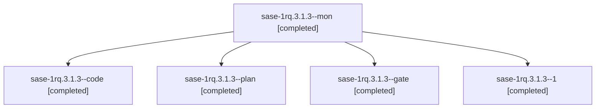

# Session: sase-1rq.3.1.3

[Agent Hoods](../README.md) / [bbugyi200](../users/bbugyi200/README.md) / [athena](../users/bbugyi200/machines/athena/README.md) / [sase-1rq](../users/bbugyi200/machines/athena/hoods/sase-1rq/README.md) / sase-1rq.3.1.3

Owner: `bbugyi200.athena` · Hood: `sase-1rq` · Members: 5 · Bead: [sase-1rq.3.1.3](https://github.com/sase-org/sase--beads/blob/main/pages/sase-1rq/sase-1rq.3.1.3.md)

## Lineage



The diagram is an optional enhancement; the ordered table below contains the same lineage in accessible text.

| Role | Agent | State | Model / provider | Timing | Commits | Prompt | Chat |
|---|---|---|---|---|---:|---|---|
| <a id="member-mon"></a>mon | sase-1rq.3.1.3--mon | completed | opus / claude | 2026-11-07T16:14:32.202549+00:00 → 2026-11-07T16:43:15.443748+00:00 | 0 | — | [Chat](../agents/bbugyi200.athena.sase-1rq.3.1.3--mon/chat.md) |
| <a id="member-code"></a>code | sase-1rq.3.1.3--code | completed | opus / claude | 2026-11-07T14:56:57.233242+00:00 → 2026-11-07T16:15:17.984370+00:00 | 0 | — | [Chat](../agents/bbugyi200.athena.sase-1rq.3.1.3--code/chat.md) |
| <a id="member-plan"></a>plan | sase-1rq.3.1.3--plan | completed | gpt-6-astra / codex | 2026-11-07T14:46:12.241400+00:00 → 2026-11-07T16:15:17.984370+00:00 | 0 | [Prompt](../agents/bbugyi200.athena.sase-1rq.3.1.3--plan/prompt.md) | [Chat](../agents/bbugyi200.athena.sase-1rq.3.1.3--plan/chat.md) |
| <a id="member-gate"></a>gate | sase-1rq.3.1.3--gate | completed | gpt-6-astra / codex | 2026-11-07T14:54:38.486342+00:00 → 2026-11-07T14:56:07.732253+00:00 | 0 | — | [Chat](../agents/bbugyi200.athena.sase-1rq.3.1.3--gate/chat.md) |
| <a id="member-1"></a>1 | sase-1rq.3.1.3--1 | completed | opus / claude | 2026-11-07T17:10:16.970476+00:00 → 2026-11-07T17:11:57.835119+00:00 | 0 | [Prompt](../agents/bbugyi200.athena.sase-1rq.3.1.3--1/prompt.md) | [Chat](../agents/bbugyi200.athena.sase-1rq.3.1.3--1/chat.md) |

## Variables

| Role | Variable | Value |
|---|---|---|
| code | `artifacts` | \[{bead: sase-1rq.3.1.3, kind: markdown, label: bob-cli macOS full-suite evidence (sase-1rq.3.1.3), path: /home/bryan/.sase/artifacts/agents/gh\_sase-org\_\_sase/20261107095617/bob\_cli\_mac\_full\_suite\_evi… |

#### artifacts

**Role:** `code`

```yaml
- bead: sase-1rq.3.1.3
  kind: markdown
  label: bob-cli macOS full-suite evidence (sase-1rq.3.1.3)
  path: /home/bryan/.sase/artifacts/agents/gh_sase-org__sase/20261107095617/bob_cli_mac_full_suite_evidence-a360de82c09c.md
  ref: file:explicit:7a3c11fee06bb3820c7abeb6
  source_path: /tmp/sase-1rq.3.1.3-tools/evidence/bob_cli_mac_full_suite_evidence.md
- bead: sase-1rq.3.1.3
  kind: file
  label: Mac local just lint log, 41a2de71 (sase-1rq.3.1.3)
  path: /home/bryan/.sase/artifacts/agents/gh_sase-org__sase/20261107095617/lint-9ac9d426e5c7.log
  ref: file:explicit:ba3d43c93e720cbed79b4a53
  source_path: /tmp/sase-1rq.3.1.3-tools/mac-logs/full/lint.log
- bead: sase-1rq.3.1.3
  kind: file
  label: Mac cargo metadata, 41a2de71 (sase-1rq.3.1.3)
  path: /home/bryan/.sase/artifacts/agents/gh_sase-org__sase/20261107095617/meta-4bc341dd720d.log
  ref: file:explicit:bb83455551e913b4ae597bd8
  source_path: /tmp/sase-1rq.3.1.3-tools/mac-logs/full/meta.log
- bead: sase-1rq.3.1.3
  kind: file
  label: Mac tool versions and env (sase-1rq.3.1.3)
  path: /home/bryan/.sase/artifacts/agents/gh_sase-org__sase/20261107095617/tool-versions-70a86609e8ff.txt
  ref: file:explicit:aa617393b7739ef3806c210d
  source_path: /tmp/sase-1rq.3.1.3-tools/mac-logs/full/tool-versions.txt
```

Values are truncated for display; see each member's agent meta.json for the full values.

## Neighbors

| Agent | Relation | State |
|---|---|---|
| [sase-1rq.3](bbugyi200.athena.sase-1rq.3.md) (session · 3) | ancestor | active 1, completed 2 |
| [sase-1rq.3.1.1](../agents/bbugyi200.athena.sase-1rq.3.1.1/README.md) | sase-1rq.3.1 hood | completed |
| [sase-1rq.3.1.2](../agents/bbugyi200.athena.sase-1rq.3.1.2/README.md) | sase-1rq.3.1 hood | completed |
| [sase-1rq.3.1.4](bbugyi200.athena.sase-1rq.3.1.4.md) (session · 3) | sase-1rq.3.1 hood | completed 3 |
| [sase-1rq.3.1.land](../agents/bbugyi200.athena.sase-1rq.3.1.land/README.md) | sase-1rq.3.1 hood | completed |
| [sase-1rq.1](bbugyi200.athena.sase-1rq.1.md) (session · 9) | sase-1rq hood | completed 9 |
| [sase-1rq.2](bbugyi200.athena.sase-1rq.2.md) (session · 3) | sase-1rq hood | active 1, completed 2 |
| [sase-1rq.2.1.1](bbugyi200.athena.sase-1rq.2.1.1.md) (session · 3) | sase-1rq hood | completed 3 |
| [sase-1rq.2.1.2](bbugyi200.athena.sase-1rq.2.1.2.md) (session · 3) | sase-1rq hood | completed 3 |
| [sase-1rq.2.1.3](bbugyi200.athena.sase-1rq.2.1.3.md) (session · 5) | sase-1rq hood | completed 4, failed 1 |
| [sase-1rq.2.1.4](bbugyi200.athena.sase-1rq.2.1.4.md) (session · 3) | sase-1rq hood | active 1, completed 2 |
| [sase-1rq.2.1.4.1.1](bbugyi200.athena.sase-1rq.2.1.4.1.1.md) (session · 5) | sase-1rq hood | completed 4, failed 1 |
| [sase-1rq.2.1.4.1.2](bbugyi200.athena.sase-1rq.2.1.4.1.2.md) (session · 3) | sase-1rq hood | completed 2, failed 1 |
| [sase-1rq.2.1.4.1.3](bbugyi200.athena.sase-1rq.2.1.4.1.3.md) (session · 3) | sase-1rq hood | completed 2, failed 1 |
| [sase-1rq.2.1.4.1.4](bbugyi200.athena.sase-1rq.2.1.4.1.4.md) (session · 3) | sase-1rq hood | completed 2, failed 1 |
| [sase-1rq.2.1.4.1.5.1](bbugyi200.athena.sase-1rq.2.1.4.1.5.1.md) (session · 5) | sase-1rq hood | completed 4, failed 1 |
| [sase-1rq.2.1.4.1.5.2](bbugyi200.athena.sase-1rq.2.1.4.1.5.2.md) (session · 6) | sase-1rq hood | active 1, completed 3, failed 2 |
| [sase-1rq.2.1.4.1.5.3](../agents/bbugyi200.athena.sase-1rq.2.1.4.1.5.3/README.md) | sase-1rq hood | waiting |
| [sase-1rq.2.1.4.1.5.land](../agents/bbugyi200.athena.sase-1rq.2.1.4.1.5.land/README.md) | sase-1rq hood | waiting |
| [sase-1rq.2.1.4.1.land](bbugyi200.athena.sase-1rq.2.1.4.1.land.md) (session · 3) | sase-1rq hood | active 1, completed 2 |
| [sase-1rq.2.1.5](bbugyi200.athena.sase-1rq.2.1.5.md) (session · 3) | sase-1rq hood | active 1, completed 2 |
| [sase-1rq.2.1.5.1.1](../agents/bbugyi200.athena.sase-1rq.2.1.5.1.1/README.md) | sase-1rq hood | completed |
| [sase-1rq.2.1.5.1.2](../agents/bbugyi200.athena.sase-1rq.2.1.5.1.2/README.md) | sase-1rq hood | completed |
| [sase-1rq.2.1.5.1.3](../agents/bbugyi200.athena.sase-1rq.2.1.5.1.3/README.md) | sase-1rq hood | completed |
| [sase-1rq.2.1.5.1.4](bbugyi200.athena.sase-1rq.2.1.5.1.4.md) (session · 3) | sase-1rq hood | completed 3 |
| [sase-1rq.2.1.5.1.land](../agents/bbugyi200.athena.sase-1rq.2.1.5.1.land/README.md) | sase-1rq hood | completed |
| [sase-1rq.2.1.6](../agents/bbugyi200.athena.sase-1rq.2.1.6/README.md) | sase-1rq hood | completed |
| [sase-1rq.2.1.7](../agents/bbugyi200.athena.sase-1rq.2.1.7/README.md) | sase-1rq hood | waiting |
| [sase-1rq.2.1.land](../agents/bbugyi200.athena.sase-1rq.2.1.land/README.md) | sase-1rq hood | waiting |
| [sase-1rq.4](bbugyi200.athena.sase-1rq.4.md) (session · 3) | sase-1rq hood | active 1, completed 2 |
| [sase-1rq.4.1.1](bbugyi200.athena.sase-1rq.4.1.1.md) (session · 15) | sase-1rq hood | completed 11, failed 4 |
| [sase-1rq.4.1.2](bbugyi200.athena.sase-1rq.4.1.2.md) (session · 3) | sase-1rq hood | completed 2, failed 1 |
| [sase-1rq.4.1.3](bbugyi200.athena.sase-1rq.4.1.3.md) (session · 5) | sase-1rq hood | completed 5 |
| [sase-1rq.4.1.4](../agents/bbugyi200.athena.sase-1rq.4.1.4/README.md) | sase-1rq hood | completed |
| [sase-1rq.4.1.land](../agents/bbugyi200.athena.sase-1rq.4.1.land/README.md) | sase-1rq hood | completed |
| [sase-1rq.5](bbugyi200.athena.sase-1rq.5.md) (session · 5) | sase-1rq hood | completed 4, failed 1 |
| [sase-1rq.land](../agents/bbugyi200.athena.sase-1rq.land/README.md) | sase-1rq hood | waiting |
