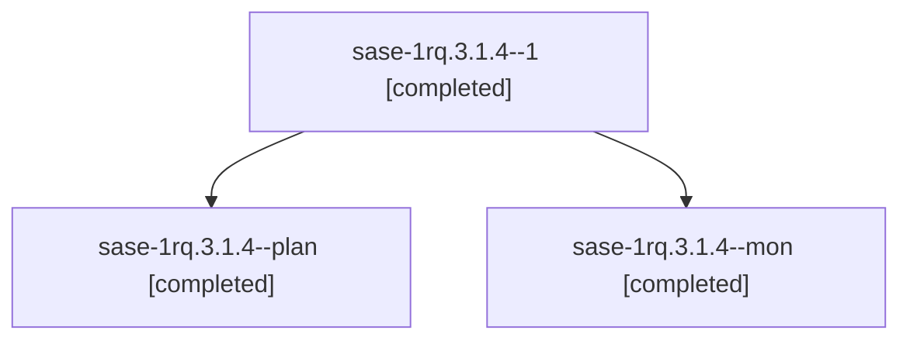

# Session: sase-1rq.3.1.4

[Agent Hoods](../README.md) / [bbugyi200](../users/bbugyi200/README.md) / [athena](../users/bbugyi200/machines/athena/README.md) / [sase-1rq](../users/bbugyi200/machines/athena/hoods/sase-1rq/README.md) / sase-1rq.3.1.4

Owner: `bbugyi200.athena` · Hood: `sase-1rq` · Members: 3 · Bead: [sase-1rq.3.1.4](https://github.com/sase-org/sase--beads/blob/main/pages/sase-1rq/sase-1rq.3.1.4.md)

## Lineage



The diagram is an optional enhancement; the ordered table below contains the same lineage in accessible text.

| Role | Agent | State | Model / provider | Timing | Commits | Prompt | Chat |
|---|---|---|---|---|---:|---|---|
| <a id="member-1"></a>1 | sase-1rq.3.1.4--1 | completed | opus / claude | 2026-11-07T18:43:16.254768+00:00 → 2026-11-07T18:45:34.032357+00:00 | 0 | [Prompt](../agents/bbugyi200.athena.sase-1rq.3.1.4--1/prompt.md) | [Chat](../agents/bbugyi200.athena.sase-1rq.3.1.4--1/chat.md) |
| <a id="member-plan"></a>plan | sase-1rq.3.1.4--plan | completed | opus / claude | 2026-11-07T17:36:39.804907+00:00 → 2026-11-07T17:43:48.964030+00:00 | 0 | [Prompt](../agents/bbugyi200.athena.sase-1rq.3.1.4--plan/prompt.md) | [Chat](../agents/bbugyi200.athena.sase-1rq.3.1.4--plan/chat.md) |
| <a id="member-mon"></a>mon | sase-1rq.3.1.4--mon | completed | opus / claude | 2026-11-07T17:43:19.741374+00:00 → 2026-11-07T18:09:51.136577+00:00 | 0 | — | [Chat](../agents/bbugyi200.athena.sase-1rq.3.1.4--mon/chat.md) |

## Variables

| Role | Variable | Value |
|---|---|---|
| 1 | `ci_evidence` | {default\_branch: master, fixes: \[{phase: lint-incremental (sase-1rq.3.1.1), sha: b8c417f0ba1995ee24c6e75a35de61128b0028c9, summary: install\_ui EarnedEta test made hermetic: Sandbox.base\_env scrubs CA… |

#### ci_evidence

**Role:** `1`

```yaml
default_branch: master
fixes:
  - phase: lint-incremental (sase-1rq.3.1.1)
    sha: b8c417f0ba1995ee24c6e75a35de61128b0028c9
    summary: install_ui EarnedEta test made hermetic: Sandbox.base_env scrubs CARGO_INCREMENTAL
  - phase: mac-known-failures (sase-1rq.3.1.2)
    sha: 41a2de71e669905adfef834fb3a0dbe8f9bfb43f
    summary: APFS-safe test names, gmail link vault-canonicalization production fix, clipboard_status test isolation, deterministic paste flow plus open/xdg-open shims for Google login tests
  - phase: mac-full-suite (sase-1rq.3.1.3)
    sha: null
    summary: no source changes landed; full macOS suite verified green
notes:
  - clippy result_large_err warnings are advisory and were deliberately left alone; the lint job actually failed in check-scripts, not clippy
  - tip 63836395 is the bot-pushed v0.5.0 release commit (version/lockfile/changelog only) which got no push CI, so it was verified by workflow_dispatch run 42397613232
  - PROPOSED FOLLOW-UP notes: sase-1rq.3.1.1 and sase-1rq.3.1.2 (install_ui live-runner PTY test); sase-1rq.3.1.3 (bob-cli macOS CI build-time headroom)
quarantined: []
repo: bobs-org/bob-cli
runs:
  - attempt: 1
    completed_at: 2026-11-07T18:06:30Z
    conclusion: success
    event: workflow_dispatch
    head_sha: 63836395ab3351a14a7644f8edd615d33c2ae9cd
    jobs:
      lint: success
      package: success
      test (macos-latest): success
      test (ubuntu-latest): success
    run_id: 42397613232
    url: https://github.com/bobs-org/bob-cli/actions/runs/42397613232
    workflow: CI (ci.yml)
  - attempt: 1
    completed_at: 2026-11-07T15:12:54Z
    conclusion: success
    event: push
    head_sha: 41a2de71e669905adfef834fb3a0dbe8f9bfb43f
    jobs:
      lint: success
      package: success
      test (macos-latest): success
      test (ubuntu-latest): success
    run_id: 42382951164
    url: https://github.com/bobs-org/bob-cli/actions/runs/42382951164
    workflow: CI (ci.yml)
tip_sha: 63836395ab3351a14a7644f8edd615d33c2ae9cd
```

Values are truncated for display; see each member's agent meta.json for the full values.

## Neighbors

| Agent | Relation | State |
|---|---|---|
| [sase-1rq.3](bbugyi200.athena.sase-1rq.3.md) (session · 3) | ancestor | active 1, completed 2 |
| [sase-1rq.3.1.1](../agents/bbugyi200.athena.sase-1rq.3.1.1/README.md) | sase-1rq.3.1 hood | completed |
| [sase-1rq.3.1.2](../agents/bbugyi200.athena.sase-1rq.3.1.2/README.md) | sase-1rq.3.1 hood | completed |
| [sase-1rq.3.1.3](bbugyi200.athena.sase-1rq.3.1.3.md) (session · 5) | sase-1rq.3.1 hood | completed 5 |
| [sase-1rq.3.1.land](../agents/bbugyi200.athena.sase-1rq.3.1.land/README.md) | sase-1rq.3.1 hood | completed |
| [sase-1rq.1](bbugyi200.athena.sase-1rq.1.md) (session · 9) | sase-1rq hood | completed 9 |
| [sase-1rq.2](bbugyi200.athena.sase-1rq.2.md) (session · 3) | sase-1rq hood | active 1, completed 2 |
| [sase-1rq.2.1.1](bbugyi200.athena.sase-1rq.2.1.1.md) (session · 3) | sase-1rq hood | completed 3 |
| [sase-1rq.2.1.2](bbugyi200.athena.sase-1rq.2.1.2.md) (session · 3) | sase-1rq hood | completed 3 |
| [sase-1rq.2.1.3](bbugyi200.athena.sase-1rq.2.1.3.md) (session · 4) | sase-1rq hood | active 1, completed 3 |
| [sase-1rq.2.1.4](bbugyi200.athena.sase-1rq.2.1.4.md) (session · 3) | sase-1rq hood | active 1, completed 2 |
| [sase-1rq.2.1.4.1.1](bbugyi200.athena.sase-1rq.2.1.4.1.1.md) (session · 5) | sase-1rq hood | completed 4, failed 1 |
| [sase-1rq.2.1.4.1.2](../agents/bbugyi200.athena.sase-1rq.2.1.4.1.2/README.md) | sase-1rq hood | waiting |
| [sase-1rq.2.1.4.1.3](../agents/bbugyi200.athena.sase-1rq.2.1.4.1.3/README.md) | sase-1rq hood | waiting |
| [sase-1rq.2.1.4.1.4](../agents/bbugyi200.athena.sase-1rq.2.1.4.1.4/README.md) | sase-1rq hood | waiting |
| [sase-1rq.2.1.4.1.land](../agents/bbugyi200.athena.sase-1rq.2.1.4.1.land/README.md) | sase-1rq hood | waiting |
| [sase-1rq.2.1.5](bbugyi200.athena.sase-1rq.2.1.5.md) (session · 3) | sase-1rq hood | active 1, completed 2 |
| [sase-1rq.2.1.5.1.1](../agents/bbugyi200.athena.sase-1rq.2.1.5.1.1/README.md) | sase-1rq hood | completed |
| [sase-1rq.2.1.5.1.2](../agents/bbugyi200.athena.sase-1rq.2.1.5.1.2/README.md) | sase-1rq hood | completed |
| [sase-1rq.2.1.5.1.3](../agents/bbugyi200.athena.sase-1rq.2.1.5.1.3/README.md) | sase-1rq hood | waiting |
| [sase-1rq.2.1.5.1.4](../agents/bbugyi200.athena.sase-1rq.2.1.5.1.4/README.md) | sase-1rq hood | waiting |
| [sase-1rq.2.1.5.1.land](../agents/bbugyi200.athena.sase-1rq.2.1.5.1.land/README.md) | sase-1rq hood | waiting |
| [sase-1rq.2.1.6](../agents/bbugyi200.athena.sase-1rq.2.1.6/README.md) | sase-1rq hood | completed |
| [sase-1rq.2.1.7](../agents/bbugyi200.athena.sase-1rq.2.1.7/README.md) | sase-1rq hood | waiting |
| [sase-1rq.2.1.land](../agents/bbugyi200.athena.sase-1rq.2.1.land/README.md) | sase-1rq hood | waiting |
| [sase-1rq.4](bbugyi200.athena.sase-1rq.4.md) (session · 3) | sase-1rq hood | active 1, completed 2 |
| [sase-1rq.4.1.1](bbugyi200.athena.sase-1rq.4.1.1.md) (session · 15) | sase-1rq hood | completed 11, failed 4 |
| [sase-1rq.4.1.2](bbugyi200.athena.sase-1rq.4.1.2.md) (session · 3) | sase-1rq hood | completed 2, failed 1 |
| [sase-1rq.4.1.3](bbugyi200.athena.sase-1rq.4.1.3.md) (session · 4) | sase-1rq hood | active 1, completed 3 |
| [sase-1rq.4.1.4](../agents/bbugyi200.athena.sase-1rq.4.1.4/README.md) | sase-1rq hood | waiting |
| [sase-1rq.4.1.land](../agents/bbugyi200.athena.sase-1rq.4.1.land/README.md) | sase-1rq hood | waiting |
| [sase-1rq.5](bbugyi200.athena.sase-1rq.5.md) (session · 5) | sase-1rq hood | completed 4, failed 1 |
| [sase-1rq.land](../agents/bbugyi200.athena.sase-1rq.land/README.md) | sase-1rq hood | waiting |
