# Session: sase-1rq.4.1.1

[Agent Hoods](../README.md) / [bbugyi200](../users/bbugyi200/README.md) / [athena](../users/bbugyi200/machines/athena/README.md) / [sase-1rq](../users/bbugyi200/machines/athena/hoods/sase-1rq/README.md) / sase-1rq.4.1.1

Owner: `bbugyi200.athena` · Hood: `sase-1rq` · Members: 15 · Bead: [sase-1rq.4.1.1](https://github.com/sase-org/sase--beads/blob/main/pages/sase-1rq/sase-1rq.4.1.1.md)

## Lineage

```mermaid
flowchart TD
  n0["sase-1rq.4.1.1--mon-2 [failed]"]
  n1["sase-1rq.4.1.1--mon-4 [completed]"]
  n0 --> n1
  n2["sase-1rq.4.1.1--4 [completed]"]
  n0 --> n2
  n3["sase-1rq.4.1.1--1 [completed]"]
  n0 --> n3
  n4["sase-1rq.4.1.1--mon-1 [failed]"]
  n0 --> n4
  n5["sase-1rq.4.1.1--3 [completed]"]
  n0 --> n5
  n6["sase-1rq.4.1.1--5 [completed]"]
  n0 --> n6
  n7["sase-1rq.4.1.1--mon-0 [failed]"]
  n0 --> n7
  n8["sase-1rq.4.1.1--6 [completed]"]
  n0 --> n8
  n9["sase-1rq.4.1.1--plan [completed]"]
  n0 --> n9
  n10["sase-1rq.4.1.1--mon-3 [completed]"]
  n0 --> n10
  n11["sase-1rq.4.1.1--2 [completed]"]
  n0 --> n11
  n12["sase-1rq.4.1.1--gate [completed]"]
  n0 --> n12
  n13["sase-1rq.4.1.1--mon [failed]"]
  n0 --> n13
  n14["sase-1rq.4.1.1--code [completed]"]
  n0 --> n14
```

The diagram is an optional enhancement; the ordered table below contains the same lineage in accessible text.

| Role | Agent | State | Model / provider | Timing | Commits | Prompt | Chat |
|---|---|---|---|---|---:|---|---|
| mon-2 | sase-1rq.4.1.1--mon-2 | failed | grok-4.6 / grok | 2026-11-07T15:33:26.581667+00:00 → 2026-11-07T15:51:14.562132+00:00 | 0 | — | [Chat](../agents/bbugyi200.athena.sase-1rq.4.1.1--mon-2/chat.md) |
| mon-4 | sase-1rq.4.1.1--mon-4 | completed | grok-4.6 / grok | 2026-11-07T17:16:33.131094+00:00 → 2026-11-07T17:44:21.390780+00:00 | 0 | — | [Chat](../agents/bbugyi200.athena.sase-1rq.4.1.1--mon-4/chat.md) |
| 4 | sase-1rq.4.1.1--4 | completed | grok-4.6 / grok | 2026-11-07T16:15:27.623459+00:00 → 2026-11-07T16:39:37.136925+00:00 | 0 | [Prompt](../agents/bbugyi200.athena.sase-1rq.4.1.1--4/prompt.md) | [Chat](../agents/bbugyi200.athena.sase-1rq.4.1.1--4/chat.md) |
| 1 | sase-1rq.4.1.1--1 | completed | grok-4.6 / grok | 2026-11-07T14:00:24.264203+00:00 → 2026-11-07T14:25:34.096438+00:00 | 0 | [Prompt](../agents/bbugyi200.athena.sase-1rq.4.1.1--1/prompt.md) | [Chat](../agents/bbugyi200.athena.sase-1rq.4.1.1--1/chat.md) |
| mon-1 | sase-1rq.4.1.1--mon-1 | failed | grok-4.6 / grok | 2026-11-07T15:03:49.666461+00:00 → 2026-11-07T15:23:19.172007+00:00 | 0 | — | [Chat](../agents/bbugyi200.athena.sase-1rq.4.1.1--mon-1/chat.md) |
| 3 | sase-1rq.4.1.1--3 | completed | grok-4.6 / grok | 2026-11-07T15:25:36.808703+00:00 → 2026-11-07T15:35:53.824054+00:00 | 0 | [Prompt](../agents/bbugyi200.athena.sase-1rq.4.1.1--3/prompt.md) | [Chat](../agents/bbugyi200.athena.sase-1rq.4.1.1--3/chat.md) |
| 5 | sase-1rq.4.1.1--5 | completed | grok-4.6 / grok | 2026-11-07T17:12:29.354324+00:00 → 2026-11-07T17:19:03.686166+00:00 | 0 | [Prompt](../agents/bbugyi200.athena.sase-1rq.4.1.1--5/prompt.md) | [Chat](../agents/bbugyi200.athena.sase-1rq.4.1.1--5/chat.md) |
| mon-0 | sase-1rq.4.1.1--mon-0 | failed | grok-4.6 / grok | 2026-11-07T14:24:04.022729+00:00 → 2026-11-07T14:40:58.562138+00:00 | 0 | — | [Chat](../agents/bbugyi200.athena.sase-1rq.4.1.1--mon-0/chat.md) |
| 6 | sase-1rq.4.1.1--6 | completed | grok-4.6 / grok | 2026-11-07T17:44:36.376775+00:00 → 2026-11-07T17:49:05.195519+00:00 | 0 | [Prompt](../agents/bbugyi200.athena.sase-1rq.4.1.1--6/prompt.md) | [Chat](../agents/bbugyi200.athena.sase-1rq.4.1.1--6/chat.md) |
| plan | sase-1rq.4.1.1--plan | completed | gpt-6-astra / codex | 2026-11-07T13:07:52.306892+00:00 → 2026-11-07T13:42:19.132322+00:00 | 0 | [Prompt](../agents/bbugyi200.athena.sase-1rq.4.1.1--plan/prompt.md) | [Chat](../agents/bbugyi200.athena.sase-1rq.4.1.1--plan/chat.md) |
| mon-3 | sase-1rq.4.1.1--mon-3 | completed | grok-4.6 / grok | 2026-11-07T16:38:22.913086+00:00 → 2026-11-07T17:08:42.445822+00:00 | 0 | — | [Chat](../agents/bbugyi200.athena.sase-1rq.4.1.1--mon-3/chat.md) |
| 2 | sase-1rq.4.1.1--2 | completed | grok-4.6 / grok | 2026-11-07T14:43:08.205549+00:00 → 2026-11-07T15:05:00.743612+00:00 | 0 | [Prompt](../agents/bbugyi200.athena.sase-1rq.4.1.1--2/prompt.md) | [Chat](../agents/bbugyi200.athena.sase-1rq.4.1.1--2/chat.md) |
| gate | sase-1rq.4.1.1--gate | completed | gpt-6-astra / codex | 2026-11-07T13:15:40.388165+00:00 → 2026-11-07T13:16:53.989582+00:00 | 0 | — | [Chat](../agents/bbugyi200.athena.sase-1rq.4.1.1--gate/chat.md) |
| mon | sase-1rq.4.1.1--mon | failed | grok-4.6 / grok | 2026-11-07T13:41:06.944224+00:00 → 2026-11-07T13:58:08.455592+00:00 | 0 | — | [Chat](../agents/bbugyi200.athena.sase-1rq.4.1.1--mon/chat.md) |
| code | sase-1rq.4.1.1--code | completed | grok-4.6 / grok | 2026-11-07T13:17:31.549587+00:00 → 2026-11-07T13:42:19.132322+00:00 | 0 | — | [Chat](../agents/bbugyi200.athena.sase-1rq.4.1.1--code/chat.md) |

## Neighbors

| Agent | Relation | State |
|---|---|---|
| [sase-1rq.4](bbugyi200.athena.sase-1rq.4.md) (session · 3) | ancestor | active 1, completed 2 |
| [sase-1rq.4.1.2](bbugyi200.athena.sase-1rq.4.1.2.md) (session · 3) | sase-1rq.4.1 hood | completed 2, failed 1 |
| [sase-1rq.4.1.3](../agents/bbugyi200.athena.sase-1rq.4.1.3/README.md) | sase-1rq.4.1 hood | active |
| [sase-1rq.4.1.4](../agents/bbugyi200.athena.sase-1rq.4.1.4/README.md) | sase-1rq.4.1 hood | waiting |
| [sase-1rq.4.1.land](../agents/bbugyi200.athena.sase-1rq.4.1.land/README.md) | sase-1rq.4.1 hood | waiting |
| [sase-1rq.1](bbugyi200.athena.sase-1rq.1.md) (session · 9) | sase-1rq hood | completed 9 |
| [sase-1rq.2](bbugyi200.athena.sase-1rq.2.md) (session · 3) | sase-1rq hood | active 1, completed 2 |
| [sase-1rq.2.1.1](bbugyi200.athena.sase-1rq.2.1.1.md) (session · 3) | sase-1rq hood | completed 3 |
| [sase-1rq.2.1.2](bbugyi200.athena.sase-1rq.2.1.2.md) (session · 3) | sase-1rq hood | completed 3 |
| [sase-1rq.2.1.3](bbugyi200.athena.sase-1rq.2.1.3.md) (session · 3) | sase-1rq hood | active 2, completed 1 |
| [sase-1rq.2.1.4](bbugyi200.athena.sase-1rq.2.1.4.md) (session · 3) | sase-1rq hood | active 1, completed 2 |
| [sase-1rq.2.1.4.1.1](bbugyi200.athena.sase-1rq.2.1.4.1.1.md) (session · 4) | sase-1rq hood | active 1, completed 2, failed 1 |
| [sase-1rq.2.1.4.1.2](../agents/bbugyi200.athena.sase-1rq.2.1.4.1.2/README.md) | sase-1rq hood | waiting |
| [sase-1rq.2.1.4.1.3](../agents/bbugyi200.athena.sase-1rq.2.1.4.1.3/README.md) | sase-1rq hood | waiting |
| [sase-1rq.2.1.4.1.4](../agents/bbugyi200.athena.sase-1rq.2.1.4.1.4/README.md) | sase-1rq hood | waiting |
| [sase-1rq.2.1.4.1.land](../agents/bbugyi200.athena.sase-1rq.2.1.4.1.land/README.md) | sase-1rq hood | waiting |
| [sase-1rq.2.1.5](bbugyi200.athena.sase-1rq.2.1.5.md) (session · 3) | sase-1rq hood | active 1, completed 2 |
| [sase-1rq.2.1.5.1.1](../agents/bbugyi200.athena.sase-1rq.2.1.5.1.1/README.md) | sase-1rq hood | completed |
| [sase-1rq.2.1.5.1.2](../agents/bbugyi200.athena.sase-1rq.2.1.5.1.2/README.md) | sase-1rq hood | completed |
| [sase-1rq.2.1.5.1.3](../agents/bbugyi200.athena.sase-1rq.2.1.5.1.3/README.md) | sase-1rq hood | waiting |
| [sase-1rq.2.1.5.1.4](../agents/bbugyi200.athena.sase-1rq.2.1.5.1.4/README.md) | sase-1rq hood | waiting |
| [sase-1rq.2.1.5.1.land](../agents/bbugyi200.athena.sase-1rq.2.1.5.1.land/README.md) | sase-1rq hood | waiting |
| [sase-1rq.2.1.6](../agents/bbugyi200.athena.sase-1rq.2.1.6/README.md) | sase-1rq hood | completed |
| [sase-1rq.2.1.7](../agents/bbugyi200.athena.sase-1rq.2.1.7/README.md) | sase-1rq hood | waiting |
| [sase-1rq.2.1.land](../agents/bbugyi200.athena.sase-1rq.2.1.land/README.md) | sase-1rq hood | waiting |
| [sase-1rq.3](bbugyi200.athena.sase-1rq.3.md) (session · 3) | sase-1rq hood | active 1, completed 2 |
| [sase-1rq.3.1.1](../agents/bbugyi200.athena.sase-1rq.3.1.1/README.md) | sase-1rq hood | completed |
| [sase-1rq.3.1.2](../agents/bbugyi200.athena.sase-1rq.3.1.2/README.md) | sase-1rq hood | completed |
| [sase-1rq.3.1.3](bbugyi200.athena.sase-1rq.3.1.3.md) (session · 5) | sase-1rq hood | completed 5 |
| [sase-1rq.3.1.4](bbugyi200.athena.sase-1rq.3.1.4.md) (session · 3) | sase-1rq hood | completed 2, waiting 1 |
| [sase-1rq.3.1.land](../agents/bbugyi200.athena.sase-1rq.3.1.land/README.md) | sase-1rq hood | waiting |
| [sase-1rq.5](bbugyi200.athena.sase-1rq.5.md) (session · 5) | sase-1rq hood | completed 4, failed 1 |
| [sase-1rq.land](../agents/bbugyi200.athena.sase-1rq.land/README.md) | sase-1rq hood | waiting |
