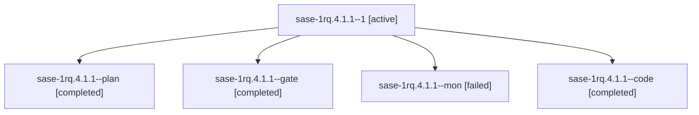

# Session: sase-1rq.4.1.1

[Agent Hoods](../README.md) / [bbugyi200](../users/bbugyi200/README.md) / [athena](../users/bbugyi200/machines/athena/README.md) / [sase-1rq](../users/bbugyi200/machines/athena/hoods/sase-1rq/README.md) / sase-1rq.4.1.1

Owner: `bbugyi200.athena` · Hood: `sase-1rq` · Members: 5 · Bead: [sase-1rq.4.1.1](https://github.com/sase-org/sase--beads/blob/main/pages/sase-1rq/sase-1rq.4.1.1.md)

## Lineage

The diagram is an optional enhancement; the ordered table below contains the same lineage in accessible text.

| Role | Agent | State | Model / provider | Timing | Commits | Prompt | Chat |
|---|---|---|---|---|---:|---|---|
| 1 | sase-1rq.4.1.1--1 | active | grok-4.6 / grok | 2026-11-07T14:00:24.264203+00:00 | 0 | [Prompt](../agents/bbugyi200.athena.sase-1rq.4.1.1--1/prompt.md) | — |
| plan | sase-1rq.4.1.1--plan | completed | gpt-6-astra / codex | 2026-11-07T13:07:52.306892+00:00 → 2026-11-07T13:42:19.132322+00:00 | 0 | [Prompt](../agents/bbugyi200.athena.sase-1rq.4.1.1--plan/prompt.md) | [Chat](../agents/bbugyi200.athena.sase-1rq.4.1.1--plan/chat.md) |
| gate | sase-1rq.4.1.1--gate | completed | gpt-6-astra / codex | 2026-11-07T13:15:40.388165+00:00 → 2026-11-07T13:16:53.989582+00:00 | 0 | — | [Chat](../agents/bbugyi200.athena.sase-1rq.4.1.1--gate/chat.md) |
| mon | sase-1rq.4.1.1--mon | failed | grok-4.6 / grok | 2026-11-07T13:41:06.944224+00:00 → 2026-11-07T13:58:08.455592+00:00 | 0 | — | [Chat](../agents/bbugyi200.athena.sase-1rq.4.1.1--mon/chat.md) |
| code | sase-1rq.4.1.1--code | completed | grok-4.6 / grok | 2026-11-07T13:17:31.549587+00:00 → 2026-11-07T13:42:19.132322+00:00 | 0 | — | [Chat](../agents/bbugyi200.athena.sase-1rq.4.1.1--code/chat.md) |

## Neighbors

| Agent | Relation | State |
|---|---|---|
| [sase-1rq.4](bbugyi200.athena.sase-1rq.4.md) (session · 3) | ancestor | active 1, completed 2 |
| [sase-1rq.4.1.2](bbugyi200.athena.sase-1rq.4.1.2.md) (session · 2) | sase-1rq.4.1 hood | active 1, completed 1 |
| [sase-1rq.4.1.3](../agents/bbugyi200.athena.sase-1rq.4.1.3/README.md) | sase-1rq.4.1 hood | active |
| [sase-1rq.4.1.4](../agents/bbugyi200.athena.sase-1rq.4.1.4/README.md) | sase-1rq.4.1 hood | waiting |
| [sase-1rq.4.1.land](../agents/bbugyi200.athena.sase-1rq.4.1.land/README.md) | sase-1rq.4.1 hood | waiting |
| [sase-1rq.1](bbugyi200.athena.sase-1rq.1.md) (session · 8) | sase-1rq hood | active 2, completed 6 |
| [sase-1rq.2](../agents/bbugyi200.athena.sase-1rq.2/README.md) | sase-1rq hood | waiting |
| [sase-1rq.3](bbugyi200.athena.sase-1rq.3.md) (session · 3) | sase-1rq hood | active 1, completed 2 |
| [sase-1rq.3.1.1](../agents/bbugyi200.athena.sase-1rq.3.1.1/README.md) | sase-1rq hood | completed |
| [sase-1rq.3.1.2](../agents/bbugyi200.athena.sase-1rq.3.1.2/README.md) | sase-1rq hood | active |
| [sase-1rq.3.1.3](../agents/bbugyi200.athena.sase-1rq.3.1.3/README.md) | sase-1rq hood | waiting |
| [sase-1rq.3.1.4](../agents/bbugyi200.athena.sase-1rq.3.1.4/README.md) | sase-1rq hood | waiting |
| [sase-1rq.3.1.land](../agents/bbugyi200.athena.sase-1rq.3.1.land/README.md) | sase-1rq hood | waiting |
| [sase-1rq.5](bbugyi200.athena.sase-1rq.5.md) (session · 4) | sase-1rq hood | active 1, completed 3 |
| [sase-1rq.land](../agents/bbugyi200.athena.sase-1rq.land/README.md) | sase-1rq hood | waiting |
