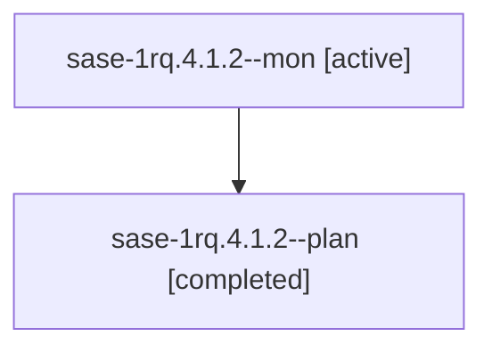

# Session: sase-1rq.4.1.2

[Agent Hoods](../README.md) / [bbugyi200](../users/bbugyi200/README.md) / [athena](../users/bbugyi200/machines/athena/README.md) / [sase-1rq](../users/bbugyi200/machines/athena/hoods/sase-1rq/README.md) / sase-1rq.4.1.2

Owner: `bbugyi200.athena` · Hood: `sase-1rq` · Members: 2 · Bead: [sase-1rq.4.1.2](https://github.com/sase-org/sase--beads/blob/main/pages/sase-1rq/sase-1rq.4.1.2.md)

## Lineage

The diagram is an optional enhancement; the ordered table below contains the same lineage in accessible text.

| Role | Agent | State | Model / provider | Timing | Commits | Prompt | Chat |
|---|---|---|---|---|---:|---|---|
| mon | sase-1rq.4.1.2--mon | active | grok-4.6 / grok | 2026-11-07T13:22:53.687500+00:00 | 0 | — | — |
| plan | sase-1rq.4.1.2--plan | completed | grok-4.6 / grok | 2026-11-07T13:07:25.802466+00:00 → 2026-11-07T13:24:15.860824+00:00 | 0 | [Prompt](../agents/bbugyi200.athena.sase-1rq.4.1.2--plan/prompt.md) | [Chat](../agents/bbugyi200.athena.sase-1rq.4.1.2--plan/chat.md) |

## Neighbors

| Agent | Relation | State |
|---|---|---|
| [sase-1rq.4](bbugyi200.athena.sase-1rq.4.md) (session · 3) | ancestor | active 1, completed 2 |
| [sase-1rq.4.1.1](bbugyi200.athena.sase-1rq.4.1.1.md) (session · 3) | sase-1rq.4.1 hood | active 2, completed 1 |
| [sase-1rq.4.1.3](../agents/bbugyi200.athena.sase-1rq.4.1.3/README.md) | sase-1rq.4.1 hood | active |
| [sase-1rq.4.1.4](../agents/bbugyi200.athena.sase-1rq.4.1.4/README.md) | sase-1rq.4.1 hood | waiting |
| [sase-1rq.4.1.land](../agents/bbugyi200.athena.sase-1rq.4.1.land/README.md) | sase-1rq.4.1 hood | waiting |
| [sase-1rq.1](bbugyi200.athena.sase-1rq.1.md) (session · 4) | sase-1rq hood | active 1, completed 3 |
| [sase-1rq.2](../agents/bbugyi200.athena.sase-1rq.2/README.md) | sase-1rq hood | waiting |
| [sase-1rq.3](bbugyi200.athena.sase-1rq.3.md) (session · 3) | sase-1rq hood | active 1, completed 2 |
| [sase-1rq.3.1.1](../agents/bbugyi200.athena.sase-1rq.3.1.1/README.md) | sase-1rq hood | active |
| [sase-1rq.3.1.2](../agents/bbugyi200.athena.sase-1rq.3.1.2/README.md) | sase-1rq hood | active |
| [sase-1rq.3.1.3](../agents/bbugyi200.athena.sase-1rq.3.1.3/README.md) | sase-1rq hood | waiting |
| [sase-1rq.3.1.4](../agents/bbugyi200.athena.sase-1rq.3.1.4/README.md) | sase-1rq hood | waiting |
| [sase-1rq.3.1.land](../agents/bbugyi200.athena.sase-1rq.3.1.land/README.md) | sase-1rq hood | waiting |
| [sase-1rq.5](bbugyi200.athena.sase-1rq.5.md) (session · 4) | sase-1rq hood | active 1, completed 3 |
| [sase-1rq.land](../agents/bbugyi200.athena.sase-1rq.land/README.md) | sase-1rq hood | waiting |
