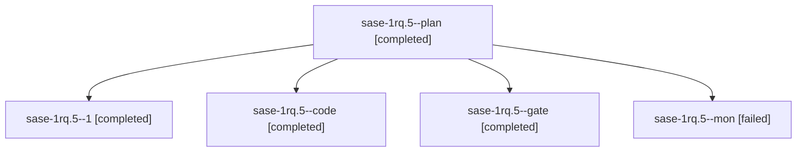

# Session: sase-1rq.5

[Agent Hoods](../README.md) / [bbugyi200](../users/bbugyi200/README.md) / [athena](../users/bbugyi200/machines/athena/README.md) / [sase-1rq](../users/bbugyi200/machines/athena/hoods/sase-1rq/README.md) / sase-1rq.5

Owner: `bbugyi200.athena` · Hood: `sase-1rq` · Members: 5 · Bead: [sase-1rq.5](https://github.com/sase-org/sase--beads/blob/main/pages/sase-1rq/sase-1rq.5.md)

## Lineage



The diagram is an optional enhancement; the ordered table below contains the same lineage in accessible text.

| Role | Agent | State | Model / provider | Timing | Commits | Prompt | Chat |
|---|---|---|---|---|---:|---|---|
| <a id="member-plan"></a>plan | sase-1rq.5--plan | completed | opus / claude | 2026-11-07T12:52:08.877983+00:00 → 2026-11-07T13:05:15.301705+00:00 | 0 | [Prompt](../agents/bbugyi200.athena.sase-1rq.5--plan/prompt.md) | [Chat](../agents/bbugyi200.athena.sase-1rq.5--plan/chat.md) |
| <a id="member-1"></a>1 | sase-1rq.5--1 | completed | gpt-6-luna / codex | 2026-11-07T14:38:45.890438+00:00 → 2026-11-07T14:41:42.709628+00:00 | 0 | [Prompt](../agents/bbugyi200.athena.sase-1rq.5--1/prompt.md) | [Chat](../agents/bbugyi200.athena.sase-1rq.5--1/chat.md) |
| <a id="member-code"></a>code | sase-1rq.5--code | completed | gpt-6-luna / codex | 2026-11-07T12:59:12.860343+00:00 → 2026-11-07T13:05:15.301705+00:00 | 0 | — | [Chat](../agents/bbugyi200.athena.sase-1rq.5--code/chat.md) |
| <a id="member-gate"></a>gate | sase-1rq.5--gate | completed | opus / claude | 2026-11-07T12:56:37.635548+00:00 → 2026-11-07T12:57:51.853960+00:00 | 0 | — | [Chat](../agents/bbugyi200.athena.sase-1rq.5--gate/chat.md) |
| <a id="member-mon"></a>mon | sase-1rq.5--mon | failed | gpt-6-luna / codex | 2026-11-07T13:03:16.916136+00:00 → 2026-11-07T14:37:05.498613+00:00 | 0 | — | [Chat](../agents/bbugyi200.athena.sase-1rq.5--mon/chat.md) |

## Variables

| Role | Variable | Value |
|---|---|---|
| 1 | `ci_evidence` | {default\_branch: master, fixes: {sha: 28fd5c78dac932cb948121b71823a3887a69a9aa, summary: Replace rg with grep in doctl\_login\_test.sh; CI passed on the first attempt.}, notes: \[The ripgrep dependency… |

#### ci_evidence

**Role:** `1`

```yaml
default_branch: master
fixes:
  sha: 28fd5c78dac932cb948121b71823a3887a69a9aa
  summary: Replace rg with grep in doctl_login_test.sh; CI passed on the first attempt.
notes:
  - The ripgrep dependency was test-only; the runtime script does not call rg.
  - On the fix commit, lint (ubuntu-latest) and test (ubuntu-latest) both succeeded on attempt 1; the newest master CI run at tip f1da6b641eca9616d687689a30e62eba12553f47 is also completed/success with both jobs successful.
  - Local bashunit tests/bash/doctl_login_test.sh passed all 17 tests with rg removed from PATH. just test, just lint, and just fmt-check passed in the implementation turn.
  - chezmoi apply was deliberately skipped because the change is under tests/, outside the chezmoi source root.
  - The CI monitor timed out because its jq filters had malformed escaping; independently queried GitHub Actions data confirms the fix and latest master runs are green.
quarantined: []
repo: bbugyi200/dotfiles
runs:
  - attempt: 1
    completed_at: 2026-11-07T13:54:15Z
    conclusion: success
    event: push
    head_sha: f1da6b641eca9616d687689a30e62eba12553f47
    run_id: 42378990324
    url: https://github.com/bbugyi200/dotfiles/actions/runs/42378990324
    workflow: CI
tip_sha: f1da6b641eca9616d687689a30e62eba12553f47
```

Values are truncated for display; see each member's agent meta.json for the full values.

## Neighbors

| Agent | Relation | State |
|---|---|---|
| [sase-1rq.1](bbugyi200.athena.sase-1rq.1.md) (session · 9) | sase-1rq hood | completed 9 |
| [sase-1rq.2](bbugyi200.athena.sase-1rq.2.md) (session · 3) | sase-1rq hood | active 1, completed 2 |
| [sase-1rq.2.1.1](bbugyi200.athena.sase-1rq.2.1.1.md) (session · 3) | sase-1rq hood | completed 3 |
| [sase-1rq.2.1.2](bbugyi200.athena.sase-1rq.2.1.2.md) (session · 3) | sase-1rq hood | completed 3 |
| [sase-1rq.2.1.3](bbugyi200.athena.sase-1rq.2.1.3.md) (session · 5) | sase-1rq hood | completed 4, failed 1 |
| [sase-1rq.2.1.4](bbugyi200.athena.sase-1rq.2.1.4.md) (session · 3) | sase-1rq hood | active 1, completed 2 |
| [sase-1rq.2.1.4.1.1](bbugyi200.athena.sase-1rq.2.1.4.1.1.md) (session · 5) | sase-1rq hood | completed 4, failed 1 |
| [sase-1rq.2.1.4.1.2](bbugyi200.athena.sase-1rq.2.1.4.1.2.md) (session · 3) | sase-1rq hood | completed 2, failed 1 |
| [sase-1rq.2.1.4.1.3](bbugyi200.athena.sase-1rq.2.1.4.1.3.md) (session · 3) | sase-1rq hood | completed 2, failed 1 |
| [sase-1rq.2.1.4.1.4](bbugyi200.athena.sase-1rq.2.1.4.1.4.md) (session · 3) | sase-1rq hood | completed 2, failed 1 |
| [sase-1rq.2.1.4.1.5.1](bbugyi200.athena.sase-1rq.2.1.4.1.5.1.md) (session · 5) | sase-1rq hood | completed 4, failed 1 |
| [sase-1rq.2.1.4.1.5.2](bbugyi200.athena.sase-1rq.2.1.4.1.5.2.md) (session · 6) | sase-1rq hood | active 1, completed 3, failed 2 |
| [sase-1rq.2.1.4.1.5.3](../agents/bbugyi200.athena.sase-1rq.2.1.4.1.5.3/README.md) | sase-1rq hood | waiting |
| [sase-1rq.2.1.4.1.5.land](../agents/bbugyi200.athena.sase-1rq.2.1.4.1.5.land/README.md) | sase-1rq hood | waiting |
| [sase-1rq.2.1.4.1.land](bbugyi200.athena.sase-1rq.2.1.4.1.land.md) (session · 3) | sase-1rq hood | active 1, completed 2 |
| [sase-1rq.2.1.5](bbugyi200.athena.sase-1rq.2.1.5.md) (session · 3) | sase-1rq hood | active 1, completed 2 |
| [sase-1rq.2.1.5.1.1](../agents/bbugyi200.athena.sase-1rq.2.1.5.1.1/README.md) | sase-1rq hood | completed |
| [sase-1rq.2.1.5.1.2](../agents/bbugyi200.athena.sase-1rq.2.1.5.1.2/README.md) | sase-1rq hood | completed |
| [sase-1rq.2.1.5.1.3](../agents/bbugyi200.athena.sase-1rq.2.1.5.1.3/README.md) | sase-1rq hood | completed |
| [sase-1rq.2.1.5.1.4](bbugyi200.athena.sase-1rq.2.1.5.1.4.md) (session · 3) | sase-1rq hood | completed 3 |
| [sase-1rq.2.1.5.1.land](../agents/bbugyi200.athena.sase-1rq.2.1.5.1.land/README.md) | sase-1rq hood | completed |
| [sase-1rq.2.1.6](../agents/bbugyi200.athena.sase-1rq.2.1.6/README.md) | sase-1rq hood | completed |
| [sase-1rq.2.1.7](../agents/bbugyi200.athena.sase-1rq.2.1.7/README.md) | sase-1rq hood | waiting |
| [sase-1rq.2.1.land](../agents/bbugyi200.athena.sase-1rq.2.1.land/README.md) | sase-1rq hood | waiting |
| [sase-1rq.3](bbugyi200.athena.sase-1rq.3.md) (session · 3) | sase-1rq hood | active 1, completed 2 |
| [sase-1rq.3.1.1](../agents/bbugyi200.athena.sase-1rq.3.1.1/README.md) | sase-1rq hood | completed |
| [sase-1rq.3.1.2](../agents/bbugyi200.athena.sase-1rq.3.1.2/README.md) | sase-1rq hood | completed |
| [sase-1rq.3.1.3](bbugyi200.athena.sase-1rq.3.1.3.md) (session · 5) | sase-1rq hood | completed 5 |
| [sase-1rq.3.1.4](bbugyi200.athena.sase-1rq.3.1.4.md) (session · 3) | sase-1rq hood | completed 3 |
| [sase-1rq.3.1.land](../agents/bbugyi200.athena.sase-1rq.3.1.land/README.md) | sase-1rq hood | completed |
| [sase-1rq.4](bbugyi200.athena.sase-1rq.4.md) (session · 3) | sase-1rq hood | active 1, completed 2 |
| [sase-1rq.4.1.1](bbugyi200.athena.sase-1rq.4.1.1.md) (session · 15) | sase-1rq hood | completed 11, failed 4 |
| [sase-1rq.4.1.2](bbugyi200.athena.sase-1rq.4.1.2.md) (session · 3) | sase-1rq hood | completed 2, failed 1 |
| [sase-1rq.4.1.3](bbugyi200.athena.sase-1rq.4.1.3.md) (session · 5) | sase-1rq hood | completed 5 |
| [sase-1rq.4.1.4](../agents/bbugyi200.athena.sase-1rq.4.1.4/README.md) | sase-1rq hood | completed |
| [sase-1rq.4.1.land](../agents/bbugyi200.athena.sase-1rq.4.1.land/README.md) | sase-1rq hood | completed |
| [sase-1rq.land](../agents/bbugyi200.athena.sase-1rq.land/README.md) | sase-1rq hood | waiting |
