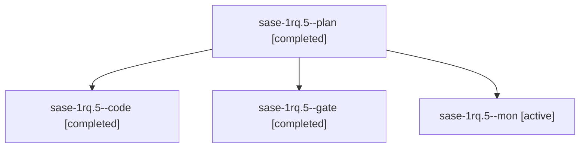

# Session: sase-1rq.5

[Agent Hoods](../README.md) / [bbugyi200](../users/bbugyi200/README.md) / [athena](../users/bbugyi200/machines/athena/README.md) / [sase-1rq](../users/bbugyi200/machines/athena/hoods/sase-1rq/README.md) / sase-1rq.5

Owner: `bbugyi200.athena` · Hood: `sase-1rq` · Members: 4 · Bead: [sase-1rq.5](https://github.com/sase-org/sase--beads/blob/main/pages/sase-1rq/sase-1rq.5.md)

## Lineage

The diagram is an optional enhancement; the ordered table below contains the same lineage in accessible text.

| Role | Agent | State | Model / provider | Timing | Commits | Prompt | Chat |
|---|---|---|---|---|---:|---|---|
| plan | sase-1rq.5--plan | completed | opus / claude | 2026-11-07T12:52:08.877983+00:00 → 2026-11-07T13:05:15.301705+00:00 | 0 | [Prompt](../agents/bbugyi200.athena.sase-1rq.5--plan/prompt.md) | [Chat](../agents/bbugyi200.athena.sase-1rq.5--plan/chat.md) |
| code | sase-1rq.5--code | completed | gpt-6-luna / codex | 2026-11-07T12:59:12.860343+00:00 → 2026-11-07T13:05:15.301705+00:00 | 0 | — | [Chat](../agents/bbugyi200.athena.sase-1rq.5--code/chat.md) |
| gate | sase-1rq.5--gate | completed | opus / claude | 2026-11-07T12:56:37.635548+00:00 → 2026-11-07T12:57:51.853960+00:00 | 0 | — | [Chat](../agents/bbugyi200.athena.sase-1rq.5--gate/chat.md) |
| mon | sase-1rq.5--mon | active | gpt-6-luna / codex | 2026-11-07T13:03:16.916136+00:00 | 0 | — | — |

## Neighbors

| Agent | Relation | State |
|---|---|---|
| [sase-1rq.1](bbugyi200.athena.sase-1rq.1.md) (session · 8) | sase-1rq hood | active 2, completed 6 |
| [sase-1rq.2](../agents/bbugyi200.athena.sase-1rq.2/README.md) | sase-1rq hood | waiting |
| [sase-1rq.3](bbugyi200.athena.sase-1rq.3.md) (session · 3) | sase-1rq hood | active 1, completed 2 |
| [sase-1rq.3.1.1](../agents/bbugyi200.athena.sase-1rq.3.1.1/README.md) | sase-1rq hood | completed |
| [sase-1rq.3.1.2](../agents/bbugyi200.athena.sase-1rq.3.1.2/README.md) | sase-1rq hood | active |
| [sase-1rq.3.1.3](../agents/bbugyi200.athena.sase-1rq.3.1.3/README.md) | sase-1rq hood | waiting |
| [sase-1rq.3.1.4](../agents/bbugyi200.athena.sase-1rq.3.1.4/README.md) | sase-1rq hood | waiting |
| [sase-1rq.3.1.land](../agents/bbugyi200.athena.sase-1rq.3.1.land/README.md) | sase-1rq hood | waiting |
| [sase-1rq.4](bbugyi200.athena.sase-1rq.4.md) (session · 3) | sase-1rq hood | active 1, completed 2 |
| [sase-1rq.4.1.1](bbugyi200.athena.sase-1rq.4.1.1.md) (session · 5) | sase-1rq hood | active 1, completed 3, failed 1 |
| [sase-1rq.4.1.2](bbugyi200.athena.sase-1rq.4.1.2.md) (session · 2) | sase-1rq hood | active 1, completed 1 |
| [sase-1rq.4.1.3](../agents/bbugyi200.athena.sase-1rq.4.1.3/README.md) | sase-1rq hood | active |
| [sase-1rq.4.1.4](../agents/bbugyi200.athena.sase-1rq.4.1.4/README.md) | sase-1rq hood | waiting |
| [sase-1rq.4.1.land](../agents/bbugyi200.athena.sase-1rq.4.1.land/README.md) | sase-1rq hood | waiting |
| [sase-1rq.land](../agents/bbugyi200.athena.sase-1rq.land/README.md) | sase-1rq hood | waiting |
