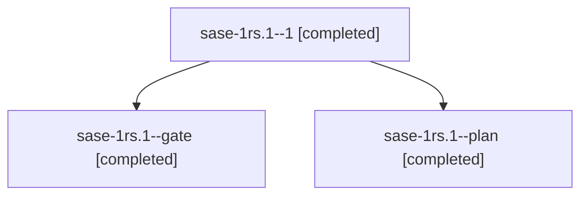

# Session: sase-1rs.1

[Agent Hoods](../README.md) / [bbugyi200](../users/bbugyi200/README.md) / [athena](../users/bbugyi200/machines/athena/README.md) / [sase-1rs](../users/bbugyi200/machines/athena/hoods/sase-1rs/README.md) / sase-1rs.1

Owner: `bbugyi200.athena` · Hood: `sase-1rs` · Members: 3 · Bead: [sase-1rs.1](https://github.com/sase-org/sase--beads/blob/main/pages/sase-1rs/sase-1rs.1.md)

## Lineage

The diagram is an optional enhancement; the ordered table below contains the same lineage in accessible text.

| Role | Agent | State | Model / provider | Timing | Commits | Prompt | Chat |
|---|---|---|---|---|---:|---|---|
| 1 | sase-1rs.1--1 | completed | opus / claude | 2026-11-07T17:04:07.000369+00:00 → 2026-11-07T17:08:00.809732+00:00 | 0 | [Prompt](../agents/bbugyi200.athena.sase-1rs.1--1/prompt.md) | [Chat](../agents/bbugyi200.athena.sase-1rs.1--1/chat.md) |
| gate | sase-1rs.1--gate | completed | opus / claude | 2026-11-07T16:22:08.088555+00:00 → 2026-11-07T16:33:55.942177+00:00 | 0 | — | [Chat](../agents/bbugyi200.athena.sase-1rs.1--gate/chat.md) |
| plan | sase-1rs.1--plan | completed | opus / claude | 2026-11-07T16:16:35.019445+00:00 → 2026-11-07T16:22:10.787177+00:00 | 0 | [Prompt](../agents/bbugyi200.athena.sase-1rs.1--plan/prompt.md) | [Chat](../agents/bbugyi200.athena.sase-1rs.1--plan/chat.md) |

## Neighbors

| Agent | Relation | State |
|---|---|---|
| [sase-1rs.10](../agents/bbugyi200.athena.sase-1rs.10/README.md) | sase-1rs hood | completed |
| [sase-1rs.11](../agents/bbugyi200.athena.sase-1rs.11/README.md) | sase-1rs hood | waiting |
| [sase-1rs.2](../agents/bbugyi200.athena.sase-1rs.2/README.md) | sase-1rs hood | completed |
| [sase-1rs.3](../agents/bbugyi200.athena.sase-1rs.3/README.md) | sase-1rs hood | completed |
| [sase-1rs.4](../agents/bbugyi200.athena.sase-1rs.4/README.md) | sase-1rs hood | completed |
| [sase-1rs.5](../agents/bbugyi200.athena.sase-1rs.5/README.md) | sase-1rs hood | completed |
| [sase-1rs.6](../agents/bbugyi200.athena.sase-1rs.6/README.md) | sase-1rs hood | completed |
| [sase-1rs.7](../agents/bbugyi200.athena.sase-1rs.7/README.md) | sase-1rs hood | completed |
| [sase-1rs.8](../agents/bbugyi200.athena.sase-1rs.8/README.md) | sase-1rs hood | completed |
| [sase-1rs.9](../agents/bbugyi200.athena.sase-1rs.9/README.md) | sase-1rs hood | completed |
| [sase-1rs.land](../agents/bbugyi200.athena.sase-1rs.land/README.md) | sase-1rs hood | waiting |
