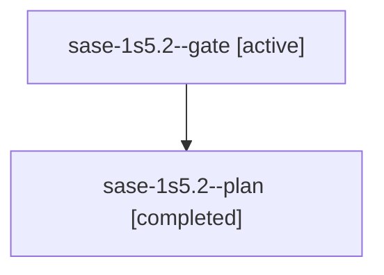

# Session: sase-1s5.2

[Agent Hoods](../README.md) / [bbugyi200](../users/bbugyi200/README.md) / [athena](../users/bbugyi200/machines/athena/README.md) / [sase-1s5](../users/bbugyi200/machines/athena/hoods/sase-1s5/README.md) / sase-1s5.2

Owner: `bbugyi200.athena` · Hood: `sase-1s5` · Members: 2 · Bead: [sase-1s5.2](https://github.com/sase-org/sase--beads/blob/main/pages/sase-1s5/sase-1s5.2.md)

## Lineage

The diagram is an optional enhancement; the ordered table below contains the same lineage in accessible text.

| Role | Agent | State | Model / provider | Timing | Commits | Prompt | Chat |
|---|---|---|---|---|---:|---|---|
| gate | sase-1s5.2--gate | active | grok-4.6 / grok | 2026-11-08T12:43:38.807349+00:00 | 0 | — | — |
| plan | sase-1s5.2--plan | completed | grok-4.6 / grok | 2026-11-08T12:03:21.553464+00:00 → 2026-11-08T12:43:42.925872+00:00 | 0 | [Prompt](../agents/bbugyi200.athena.sase-1s5.2--plan/prompt.md) | [Chat](../agents/bbugyi200.athena.sase-1s5.2--plan/chat.md) |

## Neighbors

| Agent | Relation | State |
|---|---|---|
| [sase-1s5.1](../agents/bbugyi200.athena.sase-1s5.1/README.md) | sase-1s5 hood | completed |
| [sase-1s5.3](../agents/bbugyi200.athena.sase-1s5.3/README.md) | sase-1s5 hood | active |
| [sase-1s5.land](../agents/bbugyi200.athena.sase-1s5.land/README.md) | sase-1s5 hood | waiting |
