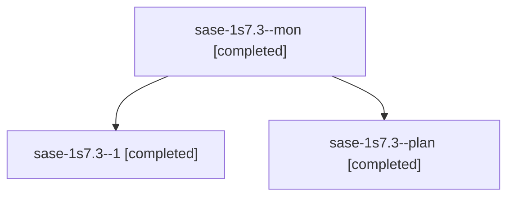

# Session: sase-1s7.3

[Agent Hoods](../README.md) / [bbugyi200](../users/bbugyi200/README.md) / [athena](../users/bbugyi200/machines/athena/README.md) / [sase-1s7](../users/bbugyi200/machines/athena/hoods/sase-1s7/README.md) / sase-1s7.3

Owner: `bbugyi200.athena` · Hood: `sase-1s7` · Members: 3 · Bead: [sase-1s7.3](https://github.com/sase-org/sase--beads/blob/main/pages/sase-1s7/sase-1s7.3.md)

## Lineage

The diagram is an optional enhancement; the ordered table below contains the same lineage in accessible text.

| Role | Agent | State | Model / provider | Timing | Commits | Prompt | Chat |
|---|---|---|---|---|---:|---|---|
| mon | sase-1s7.3--mon | completed | grok-4.6 / grok | 2026-11-10T19:45:34.098940+00:00 → 2026-11-10T20:26:17.860876+00:00 | 0 | — | [Chat](../agents/bbugyi200.athena.sase-1s7.3--mon/chat.md) |
| 1 | sase-1s7.3--1 | completed | grok-4.6 / grok | 2026-11-10T20:27:47.575600+00:00 → 2026-11-10T20:32:48.700605+00:00 | 0 | [Prompt](../agents/bbugyi200.athena.sase-1s7.3--1/prompt.md) | [Chat](../agents/bbugyi200.athena.sase-1s7.3--1/chat.md) |
| plan | sase-1s7.3--plan | completed | grok-4.6 / grok | 2026-11-10T19:41:53.967337+00:00 → 2026-11-10T19:46:19.380127+00:00 | 0 | [Prompt](../agents/bbugyi200.athena.sase-1s7.3--plan/prompt.md) | [Chat](../agents/bbugyi200.athena.sase-1s7.3--plan/chat.md) |

## Neighbors

| Agent | Relation | State |
|---|---|---|
| [sase-1s7.1](bbugyi200.athena.sase-1s7.1.md) (session · 3) | sase-1s7 hood | completed 3 |
| [sase-1s7.2](../agents/bbugyi200.athena.sase-1s7.2/README.md) | sase-1s7 hood | completed |
| [sase-1s7.4](bbugyi200.athena.sase-1s7.4.md) (session · 5) | sase-1s7 hood | completed 5 |
| [sase-1s7.5](bbugyi200.athena.sase-1s7.5.md) (session · 9) | sase-1s7 hood | completed 9 |
| [sase-1s7.6](bbugyi200.athena.sase-1s7.6.md) (session · 3) | sase-1s7 hood | completed 3 |
| [sase-1s7.7.1](../agents/bbugyi200.athena.sase-1s7.7.1/README.md) | sase-1s7 hood | active |
| [sase-1s7.7.2](../agents/bbugyi200.athena.sase-1s7.7.2/README.md) | sase-1s7 hood | active |
| [sase-1s7.land](bbugyi200.athena.sase-1s7.land.md) (session · 3) | sase-1s7 hood | active 1, completed 2 |
