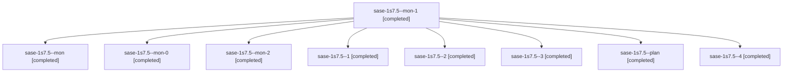

# Session: sase-1s7.5

[Agent Hoods](../README.md) / [bbugyi200](../users/bbugyi200/README.md) / [athena](../users/bbugyi200/machines/athena/README.md) / [sase-1s7](../users/bbugyi200/machines/athena/hoods/sase-1s7/README.md) / sase-1s7.5

Owner: `bbugyi200.athena` · Hood: `sase-1s7` · Members: 9 · Bead: [sase-1s7.5](https://github.com/sase-org/sase--beads/blob/main/pages/sase-1s7/sase-1s7.5.md)

## Lineage

The diagram is an optional enhancement; the ordered table below contains the same lineage in accessible text.

| Role | Agent | State | Model / provider | Timing | Commits | Prompt | Chat |
|---|---|---|---|---|---:|---|---|
| mon-1 | sase-1s7.5--mon-1 | completed | grok-4.6 / grok | 2026-11-11T02:55:23.999576+00:00 → 2026-11-11T05:06:21.603618+00:00 | 0 | — | [Chat](../agents/bbugyi200.athena.sase-1s7.5--mon-1/chat.md) |
| mon | sase-1s7.5--mon | completed | grok-4.6 / grok | 2026-11-10T20:40:19.574813+00:00 → 2026-11-11T00:27:00.393923+00:00 | 0 | — | [Chat](../agents/bbugyi200.athena.sase-1s7.5--mon/chat.md) |
| mon-0 | sase-1s7.5--mon-0 | completed | grok-4.6 / grok | 2026-11-11T00:53:36.191378+00:00 → 2026-11-11T02:37:45.343512+00:00 | 0 | — | [Chat](../agents/bbugyi200.athena.sase-1s7.5--mon-0/chat.md) |
| mon-2 | sase-1s7.5--mon-2 | completed | grok-4.6 / grok | 2026-11-11T05:28:11.228499+00:00 → 2026-11-11T07:23:26.130705+00:00 | 0 | — | [Chat](../agents/bbugyi200.athena.sase-1s7.5--mon-2/chat.md) |
| 1 | sase-1s7.5--1 | completed | grok-4.6 / grok | 2026-11-11T00:28:12.586392+00:00 → 2026-11-11T00:58:54.452173+00:00 | [1](../agents/bbugyi200.athena.sase-1s7.5--1/README.md#commits) | [Prompt](../agents/bbugyi200.athena.sase-1s7.5--1/prompt.md) | [Chat](../agents/bbugyi200.athena.sase-1s7.5--1/chat.md) |
| 2 | sase-1s7.5--2 | completed | grok-4.6 / grok | 2026-11-11T02:38:45.390599+00:00 → 2026-11-11T02:57:26.235530+00:00 | [1](../agents/bbugyi200.athena.sase-1s7.5--2/README.md#commits) | [Prompt](../agents/bbugyi200.athena.sase-1s7.5--2/prompt.md) | [Chat](../agents/bbugyi200.athena.sase-1s7.5--2/chat.md) |
| 3 | sase-1s7.5--3 | completed | grok-4.6 / grok | 2026-11-11T05:07:26.096503+00:00 → 2026-11-11T05:30:21.787666+00:00 | [1](../agents/bbugyi200.athena.sase-1s7.5--3/README.md#commits) | [Prompt](../agents/bbugyi200.athena.sase-1s7.5--3/prompt.md) | [Chat](../agents/bbugyi200.athena.sase-1s7.5--3/chat.md) |
| plan | sase-1s7.5--plan | completed | grok-4.6 / grok | 2026-11-10T20:33:13.125759+00:00 → 2026-11-10T20:41:07.219971+00:00 | 0 | [Prompt](../agents/bbugyi200.athena.sase-1s7.5--plan/prompt.md) | [Chat](../agents/bbugyi200.athena.sase-1s7.5--plan/chat.md) |
| 4 | sase-1s7.5--4 | completed | grok-4.6 / grok | 2026-11-11T07:24:31.565036+00:00 → 2026-11-11T07:33:52.477084+00:00 | 0 | [Prompt](../agents/bbugyi200.athena.sase-1s7.5--4/prompt.md) | [Chat](../agents/bbugyi200.athena.sase-1s7.5--4/chat.md) |

## Commits

| Role | Repo | Commit | Subject | Committed |
|---|---|---|---|---|
| 1 | sase | [`39cdbd5`](https://github.com/sase-org/sase/commit/39cdbd548aa4f46e23083058d52c8f66cb59e53d) | fix(release-watch): match exact PR core-smoke check name | 2026-11-10 19:58:00 EST |
| 2 | sase | [`1a5bb80`](https://github.com/sase-org/sase/commit/1a5bb8097b4c4252c788e6af0038c73f1d00c6f2) | fix(ci): publish Telemetry leak-detector nodeids | 2026-11-10 21:56:34 EST |
| 3 | sase | [`b0f947b`](https://github.com/sase-org/sase/commit/b0f947b91df1ea054d6f52818af92895e5e4880e) | fix(tests): drain config-token refresh before leak snapshots | 2026-11-11 00:29:29 EST |

## Neighbors

| Agent | Relation | State |
|---|---|---|
| [sase-1s7.1](bbugyi200.athena.sase-1s7.1.md) (session · 3) | sase-1s7 hood | completed 3 |
| [sase-1s7.2](../agents/bbugyi200.athena.sase-1s7.2/README.md) | sase-1s7 hood | completed |
| [sase-1s7.3](bbugyi200.athena.sase-1s7.3.md) (session · 3) | sase-1s7 hood | completed 3 |
| [sase-1s7.4](bbugyi200.athena.sase-1s7.4.md) (session · 5) | sase-1s7 hood | completed 5 |
| [sase-1s7.6](bbugyi200.athena.sase-1s7.6.md) (session · 3) | sase-1s7 hood | completed 3 |
| [sase-1s7.7.1](../agents/bbugyi200.athena.sase-1s7.7.1/README.md) | sase-1s7 hood | active |
| [sase-1s7.7.2](../agents/bbugyi200.athena.sase-1s7.7.2/README.md) | sase-1s7 hood | active |
| [sase-1s7.land](bbugyi200.athena.sase-1s7.land.md) (session · 3) | sase-1s7 hood | active 1, completed 2 |
