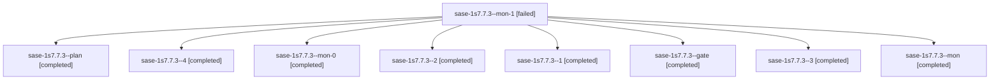

# Session: sase-1s7.7.3

[Agent Hoods](../README.md) / [bbugyi200](../users/bbugyi200/README.md) / [athena](../users/bbugyi200/machines/athena/README.md) / [sase-1s7](../users/bbugyi200/machines/athena/hoods/sase-1s7/README.md) / sase-1s7.7.3

Owner: `bbugyi200.athena` · Hood: `sase-1s7` · Members: 9 · Bead: [sase-1s7.7.3](https://github.com/sase-org/sase--beads/blob/main/pages/sase-1s7/sase-1s7.7.3.md)

## Lineage

The diagram is an optional enhancement; the ordered table below contains the same lineage in accessible text.

| Role | Agent | State | Model / provider | Timing | Commits | Prompt | Chat |
|---|---|---|---|---|---:|---|---|
| mon-1 | sase-1s7.7.3--mon-1 | failed | gpt-6-luna / codex | 2026-11-11T17:37:11.974569+00:00 → 2026-11-11T20:21:34.621922+00:00 | 0 | — | [Chat](../agents/bbugyi200.athena.sase-1s7.7.3--mon-1/chat.md) |
| plan | sase-1s7.7.3--plan | completed | gpt-6-luna / codex | 2026-11-11T11:01:08.420729+00:00 → 2026-11-11T11:05:27.952263+00:00 | 0 | [Prompt](../agents/bbugyi200.athena.sase-1s7.7.3--plan/prompt.md) | [Chat](../agents/bbugyi200.athena.sase-1s7.7.3--plan/chat.md) |
| 4 | sase-1s7.7.3--4 | completed | gpt-6-luna / codex | 2026-11-11T20:24:18.646477+00:00 → 2026-11-11T20:32:48.100671+00:00 | 0 | [Prompt](../agents/bbugyi200.athena.sase-1s7.7.3--4/prompt.md) | [Chat](../agents/bbugyi200.athena.sase-1s7.7.3--4/chat.md) |
| mon-0 | sase-1s7.7.3--mon-0 | completed | gpt-6-luna / codex | 2026-11-11T11:13:35.857313+00:00 → 2026-11-11T17:18:29.450235+00:00 | 0 | — | [Chat](../agents/bbugyi200.athena.sase-1s7.7.3--mon-0/chat.md) |
| 2 | sase-1s7.7.3--2 | completed | gpt-6-luna / codex | 2026-11-11T17:20:26.209537+00:00 → 2026-11-11T17:29:39.624369+00:00 | 0 | [Prompt](../agents/bbugyi200.athena.sase-1s7.7.3--2/prompt.md) | [Chat](../agents/bbugyi200.athena.sase-1s7.7.3--2/chat.md) |
| 1 | sase-1s7.7.3--1 | completed | gpt-6-luna / codex | 2026-11-11T11:10:44.680879+00:00 → 2026-11-11T11:14:07.035173+00:00 | 0 | [Prompt](../agents/bbugyi200.athena.sase-1s7.7.3--1/prompt.md) | [Chat](../agents/bbugyi200.athena.sase-1s7.7.3--1/chat.md) |
| gate | sase-1s7.7.3--gate | completed | gpt-6-luna / codex | 2026-11-11T17:30:20.303725+00:00 → 2026-11-11T17:32:22.014704+00:00 | 0 | — | [Chat](../agents/bbugyi200.athena.sase-1s7.7.3--gate/chat.md) |
| 3 | sase-1s7.7.3--3 | completed | gpt-6-luna / codex | 2026-11-11T17:34:33.186218+00:00 → 2026-11-11T17:37:44.761226+00:00 | 0 | [Prompt](../agents/bbugyi200.athena.sase-1s7.7.3--3/prompt.md) | [Chat](../agents/bbugyi200.athena.sase-1s7.7.3--3/chat.md) |
| mon | sase-1s7.7.3--mon | completed | gpt-6-luna / codex | 2026-11-11T11:04:55.593931+00:00 → 2026-11-11T11:09:46.387398+00:00 | 0 | — | [Chat](../agents/bbugyi200.athena.sase-1s7.7.3--mon/chat.md) |

## Neighbors

| Agent | Relation | State |
|---|---|---|
| [sase-1s7.7.1](../agents/bbugyi200.athena.sase-1s7.7.1/README.md) | sase-1s7.7 hood | completed |
| [sase-1s7.7.2](bbugyi200.athena.sase-1s7.7.2.md) (session · 3) | sase-1s7.7 hood | completed 3 |
| [sase-1s7.7.land](bbugyi200.athena.sase-1s7.7.land.md) (session · 4) | sase-1s7.7 hood | active 1, completed 3 |
| [sase-1s7.1](bbugyi200.athena.sase-1s7.1.md) (session · 3) | sase-1s7 hood | completed 3 |
| [sase-1s7.2](../agents/bbugyi200.athena.sase-1s7.2/README.md) | sase-1s7 hood | completed |
| [sase-1s7.3](bbugyi200.athena.sase-1s7.3.md) (session · 3) | sase-1s7 hood | completed 3 |
| [sase-1s7.4](bbugyi200.athena.sase-1s7.4.md) (session · 5) | sase-1s7 hood | completed 5 |
| [sase-1s7.5](bbugyi200.athena.sase-1s7.5.md) (session · 9) | sase-1s7 hood | completed 9 |
| [sase-1s7.6](bbugyi200.athena.sase-1s7.6.md) (session · 3) | sase-1s7 hood | completed 3 |
| [sase-1s7.land](bbugyi200.athena.sase-1s7.land.md) (session · 3) | sase-1s7 hood | active 1, completed 2 |
