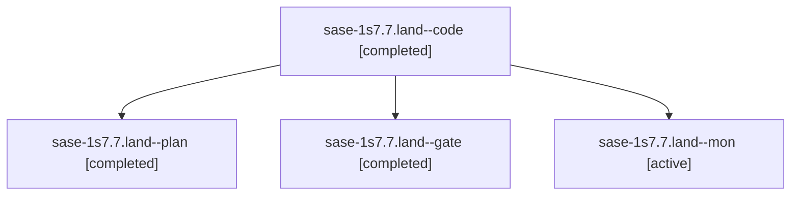

# Session: sase-1s7.7.land

[Agent Hoods](../README.md) / [bbugyi200](../users/bbugyi200/README.md) / [athena](../users/bbugyi200/machines/athena/README.md) / [sase-1s7](../users/bbugyi200/machines/athena/hoods/sase-1s7/README.md) / sase-1s7.7.land

Owner: `bbugyi200.athena` · Hood: `sase-1s7` · Members: 4 · Bead: [sase-1s7.7](https://github.com/sase-org/sase--beads/blob/main/pages/sase-1s7/sase-1s7.7.md)

## Lineage



The diagram is an optional enhancement; the ordered table below contains the same lineage in accessible text.

| Role | Agent | State | Model / provider | Timing | Commits | Prompt | Chat |
|---|---|---|---|---|---:|---|---|
| <a id="member-code"></a>code | sase-1s7.7.land--code | completed | gpt-6-luna / codex | 2026-11-11T20:54:14.180103+00:00 → 2026-11-11T21:05:19.350208+00:00 | 0 | — | [Chat](../agents/bbugyi200.athena.sase-1s7.7.land--code/chat.md) |
| <a id="member-plan"></a>plan | sase-1s7.7.land--plan | completed | gpt-6-astra / codex | 2026-11-11T20:37:22.498629+00:00 → 2026-11-11T21:05:19.350208+00:00 | 0 | [Prompt](../agents/bbugyi200.athena.sase-1s7.7.land--plan/prompt.md) | [Chat](../agents/bbugyi200.athena.sase-1s7.7.land--plan/chat.md) |
| <a id="member-gate"></a>gate | sase-1s7.7.land--gate | completed | gpt-6-astra / codex | 2026-11-11T20:51:55.305459+00:00 → 2026-11-11T20:53:35.460073+00:00 | 0 | — | [Chat](../agents/bbugyi200.athena.sase-1s7.7.land--gate/chat.md) |
| <a id="member-mon"></a>mon | sase-1s7.7.land--mon | active | gpt-6-luna / codex | 2026-11-11T21:04:09.431298+00:00 | 0 | — | — |

## Variables

| Role | Variable | Value |
|---|---|---|
| plan | `artifacts` | \[{bead: sase-1s7.7, kind: markdown, label: sase-1s7.7 landing audit and release API blocker, path: /home/bryan/.sase/artifacts/agents/gh\_sase-org\_\_sase/20261111032413/sase-1s7-7-landing-audit-553aad7… |

#### artifacts

**Role:** `plan`

```yaml
- bead: sase-1s7.7
  kind: markdown
  label: sase-1s7.7 landing audit and release API blocker
  path: /home/bryan/.sase/artifacts/agents/gh_sase-org__sase/20261111032413/sase-1s7-7-landing-audit-553aad7d0b62.md
  ref: file:explicit:33034c169e9a1736ac9a6385
  source_path: /tmp/sase-1s7-7-landing-audit.md
```

Values are truncated for display; see each member's agent meta.json for the full values.

## Neighbors

| Agent | Relation | State |
|---|---|---|
| [sase-1s7.7.1](../agents/bbugyi200.athena.sase-1s7.7.1/README.md) | sase-1s7.7 hood | completed |
| [sase-1s7.7.2](bbugyi200.athena.sase-1s7.7.2.md) (session · 3) | sase-1s7.7 hood | completed 3 |
| [sase-1s7.7.3](bbugyi200.athena.sase-1s7.7.3.md) (session · 9) | sase-1s7.7 hood | completed 8, failed 1 |
| [sase-1s7.1](bbugyi200.athena.sase-1s7.1.md) (session · 3) | sase-1s7 hood | completed 3 |
| [sase-1s7.2](../agents/bbugyi200.athena.sase-1s7.2/README.md) | sase-1s7 hood | completed |
| [sase-1s7.3](bbugyi200.athena.sase-1s7.3.md) (session · 3) | sase-1s7 hood | completed 3 |
| [sase-1s7.4](bbugyi200.athena.sase-1s7.4.md) (session · 5) | sase-1s7 hood | completed 5 |
| [sase-1s7.5](bbugyi200.athena.sase-1s7.5.md) (session · 9) | sase-1s7 hood | completed 9 |
| [sase-1s7.6](bbugyi200.athena.sase-1s7.6.md) (session · 3) | sase-1s7 hood | completed 3 |
| [sase-1s7.land](bbugyi200.athena.sase-1s7.land.md) (session · 3) | sase-1s7 hood | active 1, completed 2 |
