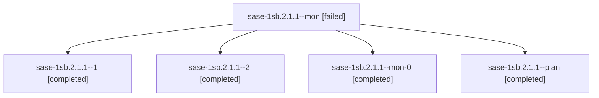

# Session: sase-1sb.2.1.1

[Agent Hoods](../README.md) / [bbugyi200](../users/bbugyi200/README.md) / [athena](../users/bbugyi200/machines/athena/README.md) / [sase-1sb](../users/bbugyi200/machines/athena/hoods/sase-1sb/README.md) / sase-1sb.2.1.1

Owner: `bbugyi200.athena` · Hood: `sase-1sb` · Members: 5 · Bead: [sase-1sb.2.1.1](https://github.com/sase-org/sase--beads/blob/main/pages/sase-1sb/sase-1sb.2.1.1.md)

## Lineage

The diagram is an optional enhancement; the ordered table below contains the same lineage in accessible text.

| Role | Agent | State | Model / provider | Timing | Commits | Prompt | Chat |
|---|---|---|---|---|---:|---|---|
| mon | sase-1sb.2.1.1--mon | failed | muse-spark-1.3-contributor / muse | 2026-11-12T03:00:52.375963+00:00 → 2026-11-12T03:16:18.240309+00:00 | 0 | — | [Chat](../agents/bbugyi200.athena.sase-1sb.2.1.1--mon/chat.md) |
| 1 | sase-1sb.2.1.1--1 | completed | muse-spark-1.3-contributor / muse | 2026-11-12T03:18:32.595984+00:00 → 2026-11-12T03:54:46.594751+00:00 | [1](../agents/bbugyi200.athena.sase-1sb.2.1.1--1/README.md#commits) | [Prompt](../agents/bbugyi200.athena.sase-1sb.2.1.1--1/prompt.md) | [Chat](../agents/bbugyi200.athena.sase-1sb.2.1.1--1/chat.md) |
| 2 | sase-1sb.2.1.1--2 | completed | muse-spark-1.3-contributor / muse | 2026-11-12T04:05:19.074510+00:00 → 2026-11-12T04:07:29.982289+00:00 | 0 | [Prompt](../agents/bbugyi200.athena.sase-1sb.2.1.1--2/prompt.md) | [Chat](../agents/bbugyi200.athena.sase-1sb.2.1.1--2/chat.md) |
| mon-0 | sase-1sb.2.1.1--mon-0 | completed | muse-spark-1.3-contributor / muse | 2026-11-12T03:51:21.238216+00:00 → 2026-11-12T04:03:16.766174+00:00 | 0 | — | [Chat](../agents/bbugyi200.athena.sase-1sb.2.1.1--mon-0/chat.md) |
| plan | sase-1sb.2.1.1--plan | completed | muse-spark-1.3-contributor / muse | 2026-11-12T01:56:49.815841+00:00 → 2026-11-12T03:04:26.846967+00:00 | [1](../agents/bbugyi200.athena.sase-1sb.2.1.1--plan/README.md#commits) | [Prompt](../agents/bbugyi200.athena.sase-1sb.2.1.1--plan/prompt.md) | [Chat](../agents/bbugyi200.athena.sase-1sb.2.1.1--plan/chat.md) |

## Commits

| Role | Repo | Commit | Subject | Committed |
|---|---|---|---|---|
| plan | sase | [`2e7ce5c`](https://github.com/sase-org/sase/commit/2e7ce5cea11b8cd5509d3b90e5567be7a1356852) | feat(config): add local-command trust projection adapter and contract tests | 2026-11-11 22:03:16 EST |
| 1 | sase | [`181b213`](https://github.com/sase-org/sase/commit/181b213e8c58f8c90357d1e56cf910b5c727c0ea) | fix(trust-policy): whitelist local-trust adapter in symvision and terminology guard | 2026-11-11 22:53:14 EST |

## Neighbors

| Agent | Relation | State |
|---|---|---|
| [sase-1sb.2](bbugyi200.athena.sase-1sb.2.md) (session · 3) | ancestor | active 1, completed 2 |
| [sase-1sb.2.1.2](../agents/bbugyi200.athena.sase-1sb.2.1.2/README.md) | sase-1sb.2.1 hood | completed |
| [sase-1sb.2.1.3](bbugyi200.athena.sase-1sb.2.1.3.md) (session · 5) | sase-1sb.2.1 hood | completed 4, failed 1 |
| [sase-1sb.2.1.4](../agents/bbugyi200.athena.sase-1sb.2.1.4/README.md) | sase-1sb.2.1 hood | completed |
| [sase-1sb.2.1.land](../agents/bbugyi200.athena.sase-1sb.2.1.land/README.md) | sase-1sb.2.1 hood | waiting |
| [sase-1sb.1](../agents/bbugyi200.athena.sase-1sb.1/README.md) | sase-1sb hood | completed |
| [sase-1sb.3](../agents/bbugyi200.athena.sase-1sb.3/README.md) | sase-1sb hood | completed |
| [sase-1sb.4](bbugyi200.athena.sase-1sb.4.md) (session · 3) | sase-1sb hood | completed 2, failed 1 |
| [sase-1sb.5](../agents/bbugyi200.athena.sase-1sb.5/README.md) | sase-1sb hood | completed |
| [sase-1sb.6](../agents/bbugyi200.athena.sase-1sb.6/README.md) | sase-1sb hood | completed |
| [sase-1sb.7](bbugyi200.athena.sase-1sb.7.md) (session · 3) | sase-1sb hood | completed 3 |
| [sase-1sb.land](../agents/bbugyi200.athena.sase-1sb.land/README.md) | sase-1sb hood | waiting |
